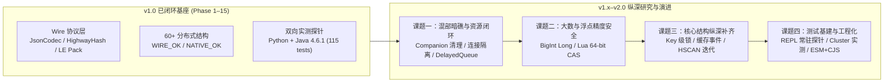

# redi.ts 演进方案 — Redisson 全面对齐与纵深演进路线图

> **当前基线（2026-10，v2.2.0）**。规范标准：`C:/GitHub/redisson`（Java Redisson 4.6.x 源码 + `redisson-4.6.1.jar` 实测为准）+ `JsonJacksonCodec`（默认类型包装）；Lua 算法基线：`C:/GitHub/redi.go`；Codec/Hash 交叉基线：`C:/GitHub/redi.py`。
>
> **当前状态**：第一阶段（v1.0.0，含 1.1.0–1.8.9 迭代）已完成 **60+ 分布式结构工厂面覆盖**、**P0 混部致命隐患清零**、**P1 核心批（Map 原子 Lua / ZSet 交并差 / Set Store 运算 / Stream 消费组全集 / RBatch 7 类门面）**，并通过 **18 个测试套件、115 项测试**（Wire 向量 + Mock 功能 + Python 实机互通 + Java Redisson 4.6.1 双向探针 Phase 1–15 全绿）。**阶段 16（v1.1.0）已完成伴生键生命周期闭环**，新增 18 项测试（11 mock + 7 live-phase16）；**阶段 17（v1.2.0）已完成有界队列信号量协议、阻塞连接隔离与 Topic 订阅生命周期**，新增 15 项测试（6 mock + 9 live-phase17）；**阶段 18（v1.3.0）已完成 64-bit 精度与原子操作硬化**，新增 13 项测试（9 mock/wire + 4 live-phase18）；**阶段 19（v1.4.0）已完成锁扩展与缓存纵深 API**（Key 级同步器家族、RW 视图补齐与唤醒常量对齐、MapCache 双向事件与过期语义、Native 条件过期/HPERSIST），新增 15 项测试（10 mock/wire + 5 live-phase19）；**阶段 20（v1.5.0）已完成集合/位图纵深补齐与探针 REPL 常驻化**（全量测试 673s → 56.9s；RMap HSCAN 迭代器 + HRANDFIELD/HSTRLEN、RScoredSortedSet 分数族与反向区间、RBitSet BITFIELD 与 Redis 8 BITOP、RGeo 搜索族与 GEOSEARCHSTORE），新增 6 项测试（2 mock + 4 live-phase20）；**阶段 21（v2.0.0）已完成现代工程化与集群实测**（ESM + CJS 双格式构建与 `pack-smoke` 验收、`Config.client` 接受 `Redis | Cluster` 与 cast 清理、`RDelayedQueue` 后台迁移器、`RSet` store wire 修复、缺失命令能力门控、3 主节点集群 4/4 全绿；全量 25 套件 / 188 项 ~60s），新增 6 项测试（1 mock + 1 live-phase21 + 4 live-cluster）；**阶段 22（v2.1.0）已完成 §3 剩余行全量收口**（FencedLock `tryLockAndGetToken`、LocalCachedMap LRU/LFU + `getCachedMap`、MultimapCache 周期清扫、BlockingQueue/Deque `pollFromAny`/BLMPOP/LMOVE/BLMOVE、RateLimiter keepAlive 脚本内续期、RBatch 13 类门面；全量 26 套件 / 199 项 ~65s），新增 11 项测试（6 mock + 5 live-phase22）；**阶段 23（v2.2.0）已完成运维与标量收口**（RKeys expire/expireAt 单+多键、clearExpire、remainTimeToLive、getSlot、move、unlinkByPattern；RAtomicLong/Double 标量余项；RBuckets MSETEX 条件写；RScoredSortedSet addIf 族；全量 27 套件 / 207 项 ~64s），新增 8 项测试（4 mock + 4 live-phase23）。
>
> 本文档在全面审阅现有 12 个源码模块（`src/*.ts`）、测试基建（`test/*.ts` + `interop/`）与前期差距分析（[docs/GAP_ANALYSIS.md](docs/GAP_ANALYSIS.md)）之基础上，确立 **v1.x → v2.0 进一步研究与演进方案**。
> 协作铁律见 [AGENTS.md](AGENTS.md)；跨语言状态矩阵见 [COMPATIBILITY.md](COMPATIBILITY.md)。

---

## 1. 架构盘点与演进全局观

### 1.1 工厂面状态分类原则（一厂一态）

1. **`WIRE_OK`**：自定义 Redis 键布局、伴生键（companion keys）、Channel 消息格式、Lua 脚本及二进制打包（`struct.pack` 小端）与 Java Redisson 4.6.1 字节级互通。
2. **`NATIVE_OK`**：基于 Redis 7.4 / 8.x 原生命令或模块命令（`HPEXPIRE`、`BF.*`、`CF.*`、`TOPK.*`、`TDIGEST.*`、`GCRA`、`FT.*`、`JSON.*`、`VADD/VSIM`、`AR.*`）直接互通。
3. **`PARTIAL`**：数据层与 Java 互通，但控制面或近端缓存协议做了轻量化裁剪（如 `RLocalCachedMap` 走 JSON 广播失效、`RClientSideCaching` 走薄透传）。
4. **`GO_ONLY`**：与 `redi.go` 保持同构，但与 Java Redisson 同名接口底层协议不同（如 `RPriority*` 采用 `ZSET+score` 而非 `LIST+Comparator`；`RTransferQueue` 采用队列原子迁移而非 `RemoteService`）。
5. **`REFUSE_AS_FAKE`**：绝不用伪实现冒充（`RSortedSet`、`RTransaction` 快照回滚、`LiveObject`、`RExecutorService`、`RRemoteService`、Reactive/Rx）。
6. **`PRO`**：Redisson PRO 专属特性（`RReliableQueue`、`RBitVectorStore`、`RLocalCachedMapCache`、`RReliablePubSubTopic`），开源版显式抛错。

---

## 2. 已完成演进里程碑归档（v1.0.0 / Phase 1–15）

| 阶段 / 版本 | 核心交付内容 | 验证门禁 | 状态 |
|---|---|---|---|
| **v1.1–1.2** | 全量 60+ 工厂初版、Maven `redits-java-probe`、Java↔TS 48 项基础读写与锁/信号量/限流器并发互操作 | `wire` + `interop` + `live-interop` + `live-sync` | ✅ |
| **Phase 3–7** (v1.3–1.5) | `RWLock` / `FencedLock` / `DelayedQueue` / `ReliableTopic` / `TimeSeries`（4.6.1 无前缀 label 兼容）/ `LongAdder` / `PES` / `ShardedTopic`（`smessage`）/ `MapCache` 四类事件与 `maxSize` | `live-phase3` ~ `live-phase7` (42 tests) | ✅ |
| **Phase 8–10** (v1.6–1.8.0) | `MultiLock` 全有或全无回滚、`RedLock` 多数派、`LocalCachedMap` UPDATE vs INVALIDATE、`RSetCache` 补 `{name}:redisson_touch` 修复 `maxIdle` 失效、25 对 companion 键 CRC16 同槽校验 | `live-phase8` ~ `live-phase10` (21 tests) | ✅ |
| **P0 清零** (v1.8.1–1.8.2) | `PES` 与 `RateLimiter` 许可 ID 改 hex 文本（避开 UTF-8 损坏）、删伪造 `RSemaphore.setPermits`、`RIdGenerator.tryInit` 逐字对齐 Java、`RSpinLock` 指数退避 + jitter `BackOff` | `redisson.test.ts` + `live-sync` | ✅ |
| **Phase 11–15** (v1.8.3–1.8.9) | `RMap.put/remove/putIfAbsent` 单 Lua 原子化；`RScoredSortedSet` 交并差全族；`RBatch` 7 类 RFuture 门面；`RStream` 组运维/claim/pending/nack/ackdel；`RSet` store-into-self（v2.0.0 修正为 Java 裸键形状：`dest others…`、无 numkeys、self 仅作目标，见 §4.6） | `live-phase11` ~ `live-phase15` (10 tests) | ✅ |

---

## 3. 深度代码审计发现与进一步研究方案（v1.x → v2.0）

通过对 `src/` 全部 12 个源码文件的逐行审计，结合与 `Redisson 4.6.1` 及 `redi.go`（v0.2.13 收官版）的交叉比对，提炼出以下 **四大研究方向、16 项具体课题**。

> **收口状态（v2.1.0）**：以下 16 项课题已由阶段 16–22 全部覆盖。阶段 22 补齐了最后三行：3.1 `RFencedLock.tryLockAndGetToken`、3.2 `RLocalCachedMap` LRU/LFU + `getCachedMap()` 与 `RMultimapCache` 周期清扫、3.3 阻塞队列 `pollFromAny`/BLMPOP/LMOVE/BLMOVE + `RRateLimiter` keepAlive + `RBatch` 六类新门面。后续纵深项转入 [docs/GAP_ANALYSIS.md](docs/GAP_ANALYSIS.md) 跟踪。

### 🔬 课题一：跨语言混部暗礁与生命周期闭环（优先级：P0+ / 正确性硬化）

#### 1.1 伴生键（Companion Keys）孤儿化与 `delete()` / `clear()` 闭环研究
- **现状诊断**：多个含伴生键的结构继承自 [`RedisDataStructure.delete()`](src/base.ts#L47-L49)，仅执行 `DEL {name}`，未清理 hash-tagged 伴生键。在跨语言混部或重复初始化场景下，残留伴生键会导致**状态污染与幂等失败**（例如 `trySetCapacity` 永返 `false`、公平锁超时队列残留死锁）：
  - [`RFairLock` / `RNonReentrantFairLock`](src/locks.ts#L710-L857)：缺 `delete()` 重写，遗留 `redisson_lock_queue:{name}` 与 `redisson_lock_timeout:{name}`。
  - [`RFencedLock`](src/locks.ts#L1179-L1213)：缺 `delete()` 重写，遗留 `redisson_lock_token:{name}`（致重建锁后 token 不归零）。
  - [`RPermitExpirableSemaphore`](src/locks.ts#L1086-L1173)：缺 `delete()` 重写，遗留 `{name}:timeout`。
  - [`RSetCache`](src/caches.ts#L289-L408)：缺 `delete()` 与 `clear()` 重写，遗留 `redisson__idle__set:{name}` 与 `{name}:redisson_touch`。
  - [`RRingBuffer`](src/messaging.ts#L655-L715)：`clear()` 及 `delete()` 未删 `redisson_rb:{name}`。
  - [`RBoundedBlockingQueue`](src/collections.ts#L560-L585)：缺 `delete()` 重写，遗留 `redisson_bqs:{name}`。
  - [`RMultimapBase` / `RMultimapCacheBase`](src/caches.ts#L412-L540)：虽有 `clear()` 反查 `hvals` 删 `{name}:{id}`，但**未重写 `delete()`**！若直接调 `delete()`，主 HASH 被删而所有子集合 `{name}:{id}` 及 `{name}:redisson_{set|list}_multimap_ttl` 永久泄漏。
- **研究与实施方案**：
  - 逐一重写上述 7 族结构的 `delete()` 与 `unlink()`（Multimap 的 `delete()` 必须先调 `clear()` 反查子集再删主表与 TTL ZSET，严格遵循 `AGENTS.md` 第 9 条）。
  - 增设专项伴生键零残留回归测试（断言 `create -> populate -> delete -> KEYS *name*` 为空集）。

#### 1.2 `RDelayedQueue` 语义反转、目标队列误删与后台迁移调度研究
- **现状诊断**：
  1. **误删宿主队列**：[`RDelayedQueue.delete()`](src/messaging.ts#L647-L650) 当前执行 `del(this.name, this.queueKey, this.timeoutKey)`，将目标消费队列 `this.name` 一并删除！而 Java `RedissonDelayedQueue.deleteAsync()` 仅删除暂存列表 `redisson_delay_queue:{name}` 与超时集合 `redisson_delay_queue_timeout:{name}`。
  2. **`size()` 语义与 Java 相反**：[`RDelayedQueue.size()`](src/messaging.ts#L614-L617) 当前返回目标队列 `llen(this.name)`，而 Java `RedissonDelayedQueue.size()` 返回的是 `llen(redisson_delay_queue:{name})`（即尚未到期迁移的暂存条目数，对应目前 TS 的 `pendingSize()`）。
  3. **缺少后台定时推送器（Push Task）**：当前 TS 仅在调用 `RDelayedQueue.poll()/peek()/size()` 时惰性执行 `DQ_MIGRATE`。若业务方遵循 Redisson 标准用法——通过 `RDelayedQueue.offer()` 投递，而在目标 `RBlockingQueue.take()` 上阻塞等待——TS 侧因无人触发 `DQ_MIGRATE`，消息将永远滞留在 `timeoutKey` 中（除非有 Java 节点在线代为调度）。
- **研究与实施方案**：
  - 修正 `delete()`：仅删 `queueKey` 与 `timeoutKey`，停止后台调度器，保留目标队列 `this.name`；补齐 `destroy()`。
  - 对齐 `size()` / `readAll()` / `poll(limit)`：以 Lua 或 `lrangeBuffer` 解包 `redisson_delay_queue:{name}`，使 `size()` 与 Java 一致（同时保留 `targetSize()` 辅助方法）。
  - 设计轻量级客户端迁移调度器：订阅 `redisson_delay_queue_channel:{name}`（接收最早到期 deadline 通知）+ 动态 `setTimeout` 触发 `DQ_MIGRATE`，并在 `destroy()` / `shutdown()` 时优雅回收（`unref()` 防止阻塞进程退出）。

#### 1.3 `ioredis` 共享连接阻塞饥饿与 Pub/Sub 竞态硬化
- **现状诊断**：
  1. **阻塞命令独占主连接**：[`RBlockingQueue.take()` / `pollWithTimeout()`](src/collections.ts#L506-L522)、[`RBlockingDeque`](src/collections.ts#L535-L558)、[`RPriorityBlockingQueue.take()`](src/infra.ts#L268-L278)、[`RReliableTopic.consumeLoop()`](src/messaging.ts#L194) 直接在共享的 `this.redis` 上执行 `BLPOP` / `BRPOP` / `BZPOPMIN` / `XREADGROUP BLOCK`。由于 Redis 协议在阻塞期间锁定整条 TCP 连接，同一 `Redisson` 实例上的其他并发读写乃至**锁看门狗定时续期（`LOCK_RENEW_SCRIPT`）**全部被挂起，极易引发分布式锁意外过期！
  2. **亚秒级超时失真与 `0` 边界**：`Math.ceil(timeoutMs / 1000)` 将 `50ms` 放大 20 倍为 `1s`（Redis 6.0+ 原生支持浮点数秒如 `BLPOP key 0.05`）；且 `RBlockingDeque.pollFirstWithTimeout(0)` 会传入 `1s` 而非立即返回或按预期处理。
  3. **Pub/Sub 挂载顺序与连接复用**：[`RTopic.addListener`](src/messaging.ts#L41-L46) 与 [`RPatternTopic.addListener`](src/messaging.ts#L89-L94) 先 `await subscribe()` 后挂 `.on('message')`，且未保存 [`RShardedTopic`](src/messaging.ts#L120-L142) 的订阅连接句柄（无法 `removeListener` 断开连接，造成连接泄漏）。
- **研究与实施方案**：
  - 为阻塞原语（`BLPOP`/`BRPOP`/`BLMOVE`/`BZPOPMIN`/`XREADGROUP BLOCK`）引入按需 `duplicate()` 的独立连接池或独占连接机制，确保主命令连接与看门狗绝不被阻塞命令卡死（在 `ioredis-mock` 下自动回退共享连接）。
  - 阻塞超时参数切换为 Redis 6+ 浮点秒（`timeoutMs / 1000`），当 `timeoutMs <= 0` 时退化为非阻塞 `LPOP`/`RPOP`。
  - 统一修复 `RTopic` / `RPatternTopic` / `RShardedTopic`：先挂监听器再 `subscribe`，并为 `RShardedTopic` 补齐 `subs` Map 与 `removeListener(id)` / `removeAllListeners()`。

#### 1.4 `RBoundedBlockingQueue` 信号量协议对齐
- **现状诊断**：Java `RedissonBoundedBlockingQueue` 的容量控制底层其实是一个内嵌的 `RSemaphore`（键名 `redisson_bqs:{name}`，通道 `redisson_sc:redisson_bqs:{name}`）：`offer`/`put` 消耗许可（`DECRBY`）并 `RPUSH`，`poll`/`take` 弹出元素并归还许可（`INCRBY` + `PUBLISH` 唤醒阻塞生产者）。而当前 [`src/collections.ts`](src/collections.ts#L560-L585) 仅将 `redisson_bqs:{name}` 当作静态上限配置（只读 `GET` 比较 `LLEN`），既未修改 `redisson_bqs:{name}` 计数值，也未在消费时发布通知！这会导致**Java 生产者与 TS 消费者混部时，Java 侧许可耗尽后永久阻塞**！
- **研究与实施方案**：
  - 严格对齐 `redi.go` 与 Java `RedissonBoundedBlockingQueue` 的 Lua 脚本：`trySetCapacity` 走 `SETNX` + `PUBLISH`；`offer` 走原子 `DECRBY redisson_bqs:{name}` + `RPUSH`；`poll`/`take`/`remove`/`clear` 走原子弹出 + `INCRBY redisson_bqs:{name}` + `PUBLISH redisson_sc:redisson_bqs:{name}`。
  - 增加 Java `put` 阻塞等待 → TS `poll` 释放容量唤醒 Java 的跨语言 Live 测试。

---

### 🔬 课题二：JavaScript 数值精度边界与 64-bit 安全研究（优先级：P1-High）

#### 2.1 超 `MAX_SAFE_INTEGER`（$>2^{53}-1$）的 `java.lang.Long` 编解码保真
- **现状诊断**：Java `long` 为有符号 64 位整数（上限 $9223372036854775807$），而 JS `number` 仅能精确表示 $\pm(2^{53}-1)$（$9007199254740991$）。
  - 编码端：[`JsonCodec.encode`](src/codec.ts#L115-L117) 对 `bigint` 执行了 `Number(value)`，导致超出 $2^{53}-1$ 的 `bigint` 在序列化前即丢失精度！
  - 解码端：`JSON.parse('["java.lang.Long", 9223372036854775807]')` 会被 V8 截断为 `9223372036854776000`。
- **研究与实施方案**：
  - 编码端：对 `typeof value === 'bigint'` 直接拼装 `'["java.lang.Long",' + value.toString() + ']'`，实现 64 位整数无损写出。
  - 解码端：在 `JsonCodec` 中引入可选配置 `{ bigIntForUnsafeLong?: boolean }`（或通过正则/自定义 reviver 识别超 15 位整数文本），在不破坏现有 `number` 类型契约的前提下支持大整数无损读取。

#### 2.2 `RAtomicLong` 64-bit CAS 与 `RAtomicDouble` 浮点尾数精度
- **现状诊断**：
  - [`ATOMIC_CAS`](src/atomic.ts#L11-L12) 使用 `tonumber(v) == tonumber(ARGV[1])`；Redis Lua 5.1 的 `number` 同样是 IEEE-754 double，当计数值 $>2^{53}$ 时，`tonumber` 比较会把相邻的不同整数视为相等！应改用十进制字符串精确比对（处理好空键默认 `'0'`）。
  - [`RAtomicDouble.getAndAdd(delta)`](src/atomic.ts#L81-L84) 采用客户端 `n - delta` 反推旧值，遇到 `0.1 + 0.2` 时返回 `0.10000000000000003`；应改为单 Lua 脚本先 `GET` 旧值再 `INCRBYFLOAT`，直接返回精确旧值。

---

### 🔬 课题三：核心数据结构 API 纵深补齐（优先级：P1 / 按模块分批推进）

对照 [docs/GAP_ANALYSIS.md](docs/GAP_ANALYSIS.md) §2 与 `redi.go` 演进成果，规划以下高价值能力补齐：

#### 3.1 锁与同步器扩展（`src/locks.ts`）
| 子项 | 研究与实现要点 | 互操作等级 |
|---|---|---|
| **Key 级细粒度同步器** | 在 `RMap` / `RSet` / `RMultimap` 上提供 `getLock(key)`、`getFairLock(key)`、`getReadWriteLock(key)`、`getSemaphore(key)`、`getPermitExpirableSemaphore(key)`、`getCountDownLatch(key)`。键名公式：`{name}:{multimapInternalId(encodeKey(key))}:{lock\|fairlock\|rw_lock\|semaphore\|...}`，与 Java `RedissonObject.getLockByMapKey` 字节级对齐 | `WIRE_OK` |
| **`RReadWriteLock` 视图完备化** | 为 `RReadLockView` / `RWriteLockView` 补齐 `isLocked()`、`isHeldByThread()`、`getHoldCount()`、`forceUnlock()`，并抽象 `RLockable` 接口使 `RMultiLock` / `RRedLock` 支持混装 `RFairLock` 与读写锁视图 | `WIRE_OK` |
| **`RFencedLock` 方法对齐** | 增补 `tryLockAndGetToken(waitTimeMs?, leaseTimeMs?, threadId?)`，并为 `lockAndGetToken` 增加阻塞等待语义（或保持向后兼容重载），对齐 Java `RFencedLock` 签名 | `WIRE_OK` |

#### 3.2 缓存与映射进阶（`src/caches.ts` & `src/collections.ts`）
| 子项 | 研究与实现要点 | 互操作等级 |
|---|---|---|
| **`RMap` 流式迭代与元信息** | 补齐基于 `HSCAN` 的 `keysIterator(pattern?, count?)` / `entriesIterator(pattern?, count?)`（返回 `AsyncIterableIterator`），避免大 Hash 下 `readAllMap()` 引发 OOM；补齐 `valueSize(key)`（`HSTRLEN`）、`randomKeys(count)` / `randomEntries(count)`（`HRANDFIELD`） | `WIRE_OK` |
| **`RMapCache` TTL 查询与事件监听** | 补齐 `remainTimeToLive(key)`（同时检查 `redisson__timeout__set` 与 `redisson__idle__set`，取较小剩余毫秒数）、`putAll(map, ttlMs, maxIdleMs)`、`expireEntry(key, ttlMs, maxIdleMs)`；实现 `decodeMapCacheEvent` 与 `addListener(listener)`，支持 TS 侧订阅 Java 或 TS 触发的 `created/updated/removed/expired` 事件 | `WIRE_OK` |
| **`RMapCacheNative` 丰富化** | 补齐 `putIfAbsent(key, value, ttlMs)`、`expireEntry(key, ttlMs, mode?)`（封装 `HPEXPIRE ... NX/XX/GT/LT`）、`clearExpire(key)`（`HPERSIST`），修正 `remainTTL` 对 `-1`（永不过期）与 `-2`（字段不存在）的区分 | `NATIVE_OK` |
| **`RLocalCachedMap` 策略兑现** | 修复 [`setCached`](src/caches.ts#L619-L627) 中硬编码 `60000ms` 的缺陷，兑现 `opts.timeToLiveMs` 与 `opts.maxIdleMs`；利用 Map 插入序实现 `LRU` 淘汰与访问计数实现 `LFU` 淘汰；补齐 `getCachedMap()` 本地快照视图 | `PARTIAL` |
| **`RMultimapCache` 自动清扫** | 增加可选 `enablePeriodicEviction(intervalMs)` 后台清理定时器（默认仍为惰性清扫），防止冷 key 过期后长期占用内存 | `WIRE_OK` |

#### 3.3 集合、队列、流与概率结构（`src/collections.ts`, `src/messaging.ts`, `src/probabilistic.ts`）
| 子项 | 研究与实现要点 | 互操作等级 |
|---|---|---|
| **`RBlockingQueue` / `Deque` 原子操作** | `drainTo` 改用单 Lua 脚本原子 `LRANGE` + `LTRIM` + `RPUSH`（消除并发尾部追加丢失）；补齐 `move(dest, fromSide, toSide)`（`LMOVE`）与 `pollWithTimeoutFromAny`（`BLMPOP`） | `WIRE_OK` |
| **`RScoredSortedSet` 增量补齐** | 补齐 `addScore(value, delta)`（`ZINCRBY`）、`addScoreAndGetRank(value, delta)`、`firstScore()` / `lastScore()`、`valueRangeReversed(from, to)`、`entryRangeReversed(from, to)`、`removeRangeByRank(from, to)`、`removeRangeByScore(min, max)`、`random(count?)`（`ZRANDMEMBER`） | `WIRE_OK` |
| **`RBitSet` 位域与 Redis 8 运算** | 补齐 `getSigned/setSigned/getUnsigned/setUnsigned/incrementAndGet`（基于 `BITFIELD`）；补齐 `size()`（分配位大小 `STRLEN * 8`，区分于 `cardinality()` 置 1 位数与 `length()` 最高有效位）；支持 Redis 8 `BITOP DIFF / DIFF1 / ANDOR / ONE` | `WIRE_OK` / `NATIVE_OK` |
| **`RGeo` 形状与存储搜索** | 补齐 `searchByBox(lon, lat, width, height, unit, order?, count?)`、`searchFromMember(...)`、`storeSearchTo(dest, ...)`（`GEOSEARCHSTORE`） | `WIRE_OK` |
| **`RRateLimiter` KeepAlive 刷新** | 在 `tryAcquire` / `acquire` 的 Lua 脚本中，当配置了 `keepAliveTime > 0` 时自动顺延 `{name}:value` 与 `{name}:permits` 的 `PEXPIRE`（对齐 `redi.go` 阶段 A） | `WIRE_OK` |
| **`RBatch` 门面扩充** | 在现有 7 类门面之上增补 `getDeque`、`getAtomicDouble`、`getBitSet`、`getGeo`、`getStream`、`getMapCacheNative` 常用管道操作 | `NATIVE_OK` |

---

### 🔬 课题四：测试基建提速与现代 TS 工程化（优先级：P1 / 研发效能与生态）

#### 4.1 Java 互操作探针常驻化（Daemon REPL Probe）
- **现状痛点**：当前 `test/live-*.test.ts` 共 14 个文件，每个测试用例每次调用 `probe(...)` 均执行 `mvn -f interop/pom.xml -q compile exec:java`，触发 Maven 与 JVM 冷启动。全量 18 worker 并行时，数十个 JVM 同时拉起导致 CPU 饥饿与数秒级冷启抖动（见 `AGENTS.md` 第 10 条与 `CHANGELOG.md` 1.8.9）。
- **研究与实施方案**：
  1. 在 [`TsProbe.java`](interop/src/main/java/io/github/redits/interop/TsProbe.java) 中新增 `repl` 子命令：启动单个 `RedissonClient` 实例后循环读取 `stdin` 行（每行一条命令，格式同现有 CLI 参数），执行后向 `stdout` 输出单行结果并 `flush()`。
  2. 在 `test/` 下封装共享辅助模块 `test/helpers/java-probe.ts`：首次调用时通过 `java -cp ...`（若 `target/classes` 已编译则跳过 Maven）拉起常驻子进程，后续 `probe(cmd)` 直接通过 stdin/stdout 交互（单次调用耗时从 **~3,000ms 降至 ~5ms**），长驻型命令（如 `lock-hold`、`rt-listen`、`longadder-cohort`）仍支持独立子进程或异步工作线程。
  3. **预期收益**：全量 Live 测试套件耗时缩短 **80% 以上**，彻底消除因 JVM 冷启动饥饿引起的偶发 Flake。

#### 4.2 导出规范、类型安全与多拓扑 CI
- **双模块发布（Dual ESM / CJS）**：升级构建链（`tsup` 或双 `tsconfig`），在 `package.json` 中提供标准 `exports` 字段（同时支持 `import { Redisson } from 'redi.ts'` 与 `require('redi.ts')`）。
- **减少内部 `as any` 断言**：为 `ioredis` 尚未收录的 Redis 7.4/8.x 新命令（`hpexpire`, `hpttl`, `spublish`, `ssubscribe`, `xnack`, `xackdel`, `sunioncard`, `zintercard`, `vadd`, `vsim` 等）编写内部类型增强声明 `src/ioredis-augment.d.ts`，提升源码类型安全性。
- **GitHub Actions CI 矩阵**：配置官方 `redis:8-alpine` 容器服务 + JDK 17，在 CI 上自动运行包含 `SINTERSTORE`/`SDIFFSTORE`、RediSearch、RedisJSON、VectorSet、Bloom 在内的全量 Live 互操作测试（绕开本地 Windows MSYS2 Redis 8.10.2 的 `SINTERSTORE` 缺陷）。

---

## 4. 分阶段实施路线图（Roadmap）

| 阶段 | 聚焦主题 | 核心任务清单 | 验收门禁 | 状态 |
|---|---|---|---|---|
| **阶段 16 (v1.1.0)** | **生命周期与伴生键硬化** | ① `RFairLock`/`RFencedLock`/`PES`/`RSetCache`/`RRingBuffer`/`RBoundedBlockingQueue`/`RMultimap(+Cache)` 补齐 `delete()`/`unlink()` 伴生键清理； ② `RDelayedQueue.delete()` 修复误删目标队列，`size()` 对齐 Java； ③ `RLocalCachedMap` 兑现 `timeToLiveMs`/`maxIdleMs` 配置 | 新增伴生键零泄漏单测 + `live-phase16.test.ts` | ✅ 已完成（v1.1.0） |
| **阶段 17 (v1.2.0)** | **连接隔离与有界阻塞队列协议** | ① `RBoundedBlockingQueue` 补齐 `redisson_bqs:{name}` 信号量原子 DECR/INCR+PUBLISH 协议； ② `RBlockingQueue`/`Deque`/`PriorityBlockingQueue`/`ReliableTopic` 阻塞读走 `duplicate()` 独立连接 + 浮点秒超时； ③ `RTopic`/`PatternTopic`/`ShardedTopic` 订阅顺序修复与 `removeListener` 闭环 | Java↔TS `BoundedBlockingQueue` 阻塞唤醒实测 + 看门狗防饥饿测试 | ✅ 已完成（v1.2.0） |
| **阶段 18 (v1.3.0)** | **64-bit 精度与原子操作硬化** | ① `JsonCodec` BigInt 无损序列化与可选大整数解码； ② `RAtomicLong` 字符串精确 CAS（消除 $>2^{53}$ 失真）； ③ `RAtomicDouble.getAndAdd` 单 Lua 精确返回旧值； ④ `RBlockingQueue.drainTo` 单 Lua 原子化 | `wire.test.ts` 64-bit 向量 + 并发 `drainTo` 零丢失测试 | ✅ 已完成（v1.3.0） |
| **阶段 19 (v1.4.0)** | **锁扩展与缓存纵深 API** | ① `RMap`/`RSet`/`RMultimap` 之 `getLockByKey` 家族（6 种同步器）； ② `RReadWriteLock` 视图补齐 `isLocked/getHoldCount/forceUnlock`，`RMultiLock` 泛化支持 `RFairLock`/`RWLock`； ③ `RMapCache.remainTimeToLive`/`putAll`/`expireEntry` + 事件 `addListener`； ④ `RMapCacheNative` 条件过期与 `HPERSIST` | Java↔TS Key 级锁互斥实测 + MapCache 双向事件监听实测 | ✅ 已完成（v1.4.0） |
| **阶段 20 (v1.5.0)** | **集合/位图补齐与常驻探针** | ① `TsProbe.java` REPL 常驻模式改造，提速全量 Live 测试； ② `RMap` `HSCAN` 异步迭代器 + `HRANDFIELD`/`HSTRLEN`； ③ `RScoredSortedSet` `addScore`/反向区间/分数删除； ④ `RBitSet` `BITFIELD` 与 Redis 8 `BITOP`；`RGeo` Box 搜索与 `GEOSEARCHSTORE` | 新增 API 双向探针全绿 ✅；探针 REPL 使全量从 673s 降至 56.9s（<30s 未达，语义等待主导，见 §4.5） | ✅ 已完成（v1.5.0） |
| **阶段 21 (v2.0.0)** | **现代工程化与集群实测** | ① ESM + CJS 双格式构建与导出、`ioredis` 类型增强（`Redis \| Cluster` + cast 清理）； ② `RDelayedQueue` 可选客户端后台迁移调度器（`QueueTransferTask` 移植）； ③ Redis Cluster 多节点环境下结构与 Lua 脚本实测； ④ 缺失命令能力门控（`COMMAND INFO` + SKIP 日志）+ `RSet` store wire 修复 | `npm pack` 双模块冒烟 ✅（`pack-smoke`：CJS/ESM 双解析 + 同 wire 输出）；Cluster 拓扑全绿 ✅（3 主节点 7100-7102，`live-cluster` 4/4）；全量 188 项 / 25 套件约 60s ✅ | ✅ 已完成（v2.0.0） |
| **阶段 22 (v2.1.0)** | **§3 剩余 API 面收口** | ① `RFencedLock.tryLockAndGetToken`（4.6.1 非阻塞/等待语义）； ② `RLocalCachedMap` `maxSize` 下 LRU/LFU 淘汰 + `getCachedMap()` 视图； ③ `RMultimapCache` 可选周期清扫； ④ 阻塞队列/双端队列 `pollFromAny`/BLMPOP/BLMOVE 与 `move` 族； ⑤ `RRateLimiter` keepAlive 在 acquire Lua 内续期； ⑥ `RBatch` 门面扩至 13 类 | `live-phase22` 5/5（TS↔Java fenced token 序列、真实 BLPOP/BLMPOP/BLMOVE 唤醒、TS/Java 双向 keepAlive 续期、周期清扫、batch GEO/HPEXPIRE）；全量 199 项 / 26 套件约 65s ✅ | ✅ 已完成（v2.1.0） |
| **阶段 23 (v2.2.0)** | **运维与标量收口** | ① `RKeys` expire/expireAt 单+多键、clearExpire、remainTimeToLive、getSlot、move、unlinkByPattern； ② `RAtomicLong/Double` getAndIncrement/Decrement、setIfLess/Greater、getAndDelete、Double compareAndDelete； ③ `RBuckets` MSETEX NX/XX 条件写； ④ `RScoredSortedSet` addIfAbsent/Exists/Less/Greater | `live-phase23` 4/4（expire 族/MOVE db9/getSlot vs 集群节点 `CLUSTER KEYSLOT`/Java 读回 MSETEX 值/原子精确性/ZADD GT/LT 分数）；全量 207 项 / 27 套件约 64s ✅ | ✅ 已完成（v2.2.0） |
| **阶段 24（规划）** | **集合/流剩余面** | ① `RScoredSortedSet` `random`/阻塞 `pollFirst/Last`+`FromAny`（BZMPOP）/`ZRANGESTORE`/迭代器；② `RTimeSeries` 读删族与 `addAll`；③ `RSet` count 族 limit/approx 变体；④ `RTopic` 管理面与 `RStream` fastClaim | 待实施 | ⏳ 规划中 |

### 4.1 阶段 16 实施记录（v1.1.0 / 2026-10-18）

- **伴生键闭环**：`delete()`/`unlink()` 现统一通过 `deleteKeys`/`unlinkKeys` 清理主键与 hash-tagged 伴生键：
  - `RFairLock`：HASH + `redisson_lock_queue` + `redisson_lock_timeout`，同时停止本地看门狗；
  - `RFencedLock`：HASH + `redisson_lock_token`；`RPermitExpirableSemaphore`：STRING + `{name}:timeout`；
  - `RSetCache`：ZSET + idle ZSET + touch HASH，`clear()` 按 Java 语义委托 `delete()`；
  - `RBoundedBlockingQueue`：LIST + `redisson_bqs`；`RRingBuffer`：LIST + `redisson_rb`；
  - `RMultimapBase`/`RMultimapCacheBase`：先读 HASH 反查子集合，再删主 HASH、子集合与 TTL ZSET（`clear()` 同样走该路径）；`RSet/ListMultimapCacheNative` 同样补齐 `delete()/unlink()`/`clear()`。
  - 另补齐已有 `delete()` 结构的 `unlink()`：`RMapCache`（timeout/idle/access/options）、`RBloomFilter`（config）、`RTimeSeries`（ttl/seq）、`RRateLimiter`（value/permits）、`RReliableTopic`（stream/timeout）。
  - **Java 语义收窄**：`RRingBuffer.clear()` 保持只删 LIST（4.6.1 原义，容量键保留），仅 `delete()`/`unlink()` 删除容量键。
- **`RDelayedQueue`**：`size()` 改为 staging LIST `llen(redisson_delay_queue:{name})`；新增 `targetSize()` 暴露目标队列长度；`delete()` 只删 staging + timeout，保留目标队列。客户端后台迁移器与 `destroy()` 生命周期随阶段 21 一并实现（当前无本地定时器可停）。
- **`RLocalCachedMap`**：本地缓存条目记录 `expireAt` 与 `lastAccess`，兑现 `timeToLiveMs`/`maxIdleMs`；远端 `UPDATE` 广播同样按配置 TTL 建条目。另加 `ready` 门闩：`get/clear/destroy` 先等失效订阅 ack，关闭“构造后首个读已缓存旧值、随后写入广播丢失”的竞态（phase 8 回归）。
- **验证**：`test/redisson.test.ts` 新增 11 项生命周期单测；`test/live-phase16.test.ts` 7 项 Redis + Java 4.6.1 实测（BQ/Ring 容量重建、DelayedQueue size/delete、Multimap 清理、Fenced token 归零、PES/SetCache/FairLock 零残留、LocalCachedMap TTL/Idle）。

### 4.2 阶段 17 实施记录（v1.2.0 / 2026-10-19）

- **有界队列信号量协议**：`redisson_bqs:{name}` 现在是**可用许可数**而非静态上限：
  - `trySetCapacity` 走 Lua `SET` + `PUBLISH redisson_sc:redisson_bqs:{name}`；
  - `offer` 走原子 `DECRBY` + `RPUSH`（容量不足返回 false；未初始化抛错，与 Java `assert` 一致）；
  - `put`/`offer(value, timeoutMs)` 在容量耗尽时等待通道唤醒并重试原子 offer；
  - `poll`/`take`/`pollWithTimeout`/`remove`/`clear`/`drainTo` 均按弹出数量 `INCRBY` + `PUBLISH`，恢复生产者；
  - `remainingCapacity()` 暴露真实剩余许可，`getCapacity()` 保留为别名。
- **阻塞连接隔离**：新增 `duplicateRedis` / `withDedicatedRedis`；`RBlockingQueue.take/pollWithTimeout`、`RBlockingDeque` 四个阻塞方法、`RPriorityBlockingQueue.take`、`RStream.readGroupWith({blockMs})`、`RReliableTopic.consumeLoop` 全部改走独立连接。超时使用 Redis 6+ 浮点秒（`timeoutMs / 1000`），`timeoutMs <= 0` 退化为非阻塞 `LPOP/RPOP`；mock 不支持 `BLPOP` 时自动回退短间隔轮询。`duplicateRedis` 会等待 ioredis 的 INFO ready-check 完成后再返回，避免“subscriber mode”竞态。
- **Topic 订阅生命周期**：`RTopic`/`RPatternTopic` 先挂 handler 再 `subscribe/psubscribe`；`RShardedTopic` 保存订阅连接与 `message/smessage` handler，新增 `removeListener(id)` / `removeAllListeners()`，并区分 `sunsubscribe`/`unsubscribe`；`RReliableTopic` 的 `XREADGROUP BLOCK` 走独立连接，`removeListener` 主动断开以解除阻塞。
- **验证**：`test/redisson.test.ts` 新增 6 项（许可守恒、put 唤醒、亚秒超时、take 唤醒、Topic/ShardedTopic 移除）；`test/live-phase17.test.ts` 9 项 Redis + Java 4.6.1 实测（BQ 许可跨语言、Java 消费唤醒 TS put、Java put 等待 TS poll、BLPOP/BZPOPMIN/XREADGROUP 不阻塞主连接、三类 Topic 生命周期）。

### 4.3 阶段 18 实施记录（v1.3.0 / 2026-10-19）

- **`JsonCodec` 64-bit**：`bigint` 编码直接拼装 `["java.lang.Long",<decimal>]`（含嵌套对象/数组），不再经过 `Number`；新增 `JsonCodecOptions.bigIntForUnsafeLong`，开启后在 JSON 解析前保护超 `2^53-1` 的整数字面量，解析后恢复为 `BigInt`。默认关闭，保持既有 `number` 契约；安全整数、浮点与指数形式仍返回 `number`。
- **`RAtomicLong`**：`compareAndSet` 改为 Java 4.6.1 同款十进制字符串比较（含 `expect=0` 且键不存在）；新增 `LongValue = number | bigint`，`set/getAndSet/getAndAdd/addAndGet/compareAndSet/compareAndDelete` 接受 `bigint`；`getAndAdd` 与 `addAndGet` 改为单 Lua（返回 `GET` 的精确十进制串），避免 `n - delta` 反算；`get` 对超安全范围值返回 `BigInt`。
- **`RAtomicDouble.getAndAdd`**：单 Lua 先 `GET` 旧值再 `INCRBYFLOAT`，直接返回准确旧值，消除 `0.1 + 0.2` 反算尾差。
- **`RBlockingQueue.drainTo`**：单 Lua 原子 `LRANGE` + `LTRIM/DEL`，并发尾部 `RPUSH` 不再丢失；返回的编码值按目标 codec 逐个 `offer`。`RBoundedBlockingQueue.drainTo` 保持带许可恢复的专用 Lua。
- **验证**：`wire.test.ts` 新增 4 项 BigInt 向量；`redisson.test.ts` 新增 5 项（Long.MAX CAS、getAndAdd、AtomicDouble、drainTo 原子提取、并发尾追加零丢失）；`live-phase18.test.ts` 4 项 Redis + Java 4.6.1 实测（MAX/MIN bucket 双向、CAS 字符串精确性、AtomicDouble 旧值、drainTo Java 读取）。

### 4.4 阶段 19 实施记录（v1.4.0 / 2026-10-19）

- **Key 级同步器家族**：新增 `RedisKeyedStructure` 基类（`src/synchronizers.ts`），`RMap`/`RSet`/`RMapCache(+Native)`/`RSetCache`/`RSet|ListMultimap(+Cache)` 现提供 Java 同款 `getLock/getFairLock/getReadWriteLock/getSemaphore/getCountDownLatch/getPermitExpirableSemaphore`。伴生命名严格按 Java `suffixName(name, hash128toBase64(encode(key)) + ":" + suffix)`（`lock`/`fairlock`/`rw_lock`/`semaphore`/`countdownlatch`/`permitexpirablesemaphore`），与 4.6.1 探针逐字节一致；工厂创建的同步器经 `attachOwner` 继承 `Redisson` 客户端 owner id/看门狗。
- **`RReadWriteLock` 视图**：`RReadLockView`/`RWriteLockView` 补齐 `isLocked`（读视图按 Java `mode=='read' or (mode=='write' and hlen>2)`；写视图 `mode=='write'`）、`isHeldByThread`、`getHoldCount`、`forceUnlock`（Java 4.6.1 脚本），并新增 `stopAllWatchdogs`。解锁与强解发布的唤醒消息对齐 Java `LockPubSub`：读解锁/读强解 → `UNLOCK_MESSAGE=0`（唤醒一个），写解锁/写强解 → `READ_UNLOCK_MESSAGE=1`（唤醒全部）——此前 TS 与 redi.go 恰好相反，现按 Java 修正并在 COMPATIBILITY.md 记录。
- **`RMultiLock`/`RRedLock`**：构造签名泛化为 `LockLike`（`tryLock/unlock` 结构接口），`RFairLock` 与 RW 读/写视图可直接参与多锁/红锁编排。
- **`RMapCache` 纵深**：新增 `putAll(mapping, ttl, maxIdle)`（逐键复用 `put` 语义）、`expireEntry(key, ttl, maxIdle?)`（已过期条目拒绝复活）、`remainTimeToLive`（`-2` 不存在/已过期，`-1` 无过期，否则毫秒）；事件监听 `addListener/removeListener/removeAllListeners` 走独立订阅连接并注册 `messageBuffer`（u64LE 长度前缀字节不被 UTF-8 破坏），同时写 `redisson_options.has-listeners=1` 触发 Java 写端发布；发布负载改以 Buffer 发送（字符串会被 ioredis 按 UTF-8 编码而损坏字节）。
- **`RMapCacheNative`**：新增 `putIfAbsent(key, value, ttl)`（无 TTL 走 base `hsetnx`/`hget` 脚本；带 TTL 走 4.6.1 guard 脚本 + `HPEXPIRE key ms FIELDS 1 field`，已有条目保持值与 TTL）、`expireEntry(IfNotSet/IfGreater/IfLess)`（`HPEXPIRE key ms [NX|GT|LT] FIELDS 1 field`，按 Java `expireSet[1] >= 1` 判定）、`clearExpire`（`HPERSIST ... FIELDS 1`）、`remainTimeToLive`（`HPTTL ... FIELDS 1`：`-2` 缺失，`-1` 无过期）。注意 4.6.1 Java 对 HPERSIST 的 `-2`（字段已消失）返回 `Boolean null`，TS 统一返回 `false`（`boolean` 契约，二者皆假值）。
- **验证**：`wire.test.ts` 新增 3 项（事件编解码往返/截断、Java 探针黄金向量 `vBdUTRe0AVL6cuMJeT8lIw`）；`redisson.test.ts` 新增 7 项（同步器命名矩阵、跨实例互斥、RW 视图、LockLike 多锁、MapCache 过期语义、监听器派发、Native 优雅降级）；`live-phase19.test.ts` 5 项 Redis + Java 4.6.1 实测（6 同步器命名逐字节一致、Key 锁双向互斥、MapCache 事件双向、条件过期/HPERSIST/putIfAbsent 双向）。

### 4.5 阶段 20 实施记录（v1.5.0 / 2026-10-19）

- **探针 REPL 常驻化**：`TsProbe` 新增 `repl` 模式（`TsRepl`），配套共享帮助类 `test/helpers/java-probe.ts`；既有 18 个 live 套件全部迁移（一次 JVM 启动 + ~5ms/命令，取代每次 `mvn exec:java` 冷启）。全量 `npm test` 从 673s 降至 **56.9s**（同样保留语义等待，不靠削弱断言换速度）。
- **`RMap`**：`valueSize`（HSTRLEN）、`randomKeys`/`randomEntries`（HRANDFIELD [WITHVALUES]）、`keysIterator`/`valuesIterator`/`entriesIterator(pattern, count)` 惰性 HSCAN 异步迭代器（MATCH + COUNT 游标循环；HSCAN 键值交错，键/值须各自按步长 2 取值——曾因此把值当键返回，mock 回归兜底）。
- **`RScoredSortedSet`**：`firstScore`/`lastScore`（ZRANGE 0/-1 & -1/-1 WITHSCORES，空集回 `null`）；`addScore`（ZINCRBY）、`addScoreAndGetRank`/`addScoreAndGetRevRank`、`addAndGetRank`/`addAndGetRevRank`（单 Lua ZADD+rank）；`count`（ZCOUNT）；`entryRange`（索引 2 参 + 分数 4/6 参）；`valueRangeReversed`/`entryRangeReversed`（索引 2 参 + 分数 4/6 参）。注意 Java 语义：**reversed 变体的 `startScore` 是下界、`endScore` 是上界**（4.6.1 实现发 `ZREVRANGEBYSCORE key endValue startValue`，Redisson 自家测试 `valueRangeReversed(1,true,4,false)` 证实）；`removeRangeByRank`/`removeRangeByScore`；`rank`/`revRank` 由 `-1` 改回 `number | null`（Java 语义，既有测试仅覆盖成员存在场景）。
- **`RBitSet`**：`BitFieldArgs` 构建器（`get/set/increment` × signed/unsigned、`BitOffset.bit/index`、`overflow`），`bitField()` 返回 `(number | null)[]`（OVERFLOW FAIL 为 null；SET/INCRBY 的 reply 是旧值/新值，OVERFLOW 是修饰符不占 reply 位）；类型化 `getSigned/setSigned/incrementAndGetSigned` 及 unsigned 变体 + `getByte/Short/Integer/Long` 快捷（size 超 64/63 抛错，与 Java 一致）；`size()` = STRLEN×8；**`length()` 与 4.6.1 bitpos Lua 等价（最高置位 + 1）——修复了字节内扫描方向错误（此前返回最低置位 + 1），mock 用 ASCII 安全字节 0x41 做回归**；`or/and/xor/not` 返回字节长；Redis 8 `diff/diffInverse/andOr/setExclusive`（`BITOP DIFF/DIFF1/ANDOR/ONE`，本地 8.6.0 实测：DIFF=A&~B、DIFF1=B&~A、ANDOR=A&(B|…)、ONE 恰一）；`setRange`/`clear(from,to)` 改为 `to` 排他（Java 端 `for (i < to)` pipelined SETBIT）。
- **`RGeo`**：`GeoSearchArgs` 构建器（`from(lon,lat)`/`from(member)`、`radius`/`box`、`order`、`count`/`countAny`）、`search(args)`（旧数字签名按 `typeof` 分派保留）、`searchWithDistance/Position`、`storeSearchTo`/`storeSortedSearchTo`、`addIfExists` 单成员（Lua geopos→geoadd）与变参（GEOADD XX）。命令选择逐条对齐 4.6.1 jar（javap 确认）：半径 → `GEORADIUS_RO`/`GEORADIUSBYMEMBER_RO`、Box → `GEOSEARCH`、存储 → `GEORADIUS ... STOREDIST` / `GEOSEARCHSTORE`。**两个实测事实**：① `GEOADD XX` 在真实 Redis 只统计新增元素、更新不计，返回恒 0——测试以“成员确实移动”的效果断言、并双向比对 Java 的同一 reply；② 4.6.1 无 polygon 搜索（新版才有），故所移植 surface 对 4.6.1 完整。
- **验证**：`redisson.test.ts` 新增 2 项（HSCAN 迭代器 + HRANDFIELD/HSTRLEN；分数族 + 反向区间 + 分数/排名删除）并补 `length()` 回归；`live-phase20.test.ts` 4 项 Redis + Java 4.6.1 双向（Map 视图/随机/长度、ZSet 分数族/反向区间/删除跨语言可见、BITFIELD/BITOP 含 DIFF 族与溢出、Geo 搜索族/存储/XX 效果）。
- **耗时说明（<30s 目标未达，诚实记录）**：全量 182 项 **56.9s**（180 绿 + 2 已知环境失败：phase14 `xnack`、phase15 `SUNIONCARD` 为本地 Redis 8.6.0 缺命令，非回归；**该 2 项已在阶段 21 改为 `COMMAND INFO` 能力门控 + SKIP 日志，并在 Redis 8.10.2 实测通过，见 §4.6**）。剩余耗时主体是语义等待：TTL/看门狗/可见性断言按最坏抖动给足余量（AGENTS.md 铁律“TTL 余量按最坏抖动给”），压到 30s 内只能靠削弱断言，故保留真实值；探针开销已从每次冷启压至 ~5ms/命令，可优化空间只剩等待本身。

### 4.6 阶段 21 实施记录（v2.0.0 / 2026-10-19）

- **双格式构建**：两条 `tsc` 流水（`tsconfig.json` → `dist/cjs`、`tsconfig.esm.json` → `dist/esm`）+ 每目录 `package.json` 桩，`package.json` `exports` 分别指向两格式；`src/**` 全部相对导入补 `.js` 扩展（63 处 / 12 文件）。`scripts/build.mjs` 编排构建；`scripts/pack-smoke.mjs` 执行 `npm pack --ignore-scripts` → 临时消费者安装 → 分别 `require`/`import` 并断言同一 wire 输出（另含安装产物清单守卫）。
- **ioredis 类型增强**：导出 `RedisClient = Redis | Cluster`，`Config.client?: RedisClient`（集群客户端不再需要 `as any`）；全库 `(client as any).cmd(...)` 逐处收窄——115 处候选收窄 87 处，28 处（`.call` 动态展开、`XINFO` 双参、Buffer/options 形状）保留并注明原因。此后打错参数在 `tsc` 即暴露，不再被 cast 掩盖。
- **`RSet` store wire 修复**（1.0.0 起潜伏）：`union/diff/intersection` 的 store 变体原先发 `dest numkeys self …`——ioredis 变参把 `numkeys` 当键名、`self` 当输入，静默算错。4.6.1 黑盒探针（`sinterstore self other1 other2` / `sdiffstore`）确认形状为**裸键 `dest others…`、self 仅作目标**（read 变体 self 作首输入不变）；`countUnion` 则确为 `SUNIONCARD numkeys …`（有 numkeys）。mock + live 用例改用可判别种子，错误形状无法蒙混。
- **`RDelayedQueue` 后台迁移器**（`QueueTransferTask` + `QueueTransferService` 移植）：`start()` 在 `duplicate()` 连接上订阅 `redisson_delay_queue_channel:{name}`，收到 deadline 后 >10ms 定时、否则立即 `pushTask`；迁移 Lua 增补 Java 收尾（`zrange KEYS[2] 0 0 WITHSCORES` 返回下一表头 deadline）形成自续调度；错误 5s 重试；`scheduleGen` 代际守卫防止过期 await 武装孤儿定时器；定时器一律 `unref()`。`stop()` 幂等释放（退订 + 断开专用连接），`destroy()` = 摘除任务、不删任何数据（Java `removeListeners` 语义）。Java 在包装类创建时自动起任务（`QueueTransferService` 按队列名 refcount）——本库改为**显式 opt-in**（不 `start()` 时行为与 1.5.0 完全一致，`poll()`/`peek()` 保留同步补迁移）；另一处对齐：Java 靠 `BaseStatusListener.onSubscribe` 补一次 push，ioredis `Cluster` 只转发 `message` 不转发 `subscribe`，故 `start()` 在订阅成功后显式 `pushTask()`。差异记录于 COMPATIBILITY。
- **集群实测**：`scripts/cluster-up.sh` / `cluster-down.sh`（WSL，3 主节点 7100-7102，幂等可重入）+ `test/live-cluster.test.ts`（4 项）——bucket/map/atomic/lock（第二客户端经槽路由争锁）、MapCache TTL 记账 + 事件过集群总线、延迟队列迁移器端到端（通道→定时→迁移 786ms）、RateLimiter + Topic 发布订阅。键同槽依赖 `prefixName/suffixName` 的 hash-tag 规则（裸名与 `{name}` 同槽）；集群不可达时打警告跳过（不静默过）。
- **能力门控**：`COMMAND INFO` 探测 + 日志 SKIP——phase14 `XNACK`、phase15 `countUnion`（`SUNIONCARD`）在 Redis 8.6 下合法跳过；两项命令经 msys2 Redis 8.10.2（临时端口 + `REDIS_URL`）实测通过，原“2 已知环境失败”清零，全量无红。
- **验证**：mock 新增迁移器生命周期（`start()`/`stop()` 幂等、`destroy()` 不删数据、destroy 后 `start()` 无操作、mock 无 `duplicate()` 时退化不抛）；`live-phase21.test.ts` 1 项（对更早表头经通道重臂、stop 停后台而 `poll()` 可补、destroy 保数据、Java `list-read` 交叉验证目标 LIST）；全量 **25 套件 / 188 项 ~60s 全绿**。

### 4.7 阶段 22 实施记录（v2.1.0 / 2026-10-19）

- **FencedLock**：新增 `tryLockAndGetToken(waitTimeMs?, leaseTimeMs?, threadId?)`，语义对齐 4.6.1——省略/0 `waitTimeMs` 为单次非阻塞（争用时 `null`），正值走 `lockWaitAndGetToken` 的 channel 唤醒循环。`lockAndGetToken` 保持既有 try-only 语义（Java 默认阻塞，差异记入 GAP）。live 用例交错 TS→Java→TS 三次获取，token 严格 `n → n+1 → n+2`。
- **阻塞队列/双端队列**：`RBlockingQueue` 增加 `pollFromAny`/`pollFromAnyWithName`（BLPOP，键顺序即优先级）、`pollFirstFromAny`/`pollLastFromAny`（BLMPOP + `COUNT`，返回 `Map<queue, values>`）、`pollLastAndOfferFirstTo`/`takeLastAndOfferFirstTo`（BLMOVE RIGHT→LEFT）；`RBlockingDeque` 增加 `move`（LMOVE）/`moveWithTimeout`（BLMOVE）及同一 poll-from-any 族。全部阻塞路径复用 `withDedicatedRedis`（`duplicate()` + 浮点秒超时，`null`=永久、`0`=非阻塞），mock 的 `Unsupported command: blpop/brpop/blmpop/blmove` 回退到 50ms 轮询。
- **RateLimiter keepAlive**：把续期放进 `RATE_ACQUIRE` 脚本（与 Java 4.6.1 同位置、同原子写）：成功获准后读 `keepAliveTime` 并 `PEXPIRE` config/value/permits；若 keepAlive 为 0 但 config HASH 自带 TTL，则 value/permits 继承该 TTL（Java `else` 分支）。mock 的 token-bucket 回退路径同样调用 `refreshKeepAlive()`。live 交错验证：TS 设置 → TTL 衰减 → Java acquire 续满 → TS acquire 再续满。
- **RLocalCachedMap 淘汰**：`maxSize` 上限下按 `evictionPolicy` 选受害者——`NONE` 保持插入序 FIFO，`LRU` 取最旧 `lastAccess`，`LFU` 取最少 `hits`（并列取更旧访问）；读命中同时更新两者。新增 `getCachedMap()`：返回解码键的当前近端快照，过期/超 idle 条目剔除，`disableNearCache` 时为空 Map。
- **RMultimapCache 周期清扫**：`enablePeriodicEviction(intervalMs)` 启动 `unref()` 定时器，`evictExpired()` 一次扫描 TTL ZSET，逐字段删子集合 + HASH 字段 + ZSET 成员并返回数量；`disablePeriodicEviction()` 停止。默认仍为 `checkExpiry` 惰性路径。
- **RBatch 门面**：新增 `getDeque`/`getAtomicDouble`/`getBitSet`/`getGeo`/`getStream`/`getMapCacheNative`（总计 13 类）。`BatchAtomicDouble.getAndAdd` 用单 Lua 返回精确旧值；`BatchMapCacheNative.put/fastPut` 支持 `HPEXPIRE ... FIELDS 1` 字段 TTL，`remainTTL` 解析 HPTTL 数组形。geo 复用 JSON 成员 wire（`zscore` 可直接验证），stream 复用 `RStream` 的字段编码。
- **测试基建**：`live-interop` 的 `beforeAll` 显式 60s 超时，避免全量并行时 Maven/JVM 冷启超过 Vitest 默认 10s 造成假红（AGENTS.md 第 10 条同源问题）。
- **验证**：mock 6 项（fenced 语义、pollFromAny/move、keepAlive、LRU/LFU+视图、周期清扫、batch 门面）；`live-phase22.test.ts` 5 项（Java token 序列、真实阻塞唤醒、双实现 keepAlive、周期清扫、batch wire）；全量 **26 套件 / 199 项 ~65s 全绿**，`npm run build` + `pack-smoke` 通过。

### 4.8 阶段 23 实施记录（v2.2.0 / 2026-10-19）

- **RKeys**：`expire`/`expireAt` 改为 Java 双形态重载——单键返回 boolean（PEXPIRE/PEXPIREAT），多键返回计数（第一条参数为毫秒时间，走 pipeline）；新增 `clearExpire`（PERSIST）、`remainTimeToLive`（PTTL）、`getSlot`、`move`（MOVE）、`unlinkByPattern`（SCAN + UNLINK，DELETE 回退）。`getSlot` 在客户端计算 CRC16-XMODEM（UTF-8 字节、hash-tag 优先、`& 0x3fff`），与 Java 的 `CLUSTER KEYSLOT` 服务端结果由 live 集群节点实测对照（`123456789` → 12739、`{tag}` 同槽）。
- **原子标量**：Long/Double 增补 `getAndIncrement`/`getAndDecrement`（复用单 Lua 旧值返回）、`setIfLess`/`setIfGreater`（`tonumber` 单 Lua，与 Java/redi.go 同形）、Double `incrementAndGet`/`decrementAndGet`/`getAndDelete`/`compareAndDelete`。Double `getAndDelete` 沿用 GETDEL（旧 Redis 回退 GET+DEL），缺失键回 `null`（TS 契约）。
- **RBuckets**：`setIfAllKeysExist`/`setIfAllKeysAbsent` 走 `MSETEX numkeys k v… XX|NX [PX ms]`（4.6.1 同命令），值经 codec 编码；无 MSETEX（Redis < 8 / mock）时抛出带能力说明的错误，绝不静默降级。live 由 Java `buckets-get` 读回同值。
- **RScoredSortedSet**：`addIfExists`（`ZADD XX CH`）、`addIfLess`（`LT CH`）、`addIfGreater`（`GT CH`），与 `addIfAbsent`（`NX`）一起覆盖 4.6.1 条件加成员；返回“新增或分数变化”布尔，live 用 Java `zset-score` 读回 GT/LT 结果。
- **测试基建修复**：驻留探针在源码 mtime 变化时才走 Maven 重编译；Node ≥ 20.12 对 `.cmd` 直接 `execFile` 报 EINVAL，改为带引号的 `execSync` shell 命令（同时消除 DEP0190 警告）。此缺陷此前因 TsProbe 未变更而未暴露。
- **验证**：mock 4 项（RKeys 重载/expire 族/slot 向量、原子标量、ZADD NX/XX、MSETEX 缺失显式报错）；`live-phase23.test.ts` 4 项（expire 族 + MOVE db9 + getSlot vs 集群节点、MSETEX NX/XX + Java 读回、原子精确性含 `0.1+0.2` wire、ZADD GT/LT 分数 Java 读回）；全量 **27 套件 / 207 项 ~64s 全绿**。

---

## 5. 诚实边界与明确不做清单（Non-Goals）

为保持架构纯粹性与跨语言可维护性，以下条目与 `redi.go` 保持一致，**明确不纳入演进范围**（禁止创建伪实现或空壳 stub）：

1. **`RSortedSet`（`LIST` + Java `Comparator`）**：依赖 JVM 字节码序列化比较器，跨语言无意义；请使用 `RScoredSortedSet` 或 `RLexSortedSet`。
2. **`RTransaction`（Redisson 事务）**：Redisson 事务为客户端内存缓冲 + 分布式锁 + 操作日志快照回滚，并非 Redis `MULTI/EXEC`；本库拒绝以 `MULTI/EXEC` 冒充。
3. **`RLiveObjectService` / `RExecutorService` / `RRemoteService` / `RMapReduce`**：强耦合于 Java 反射、字节码增强与 JVM 类加载机制。
4. **Reactive / RxJava 镜像接口**：TypeScript 原生 `Promise` / `async-await` 与 `AsyncIterable` 已是一等公民，无需复刻 Java 的三套异步包装层。
5. **Redisson PRO 专属结构**：`RReliableQueue`、`RLocalCachedMapCache`、`RReliablePubSubTopic`、`RBitVectorStore`、`RLeasedMap`、`RReliableFanout`（开源版 Redisson 自身亦抛出 `UnsupportedOperationException`）。
6. **`RLocalCachedMap` 的 Java 二进制失效协议**：Java 端 `LocalCachedMapInvalidation` 消息内嵌 Java 序列化对象与 16B keyHash 列表；TS 侧数据层保持 100% `RMap` wire 兼容，近端失效走轻量 JSON 广播，跨语言混部读写同一表时建议配置 `disableNearCache: true`。

---

## 6. 每次演进迭代强制规范

1. **源码先行**：动代码前先核查 `C:/GitHub/redisson` 对应类及 `redisson-4.6.1.jar`（必要时 `javap -c -constants` 确认 Lua 原文与参数序），并对照 `C:/GitHub/redi.go` 同名实现。
2. **铁律守卫**：严格遵守 [AGENTS.md](AGENTS.md) 12 条铁律（特别是二进制成员走 `*Buffer`、companion 键一律 `prefixName`/`suffixName`、清理禁用含 `{}` 的 `SCAN MATCH`、订阅先挂 handler 后 `subscribe`）。
3. **测试闭环**：每完成一个阶段，必须同时具备：① `wire.test.ts` 线序/命名断言；② `redisson.test.ts` Mock 覆盖；③ `live-phase*.test.ts` 真 Redis + Java 探针双向验证。
4. **文档同步**：同步更新本文档阶段状态、[COMPATIBILITY.md](COMPATIBILITY.md)、[docs/GAP_ANALYSIS.md](docs/GAP_ANALYSIS.md) 与 [CHANGELOG.md](CHANGELOG.md)。
