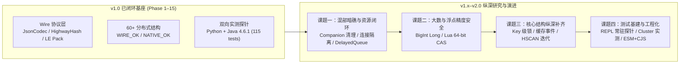

# redi.ts 演进方案 — Redisson 全面对齐与纵深演进路线图

> **当前基线（2026-10，v2.38.0）**。规范标准：`C:/GitHub/redisson`（Java Redisson 4.6.x 源码 + `redisson-4.6.1.jar` 实测为准）+ `JsonJacksonCodec`（默认类型包装）；Lua 算法基线：`C:/GitHub/redi.go`；Codec/Hash 交叉基线：`C:/GitHub/redi.py`。
>
> **当前状态**：第一阶段（v1.0.0，含 1.1.0–1.8.9 迭代）已完成 **60+ 分布式结构工厂面覆盖**、**P0 混部致命隐患清零**、**P1 核心批（Map 原子 Lua / ZSet 交并差 / Set Store 运算 / Stream 消费组全集 / RBatch 7 类门面）**，并通过 **18 个测试套件、115 项测试**（Wire 向量 + Mock 功能 + Python 实机互通 + Java Redisson 4.6.1 双向探针 Phase 1–15 全绿）。**阶段 16（v1.1.0）已完成伴生键生命周期闭环**，新增 18 项测试（11 mock + 7 live-phase16）；**阶段 17（v1.2.0）已完成有界队列信号量协议、阻塞连接隔离与 Topic 订阅生命周期**，新增 15 项测试（6 mock + 9 live-phase17）；**阶段 18（v1.3.0）已完成 64-bit 精度与原子操作硬化**，新增 13 项测试（9 mock/wire + 4 live-phase18）；**阶段 19（v1.4.0）已完成锁扩展与缓存纵深 API**（Key 级同步器家族、RW 视图补齐与唤醒常量对齐、MapCache 双向事件与过期语义、Native 条件过期/HPERSIST），新增 15 项测试（10 mock/wire + 5 live-phase19）；**阶段 20（v1.5.0）已完成集合/位图纵深补齐与探针 REPL 常驻化**（全量测试 673s → 56.9s；RMap HSCAN 迭代器 + HRANDFIELD/HSTRLEN、RScoredSortedSet 分数族与反向区间、RBitSet BITFIELD 与 Redis 8 BITOP、RGeo 搜索族与 GEOSEARCHSTORE），新增 6 项测试（2 mock + 4 live-phase20）；**阶段 21（v2.0.0）已完成现代工程化与集群实测**（ESM + CJS 双格式构建与 `pack-smoke` 验收、`Config.client` 接受 `Redis | Cluster` 与 cast 清理、`RDelayedQueue` 后台迁移器、`RSet` store wire 修复、缺失命令能力门控、3 主节点集群 4/4 全绿；全量 25 套件 / 188 项 ~60s），新增 6 项测试（1 mock + 1 live-phase21 + 4 live-cluster）；**阶段 22（v2.1.0）已完成 §3 剩余行全量收口**（FencedLock `tryLockAndGetToken`、LocalCachedMap LRU/LFU + `getCachedMap`、MultimapCache 周期清扫、BlockingQueue/Deque `pollFromAny`/BLMPOP/LMOVE/BLMOVE、RateLimiter keepAlive 脚本内续期、RBatch 13 类门面；全量 26 套件 / 199 项 ~65s），新增 11 项测试（6 mock + 5 live-phase22）；**阶段 23（v2.2.0）已完成运维与标量收口**（RKeys expire/expireAt 单+多键、clearExpire、remainTimeToLive、getSlot、move、unlinkByPattern；RAtomicLong/Double 标量余项；RBuckets MSETEX 条件写；RScoredSortedSet addIf 族；全量 27 套件 / 207 项 ~64s），新增 8 项测试（4 mock + 4 live-phase23）；**阶段 24（v2.3.0）已完成 RScoredSortedSet 收口**（`addAll*` 条件批量、`random/randomEntries`、`firstEntry/lastEntry`、非阻塞/阻塞 poll（BZPOPMIN/MAX）与 FromAny（BZMPOP）、区间改 `ZRANGE … BYSCORE`；全量 28 套件 / 212 项 ~66s），新增 5 项测试（3 mock + 2 live-phase24）；**阶段 25（v2.4.0）已完成 RTimeSeries 读写全族**（addAll、getEntry/getValue、first/last/poll 全族、正反向 range/entryRange（limit）、getAndRemove、remove/removeRange、TTL 惰性过滤与 n=2/3/4 label 兼容；全量 29 套件 / 216 项 ~68s），新增 4 项测试（2 mock + 2 live-phase25）；**阶段 26（v2.5.0）已完成剩余消息/集合面**（Topic 管理面、RStream JUSTID/多流读、RSet counted/containsEach；全量 30 套件 / 220 项 ~66s），新增 4 项测试（2 mock + 2 live-phase26）；**阶段 27（v2.6.0）已完成收尾与差异对齐**（RMap 物化视图/三参 replace、RTimeSeries stream/iterator；全量 31 套件 / 224 项 ~68s），新增 4 项测试（2 mock + 2 live-phase27）；**阶段 28（v2.7.0）已完成锁中断与缓存余项**（`lockInterruptibly` + AbortSignal、RMapCache `expireEntries/getWithTTLOnly/getMaxSize`；RedLock drift 经 4.6.1 复核确认不适用；全量 32 套件 / 228 项 ~72s），新增 4 项测试（2 mock + 2 live-phase28）；**阶段 29（v2.8.0）已完成读锁 rwlock_timeout 协议**（逐次获取伴生键、解锁按剩余键重算 HASH TTL、看门狗同步续期；修复 Java 释放读锁误删其他读者的混部风险；全量 33 套件 / 230 项 ~69s），新增 2 项测试（1 mock + 1 live-phase29）；**阶段 30（v2.9.0）已完成缓存 compute 与状态监听**（RMapCache `compute/computeIfAbsent` per-key 锁 + TTL、RTopic/RShardedTopic StatusListener；全量 34 套件 / 234 项 ~88s），新增 4 项测试（2 mock + 2 live-phase30）；**阶段 31（v2.10.0）已完成 keyspace 监听与多流 group 读**（RStream/RTimeSeries ObjectListener、`readGroupMany`；全量 35 套件 / 237 项 ~81s），新增 3 项测试（1 mock + 2 live-phase31）；**阶段 32（v2.11.0）已完成 API 细节收口**（RKeys 惰性 key stream、Topic 按 handler 删除、RStream 每流独立 group 多流读；CommonOptions/Class<M> 记录为设计差异；全量 36 套件 / 241 项 ~79s），新增 4 项测试（2 mock + 2 live-phase32）；**阶段 33（v2.12.0）已完成最终审计与真实缺口补齐**（RScript kill/flush、RFunction 运维面、VectorSet 深层 API、RBitSet 批量/asBitSet、RMapCacheNative Date、RDelayedQueue readAll/poll(count)；误报剔除与设计差异归档；全量 37 套件 / 246 项 ~82s），新增 5 项测试（2 mock + 3 live-phase33）；**阶段 34（v2.12.1）完成稳定化收尾**（连续三次全量 246 项全绿：82.15s / 71.40s / 71.62s；文档一致性、模块能力门控与 PRO/设计差异清单定稿；无行为变更）。**阶段 35（v2.13.0）完成 RJsonBucket 全族**（文档/路径/数组/字符串/数字/CAS/merge 等，Redis 8 内置 JSON 模块 + Java 双向验证；全量 38 套件 / 247 项）。**阶段 36（v2.14.0）完成概率结构深层 API**（TDigest/CuckooFilter/TopK 全族，Redis 8 模块 + live 实测；全量 39 套件 / 250 项）。**阶段 37（v2.15.0）完成 RSearch 扩展**（索引元信息/别名/增强查询/聚合/同义词/词典/配置/spellcheck，Redis 8 RediSearch；全量 40 套件 / 251 项）。**阶段 38（v2.16.0）完成惰性迭代器与限量预载**（RSet SSCAN、ZSet ZSCAN、LocalCachedMap preloadCache(count)；全量 41 套件 / 254 项）。**阶段 39（v2.17.0）完成 RReliableTopic 语义对齐**（每实例单组、publish 返回订阅者数、心跳清理 + 自动 XTRIM；全量 42 套件 / 255 项）。**阶段 40（v2.18.0）完成 JSON 批量与原生 MapCache 条件批量**（RJsonBuckets MSET/MGET、putIfAllKeys*/expireEntries 批量；全量 43 套件 / 258 项）。**阶段 41（v2.19.0）完成 RQueue/RDeque 剩余面**（poll(count)/indexOf/RPOPLPUSH/变参 add/*IfExists/LMOVE；全量 44 套件 / 261 项）；**阶段 42（v2.20.0）完成 RMapCacheNative fastPut 家族**（`fastPut`/`fastPutIfAbsent`/`putIfExist`/`fastPutIfExist` + relative/absolute TTL；全量 45 套件 / 263 项）；**阶段 43（v2.21.0）完成 RJsonBucket `*Multi` 多匹配族与多路径 `get`**（14 个 Multi 变体、两参 `arrayIndex` 全数组搜索修正；全量 46 套件 / 264 项）；**阶段 44（v2.22.0）完成 RSearch hybrid/profile/游标/alter**（FT.HYBRID KNN/RANGE + RRF/LINEAR、FT.PROFILE、FT.CURSOR、FT.ALTER；全量 47 套件 / 265 项）；**阶段 45（v2.23.0）完成阻塞队列元素订阅**（`subscribeOnElements`/`unsubscribe`、异步背压、取消即断 BLPOP、有界容量归还；全量 48 套件 / 268 项）；**阶段 46（v2.24.0）完成 RKeys 迁移/库操作**（migrate/MigrateArgs、远程 copy、swapdb、并行 flush；全量 49 套件 / 269 项）；**阶段 47（v2.25.0）完成 RKeys 全局键空间监听**（new/set/expired/del、共享 hub、RESP2 flush 拒绝；全量 50 套件 / 271 项）；**阶段 48（v2.26.0）完成队列/键扫描尾项**（`pollLastFromAnyWithName`、`getKeysWithLimit`/`getKeysByPattern`；全量 51 套件 / 274 项）；**阶段 49（v2.27.0）完成 RSearch 结构化索引**（TEXT/TAG/NUMERIC/GEO/GEOSHAPE/VECTOR FLAT|HNSW、选项与结构化 alter；全量 52 套件 / 275 项）；**阶段 50（v2.28.0）完成 RVectorSet 深层 API**（VectorAddArgs、RAW 向量、带分数邻居、三种相似查询；全量 53 套件 / 276 项）；**阶段 51（v2.29.0）完成 RMapCacheNative 结构化批量与 compute**（HSETEX PutArgs、FXX/FNX、compute/computeIfAbsent；全量 54 套件 / 278 项）；**阶段 52（v2.30.0）完成 RSet 交集计数与监听**（SINTERCARD+limit、sadd/srem/spop/store 事件；全量 55 套件 / 280 项）；**阶段 53（v2.31.0）完成原子键空间监听**（incrby/incrbyfloat、移除静默；全量 56 套件 / 282 项）；**阶段 54（v2.32.0）完成 RDelayedQueue 剩余面**（负延迟、拒绝项、无参 remove、staging 尾迁移；全量 57 套件 / 284 项）；**阶段 55（v2.33.0）完成 RVectorSet 迭代器/流**（VRANGE 分批 + 排他续页；全量 58 套件 / 285 项）；**阶段 56（v2.34.0）完成 RMap 批量 putAll(batchSize)**（字段分批 HSET，全量 59 套件 / 287 项）；**阶段 57（v2.35.0）完成 RSearch SVS-VAMANA**（压缩与建索引参数、KNN；全量 60 套件 / 288 项）；**阶段 58（v2.36.0）完成 Native MapCache 批量 TTL**（HPTTL/HPERSIST FIELDS n；全量 61 套件 / 290 项）；**阶段 59（v2.37.0）完成 Map 字段监听**（hset/hincrbyfloat/hdel、Native hexpired/hpersist；全量 62 套件 / 292 项）；**阶段 60（v2.38.0）完成条件 compareAndDelete**（六种比较运算符；全量 63 套件 / 294 项）。
>
> 本文档在全面审阅现有 12 个源码模块（`src/*.ts`）、测试基建（`test/*.ts` + `interop/`）与前期差距分析（[docs/GAP_ANALYSIS.md](docs/GAP_ANALYSIS.md)）之基础上，确立 **v1.x → v2.0 进一步研究与演进方案**。
> 协作铁律见 [AGENTS.md](AGENTS.md)；跨语言状态矩阵见 [COMPATIBILITY.md](COMPATIBILITY.md)。

---

## 1. 架构盘点与演进全局观

### 1.1 工厂面状态分类原则（一厂一态）

1. **`WIRE_OK`**：自定义 Redis 键布局、伴生键（companion keys）、Channel 消息格式、Lua 脚本及二进制打包（`struct.pack` 小端）与 Java Redisson 4.6.1 字节级互通。
2. **`NATIVE_OK`**：基于 Redis 7.4 / 8.x 原生命令或模块命令（`HPEXPIRE`、`BF.*`、`CF.*`、`TOPK.*`、`TDIGEST.*`、`GCRA`、`FT.*`、`JSON.*`、`VADD/VSIM`、`AR.*`）直接互通。
3. **`PARTIAL`**：数据层与 Java 互通，但控制面或近端缓存协议做了轻量化裁剪（如 `RLocalCachedMap` 走 JSON 广播失效、`RClientSideCaching` 走薄透传）。
4. **`GO_ONLY`**：与 `redi.go` 保持同构，但与 Java Redisson 同名接口底层协议不同（如 `RPriority*` 采用 `ZSET+score` 而非 `LIST+Comparator`；`RTransferQueue` 采用队列原子迁移而非 `RemoteService`）。
5. **`REFUSE_AS_FAKE`**：绝不用伪实现冒充（`RSortedSet`、`RTransaction` 快照回滚、`LiveObject`、`RExecutorService`、`RRemoteService`、Reactive/Rx）。
6. **`PRO`**：Redisson PRO 专属特性（`RReliableQueue`、`RBitVectorStore`、`RLocalCachedMapCache`、`RReliablePubSubTopic`、`RLeasedMap`），开源版显式抛错。

---

## 2. 已完成演进里程碑归档（v1.0.0 / Phase 1–15）

| 阶段 / 版本 | 核心交付内容 | 验证门禁 | 状态 |
|---|---|---|---|
| **v1.1–1.2** | 全量 60+ 工厂初版、Maven `redits-java-probe`、Java↔TS 48 项基础读写与锁/信号量/限流器并发互操作 | `wire` + `interop` + `live-interop` + `live-sync` | ✅ |
| **Phase 3–7** (v1.3–1.5) | `RWLock` / `FencedLock` / `DelayedQueue` / `ReliableTopic` / `TimeSeries`（4.6.1 无前缀 label 兼容）/ `LongAdder` / `PES` / `ShardedTopic`（`smessage`）/ `MapCache` 四类事件与 `maxSize` | `live-phase3` ~ `live-phase7` (42 tests) | ✅ |
| **Phase 8–10** (v1.6–1.8.0) | `MultiLock` 全有或全无回滚、`RedLock` 多数派、`LocalCachedMap` UPDATE vs INVALIDATE、`RSetCache` 补 `{name}:redisson_touch` 修复 `maxIdle` 失效、25 对 companion 键 CRC16 同槽校验 | `live-phase8` ~ `live-phase10` (21 tests) | ✅ |
| **P0 清零** (v1.8.1–1.8.2) | `PES` 与 `RateLimiter` 许可 ID 改 hex 文本（避开 UTF-8 损坏）、删伪造 `RSemaphore.setPermits`、`RIdGenerator.tryInit` 逐字对齐 Java、`RSpinLock` 指数退避 + jitter `BackOff` | `redisson.test.ts` + `live-sync` | ✅ |
| **Phase 11–15** (v1.8.3–1.8.9) | `RMap.put/remove/putIfAbsent` 单 Lua 原子化；`RScoredSortedSet` 交并差全族；`RBatch` 7 类 RFuture 门面；`RStream` 组运维/claim/pending/nack/ackdel；`RSet` store-into-self（v2.0.0 修正为 Java 裸键形状：`dest others…`、无 numkeys、self 仅作目标，见 §4.6） | `live-phase11` ~ `live-phase15` (10 tests) | ✅ |

---

## 3. 深度代码审计发现与进一步研究方案（v1.x → v2.0）

通过对 `src/` 全部 12 个源码文件的逐行审计，结合与 `Redisson 4.6.1` 及 `redi.go`（v0.2.13 收官版）的交叉比对，提炼出以下 **四大研究方向、16 项具体课题**。

> **收口状态（v2.1.0）**：以下 16 项课题已由阶段 16–22 全部覆盖。阶段 22 补齐了最后三行：3.1 `RFencedLock.tryLockAndGetToken`、3.2 `RLocalCachedMap` LRU/LFU + `getCachedMap()` 与 `RMultimapCache` 周期清扫、3.3 阻塞队列 `pollFromAny`/BLMPOP/LMOVE/BLMOVE + `RRateLimiter` keepAlive + `RBatch` 六类新门面。后续纵深项转入 [docs/GAP_ANALYSIS.md](docs/GAP_ANALYSIS.md) 跟踪。

### 🔬 课题一：跨语言混部暗礁与生命周期闭环（优先级：P0+ / 正确性硬化）

#### 1.1 伴生键（Companion Keys）孤儿化与 `delete()` / `clear()` 闭环研究
- **现状诊断**：多个含伴生键的结构继承自 [`RedisDataStructure.delete()`](src/base.ts#L47-L49)，仅执行 `DEL {name}`，未清理 hash-tagged 伴生键。在跨语言混部或重复初始化场景下，残留伴生键会导致**状态污染与幂等失败**（例如 `trySetCapacity` 永返 `false`、公平锁超时队列残留死锁）：
  - [`RFairLock` / `RNonReentrantFairLock`](src/locks.ts#L710-L857)：缺 `delete()` 重写，遗留 `redisson_lock_queue:{name}` 与 `redisson_lock_timeout:{name}`。
  - [`RFencedLock`](src/locks.ts#L1179-L1213)：缺 `delete()` 重写，遗留 `redisson_lock_token:{name}`（致重建锁后 token 不归零）。
  - [`RPermitExpirableSemaphore`](src/locks.ts#L1086-L1173)：缺 `delete()` 重写，遗留 `{name}:timeout`。
  - [`RSetCache`](src/caches.ts#L289-L408)：缺 `delete()` 与 `clear()` 重写，遗留 `redisson__idle__set:{name}` 与 `{name}:redisson_touch`。
  - [`RRingBuffer`](src/messaging.ts#L655-L715)：`clear()` 及 `delete()` 未删 `redisson_rb:{name}`。
  - [`RBoundedBlockingQueue`](src/collections.ts#L560-L585)：缺 `delete()` 重写，遗留 `redisson_bqs:{name}`。
  - [`RMultimapBase` / `RMultimapCacheBase`](src/caches.ts#L412-L540)：虽有 `clear()` 反查 `hvals` 删 `{name}:{id}`，但**未重写 `delete()`**！若直接调 `delete()`，主 HASH 被删而所有子集合 `{name}:{id}` 及 `{name}:redisson_{set|list}_multimap_ttl` 永久泄漏。
- **研究与实施方案**：
  - 逐一重写上述 7 族结构的 `delete()` 与 `unlink()`（Multimap 的 `delete()` 必须先调 `clear()` 反查子集再删主表与 TTL ZSET，严格遵循 `AGENTS.md` 第 9 条）。
  - 增设专项伴生键零残留回归测试（断言 `create -> populate -> delete -> KEYS *name*` 为空集）。

#### 1.2 `RDelayedQueue` 语义反转、目标队列误删与后台迁移调度研究
- **现状诊断**：
  1. **误删宿主队列**：[`RDelayedQueue.delete()`](src/messaging.ts#L647-L650) 当前执行 `del(this.name, this.queueKey, this.timeoutKey)`，将目标消费队列 `this.name` 一并删除！而 Java `RedissonDelayedQueue.deleteAsync()` 仅删除暂存列表 `redisson_delay_queue:{name}` 与超时集合 `redisson_delay_queue_timeout:{name}`。
  2. **`size()` 语义与 Java 相反**：[`RDelayedQueue.size()`](src/messaging.ts#L614-L617) 当前返回目标队列 `llen(this.name)`，而 Java `RedissonDelayedQueue.size()` 返回的是 `llen(redisson_delay_queue:{name})`（即尚未到期迁移的暂存条目数，对应目前 TS 的 `pendingSize()`）。
  3. **缺少后台定时推送器（Push Task）**：当前 TS 仅在调用 `RDelayedQueue.poll()/peek()/size()` 时惰性执行 `DQ_MIGRATE`。若业务方遵循 Redisson 标准用法——通过 `RDelayedQueue.offer()` 投递，而在目标 `RBlockingQueue.take()` 上阻塞等待——TS 侧因无人触发 `DQ_MIGRATE`，消息将永远滞留在 `timeoutKey` 中（除非有 Java 节点在线代为调度）。
- **研究与实施方案**：
  - 修正 `delete()`：仅删 `queueKey` 与 `timeoutKey`，停止后台调度器，保留目标队列 `this.name`；补齐 `destroy()`。
  - 对齐 `size()` / `readAll()` / `poll(limit)`：以 Lua 或 `lrangeBuffer` 解包 `redisson_delay_queue:{name}`，使 `size()` 与 Java 一致（同时保留 `targetSize()` 辅助方法）。
  - 设计轻量级客户端迁移调度器：订阅 `redisson_delay_queue_channel:{name}`（接收最早到期 deadline 通知）+ 动态 `setTimeout` 触发 `DQ_MIGRATE`，并在 `destroy()` / `shutdown()` 时优雅回收（`unref()` 防止阻塞进程退出）。

#### 1.3 `ioredis` 共享连接阻塞饥饿与 Pub/Sub 竞态硬化
- **现状诊断**：
  1. **阻塞命令独占主连接**：[`RBlockingQueue.take()` / `pollWithTimeout()`](src/collections.ts#L506-L522)、[`RBlockingDeque`](src/collections.ts#L535-L558)、[`RPriorityBlockingQueue.take()`](src/infra.ts#L268-L278)、[`RReliableTopic.consumeLoop()`](src/messaging.ts#L194) 直接在共享的 `this.redis` 上执行 `BLPOP` / `BRPOP` / `BZPOPMIN` / `XREADGROUP BLOCK`。由于 Redis 协议在阻塞期间锁定整条 TCP 连接，同一 `Redisson` 实例上的其他并发读写乃至**锁看门狗定时续期（`LOCK_RENEW_SCRIPT`）**全部被挂起，极易引发分布式锁意外过期！
  2. **亚秒级超时失真与 `0` 边界**：`Math.ceil(timeoutMs / 1000)` 将 `50ms` 放大 20 倍为 `1s`（Redis 6.0+ 原生支持浮点数秒如 `BLPOP key 0.05`）；且 `RBlockingDeque.pollFirstWithTimeout(0)` 会传入 `1s` 而非立即返回或按预期处理。
  3. **Pub/Sub 挂载顺序与连接复用**：[`RTopic.addListener`](src/messaging.ts#L41-L46) 与 [`RPatternTopic.addListener`](src/messaging.ts#L89-L94) 先 `await subscribe()` 后挂 `.on('message')`，且未保存 [`RShardedTopic`](src/messaging.ts#L120-L142) 的订阅连接句柄（无法 `removeListener` 断开连接，造成连接泄漏）。
- **研究与实施方案**：
  - 为阻塞原语（`BLPOP`/`BRPOP`/`BLMOVE`/`BZPOPMIN`/`XREADGROUP BLOCK`）引入按需 `duplicate()` 的独立连接池或独占连接机制，确保主命令连接与看门狗绝不被阻塞命令卡死（在 `ioredis-mock` 下自动回退共享连接）。
  - 阻塞超时参数切换为 Redis 6+ 浮点秒（`timeoutMs / 1000`），当 `timeoutMs <= 0` 时退化为非阻塞 `LPOP`/`RPOP`。
  - 统一修复 `RTopic` / `RPatternTopic` / `RShardedTopic`：先挂监听器再 `subscribe`，并为 `RShardedTopic` 补齐 `subs` Map 与 `removeListener(id)` / `removeAllListeners()`。

#### 1.4 `RBoundedBlockingQueue` 信号量协议对齐
- **现状诊断**：Java `RedissonBoundedBlockingQueue` 的容量控制底层其实是一个内嵌的 `RSemaphore`（键名 `redisson_bqs:{name}`，通道 `redisson_sc:redisson_bqs:{name}`）：`offer`/`put` 消耗许可（`DECRBY`）并 `RPUSH`，`poll`/`take` 弹出元素并归还许可（`INCRBY` + `PUBLISH` 唤醒阻塞生产者）。而当前 [`src/collections.ts`](src/collections.ts#L560-L585) 仅将 `redisson_bqs:{name}` 当作静态上限配置（只读 `GET` 比较 `LLEN`），既未修改 `redisson_bqs:{name}` 计数值，也未在消费时发布通知！这会导致**Java 生产者与 TS 消费者混部时，Java 侧许可耗尽后永久阻塞**！
- **研究与实施方案**：
  - 严格对齐 `redi.go` 与 Java `RedissonBoundedBlockingQueue` 的 Lua 脚本：`trySetCapacity` 走 `SETNX` + `PUBLISH`；`offer` 走原子 `DECRBY redisson_bqs:{name}` + `RPUSH`；`poll`/`take`/`remove`/`clear` 走原子弹出 + `INCRBY redisson_bqs:{name}` + `PUBLISH redisson_sc:redisson_bqs:{name}`。
  - 增加 Java `put` 阻塞等待 → TS `poll` 释放容量唤醒 Java 的跨语言 Live 测试。

---

### 🔬 课题二：JavaScript 数值精度边界与 64-bit 安全研究（优先级：P1-High）

#### 2.1 超 `MAX_SAFE_INTEGER`（$>2^{53}-1$）的 `java.lang.Long` 编解码保真
- **现状诊断**：Java `long` 为有符号 64 位整数（上限 $9223372036854775807$），而 JS `number` 仅能精确表示 $\pm(2^{53}-1)$（$9007199254740991$）。
  - 编码端：[`JsonCodec.encode`](src/codec.ts#L115-L117) 对 `bigint` 执行了 `Number(value)`，导致超出 $2^{53}-1$ 的 `bigint` 在序列化前即丢失精度！
  - 解码端：`JSON.parse('["java.lang.Long", 9223372036854775807]')` 会被 V8 截断为 `9223372036854776000`。
- **研究与实施方案**：
  - 编码端：对 `typeof value === 'bigint'` 直接拼装 `'["java.lang.Long",' + value.toString() + ']'`，实现 64 位整数无损写出。
  - 解码端：在 `JsonCodec` 中引入可选配置 `{ bigIntForUnsafeLong?: boolean }`（或通过正则/自定义 reviver 识别超 15 位整数文本），在不破坏现有 `number` 类型契约的前提下支持大整数无损读取。

#### 2.2 `RAtomicLong` 64-bit CAS 与 `RAtomicDouble` 浮点尾数精度
- **现状诊断**：
  - [`ATOMIC_CAS`](src/atomic.ts#L11-L12) 使用 `tonumber(v) == tonumber(ARGV[1])`；Redis Lua 5.1 的 `number` 同样是 IEEE-754 double，当计数值 $>2^{53}$ 时，`tonumber` 比较会把相邻的不同整数视为相等！应改用十进制字符串精确比对（处理好空键默认 `'0'`）。
  - [`RAtomicDouble.getAndAdd(delta)`](src/atomic.ts#L81-L84) 采用客户端 `n - delta` 反推旧值，遇到 `0.1 + 0.2` 时返回 `0.10000000000000003`；应改为单 Lua 脚本先 `GET` 旧值再 `INCRBYFLOAT`，直接返回精确旧值。

---

### 🔬 课题三：核心数据结构 API 纵深补齐（优先级：P1 / 按模块分批推进）

对照 [docs/GAP_ANALYSIS.md](docs/GAP_ANALYSIS.md) §2 与 `redi.go` 演进成果，规划以下高价值能力补齐：

#### 3.1 锁与同步器扩展（`src/locks.ts`）
| 子项 | 研究与实现要点 | 互操作等级 |
|---|---|---|
| **Key 级细粒度同步器** | 在 `RMap` / `RSet` / `RMultimap` 上提供 `getLock(key)`、`getFairLock(key)`、`getReadWriteLock(key)`、`getSemaphore(key)`、`getPermitExpirableSemaphore(key)`、`getCountDownLatch(key)`。键名公式：`{name}:{multimapInternalId(encodeKey(key))}:{lock\|fairlock\|rw_lock\|semaphore\|...}`，与 Java `RedissonObject.getLockByMapKey` 字节级对齐 | `WIRE_OK` |
| **`RReadWriteLock` 视图完备化** | 为 `RReadLockView` / `RWriteLockView` 补齐 `isLocked()`、`isHeldByThread()`、`getHoldCount()`、`forceUnlock()`，并抽象 `RLockable` 接口使 `RMultiLock` / `RRedLock` 支持混装 `RFairLock` 与读写锁视图 | `WIRE_OK` |
| **`RFencedLock` 方法对齐** | 增补 `tryLockAndGetToken(waitTimeMs?, leaseTimeMs?, threadId?)`，并为 `lockAndGetToken` 增加阻塞等待语义（或保持向后兼容重载），对齐 Java `RFencedLock` 签名 | `WIRE_OK` |

#### 3.2 缓存与映射进阶（`src/caches.ts` & `src/collections.ts`）
| 子项 | 研究与实现要点 | 互操作等级 |
|---|---|---|
| **`RMap` 流式迭代与元信息** | 补齐基于 `HSCAN` 的 `keysIterator(pattern?, count?)` / `entriesIterator(pattern?, count?)`（返回 `AsyncIterableIterator`），避免大 Hash 下 `readAllMap()` 引发 OOM；补齐 `valueSize(key)`（`HSTRLEN`）、`randomKeys(count)` / `randomEntries(count)`（`HRANDFIELD`） | `WIRE_OK` |
| **`RMapCache` TTL 查询与事件监听** | 补齐 `remainTimeToLive(key)`（同时检查 `redisson__timeout__set` 与 `redisson__idle__set`，取较小剩余毫秒数）、`putAll(map, ttlMs, maxIdleMs)`、`expireEntry(key, ttlMs, maxIdleMs)`；实现 `decodeMapCacheEvent` 与 `addListener(listener)`，支持 TS 侧订阅 Java 或 TS 触发的 `created/updated/removed/expired` 事件 | `WIRE_OK` |
| **`RMapCacheNative` 丰富化** | 补齐 `putIfAbsent(key, value, ttlMs)`、`expireEntry(key, ttlMs, mode?)`（封装 `HPEXPIRE ... NX/XX/GT/LT`）、`clearExpire(key)`（`HPERSIST`），修正 `remainTTL` 对 `-1`（永不过期）与 `-2`（字段不存在）的区分 | `NATIVE_OK` |
| **`RLocalCachedMap` 策略兑现** | 修复 [`setCached`](src/caches.ts#L619-L627) 中硬编码 `60000ms` 的缺陷，兑现 `opts.timeToLiveMs` 与 `opts.maxIdleMs`；利用 Map 插入序实现 `LRU` 淘汰与访问计数实现 `LFU` 淘汰；补齐 `getCachedMap()` 本地快照视图 | `PARTIAL` |
| **`RMultimapCache` 自动清扫** | 增加可选 `enablePeriodicEviction(intervalMs)` 后台清理定时器（默认仍为惰性清扫），防止冷 key 过期后长期占用内存 | `WIRE_OK` |

#### 3.3 集合、队列、流与概率结构（`src/collections.ts`, `src/messaging.ts`, `src/probabilistic.ts`）
| 子项 | 研究与实现要点 | 互操作等级 |
|---|---|---|
| **`RBlockingQueue` / `Deque` 原子操作** | `drainTo` 改用单 Lua 脚本原子 `LRANGE` + `LTRIM` + `RPUSH`（消除并发尾部追加丢失）；补齐 `move(dest, fromSide, toSide)`（`LMOVE`）与 `pollWithTimeoutFromAny`（`BLMPOP`） | `WIRE_OK` |
| **`RScoredSortedSet` 增量补齐** | 补齐 `addScore(value, delta)`（`ZINCRBY`）、`addScoreAndGetRank(value, delta)`、`firstScore()` / `lastScore()`、`valueRangeReversed(from, to)`、`entryRangeReversed(from, to)`、`removeRangeByRank(from, to)`、`removeRangeByScore(min, max)`、`random(count?)`（`ZRANDMEMBER`） | `WIRE_OK` |
| **`RBitSet` 位域与 Redis 8 运算** | 补齐 `getSigned/setSigned/getUnsigned/setUnsigned/incrementAndGet`（基于 `BITFIELD`）；补齐 `size()`（分配位大小 `STRLEN * 8`，区分于 `cardinality()` 置 1 位数与 `length()` 最高有效位）；支持 Redis 8 `BITOP DIFF / DIFF1 / ANDOR / ONE` | `WIRE_OK` / `NATIVE_OK` |
| **`RGeo` 形状与存储搜索** | 补齐 `searchByBox(lon, lat, width, height, unit, order?, count?)`、`searchFromMember(...)`、`storeSearchTo(dest, ...)`（`GEOSEARCHSTORE`） | `WIRE_OK` |
| **`RRateLimiter` KeepAlive 刷新** | 在 `tryAcquire` / `acquire` 的 Lua 脚本中，当配置了 `keepAliveTime > 0` 时自动顺延 `{name}:value` 与 `{name}:permits` 的 `PEXPIRE`（对齐 `redi.go` 阶段 A） | `WIRE_OK` |
| **`RBatch` 门面扩充** | 在现有 7 类门面之上增补 `getDeque`、`getAtomicDouble`、`getBitSet`、`getGeo`、`getStream`、`getMapCacheNative` 常用管道操作 | `NATIVE_OK` |

---

### 🔬 课题四：测试基建提速与现代 TS 工程化（优先级：P1 / 研发效能与生态）

#### 4.1 Java 互操作探针常驻化（Daemon REPL Probe）
- **现状痛点**：当前 `test/live-*.test.ts` 共 14 个文件，每个测试用例每次调用 `probe(...)` 均执行 `mvn -f interop/pom.xml -q compile exec:java`，触发 Maven 与 JVM 冷启动。全量 18 worker 并行时，数十个 JVM 同时拉起导致 CPU 饥饿与数秒级冷启抖动（见 `AGENTS.md` 第 10 条与 `CHANGELOG.md` 1.8.9）。
- **研究与实施方案**：
  1. 在 [`TsProbe.java`](interop/src/main/java/io/github/redits/interop/TsProbe.java) 中新增 `repl` 子命令：启动单个 `RedissonClient` 实例后循环读取 `stdin` 行（每行一条命令，格式同现有 CLI 参数），执行后向 `stdout` 输出单行结果并 `flush()`。
  2. 在 `test/` 下封装共享辅助模块 `test/helpers/java-probe.ts`：首次调用时通过 `java -cp ...`（若 `target/classes` 已编译则跳过 Maven）拉起常驻子进程，后续 `probe(cmd)` 直接通过 stdin/stdout 交互（单次调用耗时从 **~3,000ms 降至 ~5ms**），长驻型命令（如 `lock-hold`、`rt-listen`、`longadder-cohort`）仍支持独立子进程或异步工作线程。
  3. **预期收益**：全量 Live 测试套件耗时缩短 **80% 以上**，彻底消除因 JVM 冷启动饥饿引起的偶发 Flake。

#### 4.2 导出规范、类型安全与多拓扑 CI
- **双模块发布（Dual ESM / CJS）**：升级构建链（`tsup` 或双 `tsconfig`），在 `package.json` 中提供标准 `exports` 字段（同时支持 `import { Redisson } from 'redi.ts'` 与 `require('redi.ts')`）。
- **减少内部 `as any` 断言**：为 `ioredis` 尚未收录的 Redis 7.4/8.x 新命令（`hpexpire`, `hpttl`, `spublish`, `ssubscribe`, `xnack`, `xackdel`, `sunioncard`, `zintercard`, `vadd`, `vsim` 等）编写内部类型增强声明 `src/ioredis-augment.d.ts`，提升源码类型安全性。
- **GitHub Actions CI 矩阵**：配置官方 `redis:8-alpine` 容器服务 + JDK 17，在 CI 上自动运行包含 `SINTERSTORE`/`SDIFFSTORE`、RediSearch、RedisJSON、VectorSet、Bloom 在内的全量 Live 互操作测试（绕开本地 Windows MSYS2 Redis 8.10.2 的 `SINTERSTORE` 缺陷）。

---

## 4. 分阶段实施路线图（Roadmap）

| 阶段 | 聚焦主题 | 核心任务清单 | 验收门禁 | 状态 |
|---|---|---|---|---|
| **阶段 16 (v1.1.0)** | **生命周期与伴生键硬化** | ① `RFairLock`/`RFencedLock`/`PES`/`RSetCache`/`RRingBuffer`/`RBoundedBlockingQueue`/`RMultimap(+Cache)` 补齐 `delete()`/`unlink()` 伴生键清理； ② `RDelayedQueue.delete()` 修复误删目标队列，`size()` 对齐 Java； ③ `RLocalCachedMap` 兑现 `timeToLiveMs`/`maxIdleMs` 配置 | 新增伴生键零泄漏单测 + `live-phase16.test.ts` | ✅ 已完成（v1.1.0） |
| **阶段 17 (v1.2.0)** | **连接隔离与有界阻塞队列协议** | ① `RBoundedBlockingQueue` 补齐 `redisson_bqs:{name}` 信号量原子 DECR/INCR+PUBLISH 协议； ② `RBlockingQueue`/`Deque`/`PriorityBlockingQueue`/`ReliableTopic` 阻塞读走 `duplicate()` 独立连接 + 浮点秒超时； ③ `RTopic`/`PatternTopic`/`ShardedTopic` 订阅顺序修复与 `removeListener` 闭环 | Java↔TS `BoundedBlockingQueue` 阻塞唤醒实测 + 看门狗防饥饿测试 | ✅ 已完成（v1.2.0） |
| **阶段 18 (v1.3.0)** | **64-bit 精度与原子操作硬化** | ① `JsonCodec` BigInt 无损序列化与可选大整数解码； ② `RAtomicLong` 字符串精确 CAS（消除 $>2^{53}$ 失真）； ③ `RAtomicDouble.getAndAdd` 单 Lua 精确返回旧值； ④ `RBlockingQueue.drainTo` 单 Lua 原子化 | `wire.test.ts` 64-bit 向量 + 并发 `drainTo` 零丢失测试 | ✅ 已完成（v1.3.0） |
| **阶段 19 (v1.4.0)** | **锁扩展与缓存纵深 API** | ① `RMap`/`RSet`/`RMultimap` 之 `getLockByKey` 家族（6 种同步器）； ② `RReadWriteLock` 视图补齐 `isLocked/getHoldCount/forceUnlock`，`RMultiLock` 泛化支持 `RFairLock`/`RWLock`； ③ `RMapCache.remainTimeToLive`/`putAll`/`expireEntry` + 事件 `addListener`； ④ `RMapCacheNative` 条件过期与 `HPERSIST` | Java↔TS Key 级锁互斥实测 + MapCache 双向事件监听实测 | ✅ 已完成（v1.4.0） |
| **阶段 20 (v1.5.0)** | **集合/位图补齐与常驻探针** | ① `TsProbe.java` REPL 常驻模式改造，提速全量 Live 测试； ② `RMap` `HSCAN` 异步迭代器 + `HRANDFIELD`/`HSTRLEN`； ③ `RScoredSortedSet` `addScore`/反向区间/分数删除； ④ `RBitSet` `BITFIELD` 与 Redis 8 `BITOP`；`RGeo` Box 搜索与 `GEOSEARCHSTORE` | 新增 API 双向探针全绿 ✅；探针 REPL 使全量从 673s 降至 56.9s（<30s 未达，语义等待主导，见 §4.5） | ✅ 已完成（v1.5.0） |
| **阶段 21 (v2.0.0)** | **现代工程化与集群实测** | ① ESM + CJS 双格式构建与导出、`ioredis` 类型增强（`Redis \| Cluster` + cast 清理）； ② `RDelayedQueue` 可选客户端后台迁移调度器（`QueueTransferTask` 移植）； ③ Redis Cluster 多节点环境下结构与 Lua 脚本实测； ④ 缺失命令能力门控（`COMMAND INFO` + SKIP 日志）+ `RSet` store wire 修复 | `npm pack` 双模块冒烟 ✅（`pack-smoke`：CJS/ESM 双解析 + 同 wire 输出）；Cluster 拓扑全绿 ✅（3 主节点 7100-7102，`live-cluster` 4/4）；全量 188 项 / 25 套件约 60s ✅ | ✅ 已完成（v2.0.0） |
| **阶段 22 (v2.1.0)** | **§3 剩余 API 面收口** | ① `RFencedLock.tryLockAndGetToken`（4.6.1 非阻塞/等待语义）； ② `RLocalCachedMap` `maxSize` 下 LRU/LFU 淘汰 + `getCachedMap()` 视图； ③ `RMultimapCache` 可选周期清扫； ④ 阻塞队列/双端队列 `pollFromAny`/BLMPOP/BLMOVE 与 `move` 族； ⑤ `RRateLimiter` keepAlive 在 acquire Lua 内续期； ⑥ `RBatch` 门面扩至 13 类 | `live-phase22` 5/5（TS↔Java fenced token 序列、真实 BLPOP/BLMPOP/BLMOVE 唤醒、TS/Java 双向 keepAlive 续期、周期清扫、batch GEO/HPEXPIRE）；全量 199 项 / 26 套件约 65s ✅ | ✅ 已完成（v2.1.0） |
| **阶段 23 (v2.2.0)** | **运维与标量收口** | ① `RKeys` expire/expireAt 单+多键、clearExpire、remainTimeToLive、getSlot、move、unlinkByPattern； ② `RAtomicLong/Double` getAndIncrement/Decrement、setIfLess/Greater、getAndDelete、Double compareAndDelete； ③ `RBuckets` MSETEX NX/XX 条件写； ④ `RScoredSortedSet` addIfAbsent/Exists/Less/Greater | `live-phase23` 4/4（expire 族/MOVE db9/getSlot vs 集群节点 `CLUSTER KEYSLOT`/Java 读回 MSETEX 值/原子精确性/ZADD GT/LT 分数）；全量 207 项 / 27 套件约 64s ✅ | ✅ 已完成（v2.2.0） |
| **阶段 24 (v2.3.0)** | **RScoredSortedSet 收口** | ① `addAll*` 条件批量（NX/XX/GT/LT CH）； ② `random`/`randomEntries`、`firstEntry`/`lastEntry`； ③ 非阻塞 `pollFirst/LastEntry`； ④ 阻塞 `pollFirst/LastWithTimeout`（BZPOPMIN/MAX）与 `pollFirst/LastFromAny`（BZMPOP）； ⑤ 区间读取改 `ZRANGE … BYSCORE [REV]` | `live-phase24` 2/2（addAll 四条件 + Java 分数读回、ZRANDMEMBER 成员、BZPOPMIN/BZPOPMAX/BZMPOP 真实唤醒）；全量 212 项 / 28 套件约 68s ✅ | ✅ 已完成（v2.3.0） |
| **阶段 25 (v2.4.0)** | **RTimeSeries 读写全族** | ① `addAll`（单 Lua、序列号+双 ZSET）； ② `getEntry`/`getValue`/`getAndRemove(Entry)`； ③ `first/last` 与 `pollFirst/Last` 全族（值/Entry/Timestamp/count）； ④ `range/rangeReversed/entryRange/entryRangeReversed`（limit）； ⑤ `remove/removeRange` + TTL 惰性过滤； ⑥ label n=2/3/4 形状兼容 | `live-phase25` 2/2（addAll + Java ts-range/ts-add-label 双向、poll/getAndRemove、removeRange、TTL 过期过滤）；全量 216 项 / 29 套件约 68s ✅ | ✅ 已完成（v2.4.0） |
| **阶段 26 (v2.5.0)** | **剩余消息与集合面** | ① `RTopic` 管理面（channel/pattern names、countListeners/countSubscribers、getActiveTopics）；② `RStream` `fastClaim`/`fastAutoClaim`（JUSTID）与 `readMany`（多流 XREAD）；③ `RSet` `addAllCounted`/`removeAllCounted`/`containsEach` | `live-phase26` 2/2（live 订阅计数/active topics、XCLAIM/XAUTOCLAIM JUSTID、多流 XREAD）；全量 220 项 / 30 套件约 66s ✅ | ✅ 已完成（v2.5.0） |
| **阶段 27 (v2.6.0)** | **收尾与差异对齐** | ① `RMap.keySet/values/entrySet` 物化视图与三参 `replace`；② `RTimeSeries.stream/iterator` 分页取值；③ 视图 MATCH 语义按 Java HSCAN（编码字段名）记录 | `live-phase27` 2/2（视图 vs Java HSCAN、条件 replace/remove Java 读回、stream/iterator vs ts-range）；全量 224 项 / 31 套件约 68s ✅ | ✅ 已完成（v2.6.0） |
| **阶段 28 (v2.7.0)** | **锁中断与缓存余项** | ① `RLock.lockInterruptibly`（AbortSignal 模拟中断）；② `RMapCache.expireEntries/getWithTTLOnly/getMaxSize`；③ RedLock drift 经 4.6.1 源码复核后更正（该版本无扣减，TS 已一致） | `live-phase28` 2/2（双客户端争锁中断、TTL ZSET/only-read/max-size）；全量 228 项 / 32 套件约 72s ✅ | ✅ 已完成（v2.7.0） |
| **阶段 29 (v2.8.0)** | **读锁 rwlock_timeout 协议** | ① 读锁逐次获取创建 `<tagged>:<field>:rwlock_timeout:<n>`（SET+PX）；② 解锁删除本次键并按剩余键 max PTTL 重算 HASH TTL；③ 看门狗同步续期所有 timeout 键；④ 修复 Java 释放读锁可能误删仍有其他读者的 HASH | `live-phase29` 1/1（Java 持有读锁 + TS 读锁混部：TS 释放后 HASH/timeout 键存活，Java 释放后清空）；全量 230 项 / 33 套件约 69s ✅ | ✅ 已完成（v2.8.0） |
| **阶段 30 (v2.9.0)** | **缓存 compute 与状态监听** | ① `RMapCache.compute/computeIfAbsent`（per-key 锁 + TTL + null 删除，并发串行化）；② `RTopic/RShardedTopic` `StatusListener`（onSubscribe/onUnsubscribe，统一 removeListener/removeAllListeners） | `live-phase30` 2/2（并发 compute + Java `mc-get` 读回、实时状态回调）；全量 234 项 / 34 套件约 88s ✅ | ✅ 已完成（v2.9.0） |
| **阶段 31 (v2.10.0)** | **keyspace 监听与多流 group 读** | ① `RStream.addListener(ObjectListener)`（xadd/xdel/xgroup-* 六事件）；② `RTimeSeries.addListener`（zadd/zrem）；③ `RStream.readGroupMany`（单条 XREADGROUP 多流）；④ 服务端 `notify-keyspace-events` 能力门控（不可配置时日志跳过） | `live-phase31` 2/2（六事件按流名过滤、退订静默、TimeSeries add/remove、多流 group 读）；全量 237 项 / 35 套件约 81s ✅ | ✅ 已完成（v2.10.0） |
| **阶段 32 (v2.11.0)** | **API 细节收口** | ① `RKeys.getKeysStream/getKeysStreamByPattern` 惰性 SCAN；② Topic `removeListener(handler)` 按回调删除；③ `RStream.readGroupMany` 每流独立 group/consumer；④ CommonOptions/Class<M>/RKeys.time 设计差异与误报归档 | `live-phase32` 2/2（惰性 key stream、handler 删除后静默、每流独立 group XREADGROUP）；全量 241 项 / 36 套件约 79s ✅ | ✅ 已完成（v2.11.0） |
| **阶段 33 (v2.12.0)** | **边界收敛与最终审计** | ① GAP 全量复核：剔除误报（RSet countDiff/countUnionApprox、ZRANGESTORE、RKeys.time、DelayedQueue move/addListener、RLeasedMap 开源实现），归档设计差异（CommonOptions/Class<M>/loader-writer）；② 补齐 RScript/RFunction/VectorSet/RBitSet/RMapCacheNative Date/RDelayedQueue 读族；③ 修复 `RFunction.load` 空参数；④ 全量回归 | `live-phase33` 3/3（SCRIPT、FUNCTION dump/restore、VectorSet 深层、Date/HPEXPIREAT）；全量 246 项 / 37 套件约 82s ✅ | ✅ 已完成（v2.12.0） |
| **阶段 34 (v2.12.1)** | **稳定化与收尾** | ① 全量套件连续三次重复跑（flake 审计，全绿且无重试/阈值调整）；② README/COMPATIBILITY/GAP 最终一致性校对；③ RSearch/RedisJSON 模块缺席下的能力门控说明；④ PRO/设计差异清单定稿 | 三次全量 246 项 / 37 套件全绿（82.15s / 71.40s / 71.62s）；v2.12.0 全部验收项保持 ✅ | ✅ 已完成（v2.12.1） |
| **阶段 35 (v2.13.0)** | **RJsonBucket 全族** | ① 文档/路径读写与 NX/XX；② 原子 CAS/getAndSet/getAndDelete；③ string/array/number 操作；④ merge/keys/type/toggle/clear/delete；⑤ Java JacksonCodec 双向探针（json-set/json-get） | `live-phase35` 1/1（全 API + Java 双向；Redis 8.6 内置 JSON 模块，缺失时能力门控）；全量 247 项 / 38 套件 ✅ | ✅ 已完成（v2.13.0） |
| **阶段 36 (v2.14.0)** | **概率结构深层 API** | ① TDigest create/merge/min/max/cdf/trimmedMean/rank/byRank/info/reset；② CuckooFilter init/addIfAbsent/existsMany/count/info；③ TopK init 参数/add 丢弃项/incrementBy/contains/count/listWithCount/info | `live-phase36` 3/3（TDigest 统计+merge+reset、Cuckoo 计数/info、TopK 丢弃项/listWithCount；命令能力门控）；全量 250 项 / 39 套件 ✅ | ✅ 已完成（v2.14.0） |
| **阶段 37 (v2.15.0)** | **RSearch 扩展** | ① 索引元信息 `getIndexes/hasIndex/info/dropIndexAndDocuments`；② 别名三件套；③ 增强 search（sort/return/inKeys/filter/params/dialect/timeout）；④ aggregate 构造器；⑤ 同义词/词典/FT.CONFIG/spellcheck | `live-phase37` 1/1（建索引→搜索/排序/params→别名→聚合→同义词/词典→config→DD 删除；FT 能力门控）；全量 251 项 / 40 套件 ✅ | ✅ 已完成（v2.15.0） |
| **阶段 38 (v2.16.0)** | **惰性迭代器与限量预载** | ① `RSet.iterator/distributedIterator/stream`（SSCAN）；② `RScoredSortedSet.iterator/stream/entriesIterator`（ZSCAN）；③ `RLocalCachedMap.preloadCache(count)`（HSCAN） | `live-phase38` 1/1（编码前缀 MATCH + 限量/全量预载）；全量 254 项 / 41 套件 ✅ | ✅ 已完成（v2.16.0） |
| **阶段 39 (v2.17.0)** | **RReliableTopic 语义对齐** | ① 每客户端实例单组（监听器共享）；② `publish` 返回组数（XADD + XINFO GROUPS）；③ 心跳 ZSET + 过期组清理 + 按最早组位点 XTRIM；④ 最后监听器移除销毁组；⑤ `delete/unlink` 语义对齐 | `live-phase39` 1/1（publish 0/1/2、共享/独立组、trim 到空、实例级拆除）+ 既有 phase3/17 回归 ✅；全量 255 项 / 42 套件 ✅ | ✅ 已完成（v2.17.0） |
| **阶段 40 (v2.18.0)** | **JSON 批量与原生缓存条件批** | ① `RJsonBuckets.set/get/getWithPath`（MSET/MGET）；② `RMapCacheNative.putIfAllKeysExist/Absent`（全字段条件 Lua + TTL）；③ `expireEntries(IfNotSet/IfGreater/IfLess)` 批量；④ FPHA 能力探测（本机不支持，记录） | `live-phase40` 2/2（JSON.MSET/MGET + 路径读；条件批量/Date 过期 + Java map 读）；全量 258 项 / 43 套件 ✅ | ✅ 已完成（v2.18.0） |
| **阶段 41 (v2.19.0)** | **RQueue/RDeque 剩余面** | ① `RQueue.poll(count)`/`indexOf`/非阻塞 `pollLastAndOfferFirstTo`（RPOPLPUSH）；② `RDeque` 变参 `addFirst/addLast`、`addFirstIfExists/addLastIfExists`（LPUSHX/RPUSHX）；③ `pollFirst/pollLast(count)`；④ `move`（LMOVE）；⑤ 有界队列 `poll(count)` 容量记账 | `live-phase41` 1/1（RPOPLPUSH/变参/LPUSHX/LMOVE/批量弹出）+ mock 2 项；全量 261 项 / 44 套件 ✅ | ✅ 已完成（v2.19.0） |
| **阶段 42 (v2.20.0)** | **RMapCacheNative fast 写面** | ① `fastPut`（HSET 不读旧值）；② `fastPutIfAbsent`（HSETNX / 原子 Lua + 字段 TTL）；③ `putIfExist`（仅字段存在时写，返回旧值）；④ `fastPutIfExist`；⑤ 全部接受毫秒或绝对 `Date`（HPEXPIRE/HPEXPIREAT） | `live-phase42` 1/1（存在性守卫、相对/绝对字段 TTL、Java `map-get` 读回）+ mock 1 项；全量 263 项 / 45 套件 ✅ | ✅ 已完成（v2.20.0） |
| **阶段 43 (v2.21.0)** | **RJsonBucket 多匹配族** | ① 全部 4.6.1 `*Multi` 变体（string/array/number/keys/toggle）；② 多路径 `get(codec, paths...)`；③ 修正两参 `arrayIndex` 为全数组搜索（四参仍按 `[start, stop)`） | `live-phase43` 1/1（JSON 能力门控；Multi 全族 + 多路径 + 边界）+ 全量 264 项 / 46 套件 ✅ | ✅ 已完成（v2.21.0） |
| **阶段 44 (v2.22.0)** | **RSearch hybrid/profile/游标/alter** | ① `hybridSearch`（KNN/RANGE、RRF/LINEAR、load/groupBy/apply/filter/sort/params/timeout）；② `profileSearch`/`profileAggregate`（LIMITED）；③ `aggregate` WITHCURSOR + `readCursor`/`delCursor`；④ `alter`（SCHEMA ADD）；⑤ Buffer 参数直传 | `live-phase44` 1/1（KNN/LINEAR + RRF/RANGE、profile、游标、alter；能力门控）+ 全量 265 项 / 47 套件 ✅ | ✅ 已完成（v2.22.0） |
| **阶段 45 (v2.23.0)** | **阻塞队列元素订阅** | ① `subscribeOnElements(consumer)`（持续 take → consumer → take，异步背压）；② `unsubscribe(id)` 取消并断开挂起 BLPOP；③ consumer 异常 1s 后重试、同 consumer 重复注册抛错；④ 有界队列走容量感知 poll 并逐条归还许可 | `live-phase45` 1/1（顺序/背压、取消后元素留在队列、deque、有界容量）+ mock 2 项；全量 268 项 / 48 套件 ✅ | ✅ 已完成（v2.23.0） |
| **阶段 46 (v2.24.0)** | **RKeys 迁移/库操作** | ① `migrate` 单键；② `MigrateArgs` 多键 + COPY/REPLACE/AUTH/AUTH2；③ 远程 `copy`（MIGRATE COPY）与本地 COPY 重载共存；④ `swapdb`；⑤ `flushdbParallel/flushallParallel`（ASYNC） | `live-phase46` 1/1（第二实例 6380：单/多键迁移、远程 copy、COPY+REPLACE、SWAPDB、ASYNC flush；缺第二实例时日志 skip）+ 全量 269 项 / 49 套件 ✅ | ✅ 已完成（v2.24.0） |
| **阶段 47 (v2.25.0)** | **RKeys 键空间监听** | ① `addListener` 映射 onNew/onSet/onExpired/onDeleted；② 全局回调接收真实 key（无单结构过滤）；③ hub 按 Redis 客户端共享，跨 `getKeys()` 门面 `removeListener`；④ onFlush 在 RESP2 明确抛错、未知/空 listener 校验 | `live-phase47` 1/1（KEAn；new/set/expired/del、跨门面移除、config 保存恢复）+ mock 1 项；全量 271 项 / 50 套件 ✅ | ✅ 已完成（v2.25.0） |
| **阶段 48 (v2.26.0)** | **队列/键扫描尾项** | ① `pollLastFromAnyWithName`（BRPOP + 源名；负超时即 null）；② `RKeys.getKeysWithLimit(limit)`/`(pattern, limit)`；③ `getKeysByPattern(pattern, count?)`；④ `QueueMoveElementsArgs` 记为 4.6.1 版本外 | `live-phase48` 1/1（BRPOP 优先级/源名/负超时、deque、限量/模式扫描）+ mock 2 项；全量 274 项 / 51 套件 ✅ | ✅ 已完成（v2.26.0） |
| **阶段 49 (v2.27.0)** | **RSearch 结构化索引** | ① `SearchIndexOptions`（ON/PREFIX/FILTER/LANGUAGE/SCORE/NOOFFSETS/STOPWORDS/SKIPINITIALSCAN/TEMPORARY/PAYLOAD_FIELD 等）；② `SearchFieldIndex` TEXT/TAG/NUMERIC/GEO/GEOSHAPE/VECTOR（FLAT/HNSW，含 AS/SORTABLE/UNF/INDEXEMPTY/INDEXMISSING/权重/音标/分隔符）；③ `createIndex` 与 `alter` 同时接受原始 token 或结构化字段；④ 修正 Redis 8.6 的 INDEXEMPTY/INDEXMISSING 顺序 | `live-phase49` 1/1（别名/TAG 大小写/数值/GEO/排序/FLAT+HNSW KNN/FT.INFO/结构化 ALTER）+ 全量 275 项 / 52 套件 ✅ | ✅ 已完成（v2.27.0） |
| **阶段 50 (v2.28.0)** | **RVectorSet 深层 API** | ① `add(VectorAddArgs)`（REDUCE/CAS/Q8/BIN/EF/SETATTR/M）；② `getRawVector`（RAW，二进制保留）；③ `getNeighborEntries`（WITHSCORES）并修正 `getNeighbors` 嵌套；④ `getSimilar/getSimilarEntries/getSimilarEntriesWithAttributes`（元素/向量、过滤/扫描选项） | `live-phase50` 1/1（属性/CAS/RAW/分数邻居/过滤相似/量化等；VADD 能力门控）+ 全量 276 项 / 53 套件 ✅ | ✅ 已完成（v2.28.0） |
| **阶段 51 (v2.29.0)** | **Native MapCache 批量/compute** | ① `NativePutArgs`（entries/keepTTL/timeToLiveMs/expireAt）；② `putAll` 单条 HSETEX（KEEPTTL/PX/PXAT，旧服务回退逐字段）；③ 条件批量 HSETEX FXX/FNX；④ `compute/computeIfAbsent`（per-key 锁、异步回调、null 删除/跳过、字段 TTL） | `live-phase51` 1/1（HSETEX TTL/PXAT/KEEPTTL、FXX/FNX 原子性、compute TTL、Java 读回；HSETEX 门控）+ mock 1 项；全量 278 项 / 54 套件 ✅ | ✅ 已完成（v2.29.0） |
| **阶段 52 (v2.30.0)** | **RSet 计数/监听** | ① `countIntersection` 含 LIMIT（SINTERCARD，SMEMBERS 回退）；② `addListener/removeListener`：sadd/srem/spop/sinterstore/sunionstore/sdiffstore；③ hub 支持一个回调映射多个事件；④ `countDiff/countUnionApprox` 记为 4.6.1 版本外 | `live-phase52` 1/1（SINTERCARD+LIMIT、四类事件、移除后静默）+ mock 1 项；全量 280 项 / 55 套件 ✅ | ✅ 已完成（v2.30.0） |
| **阶段 53 (v2.31.0)** | **原子监听** | ① `RAtomicLong.addListener/removeListener` → incrby；② `RAtomicDouble` 同时订阅 incrby/incrbyfloat；③ 复用 keyspace hub 与共享测试锁 | `live-phase53` 1/1（两类事件、移除静默）+ mock 1 项；全量 282 项 / 56 套件 ✅ | ✅ 已完成（v2.31.0） |
| **阶段 54 (v2.32.0)** | **RDelayedQueue 剩余面** | ① 负延迟拒绝；② `add`/单参 `offer` 抛“使用带超时 offer”、`indexOf` 抛 Unsupported；③ 无参 `remove()` 空则 NoSuchElement；④ `pollLastAndOfferFirstTo` Lua 原子迁移 staging 尾→目标头并清 timeout | `live-phase54` 1/1（校验、staged 迁移、pending/size、到期 poll、空 remove）+ mock 1 项；全量 284 项 / 57 套件 ✅ | ✅ 已完成（v2.32.0） |
| **阶段 55 (v2.33.0)** | **VectorSet 迭代器** | ① `iterator(batchSize=10)` 用 VRANGE 分批；② `(` + last 排他续页；③ `stream()` 同一惰性序列；④ 空集合安全结束 | `live-phase55` 1/1（乱序插入、batch 2/4、空集合；VADD 能力门控）+ 全量 285 项 / 58 套件 ✅ | ✅ 已完成（v2.33.0） |
| **阶段 56 (v2.34.0)** | **RMap 批量写** | ① `putAll(map[, batchSize])` 字段分批 HSET（默认 1000）；② batchSize 必须正整数；③ 空映射 no-op；④ 4.6.1 无 putAllWithTTL（RMapCache.putAll 已实现） | `live-phase56` 1/1（batch=2 写 5 字段、Java 读回、非法 batch）+ mock 1 项；全量 287 项 / 59 套件 ✅ | ✅ 已完成（v2.34.0） |
| **阶段 57 (v2.35.0)** | **RSearch SVS-VAMANA** | ① `SearchVectorField.algorithm='SVS-VAMANA'`；② COMPRESSION（LVQ/LeanVec 全枚举）、CONSTRUCTION_WINDOW_SIZE、GRAPH_MAX_DEGREE、SEARCH_WINDOW_SIZE、EPSILON、TRAINING_THRESHOLD、LEANVEC_DIM；③ 参数 count 动态计算；④ 普通 SVS KNN 实测 | `live-phase57` 1/1（普通 SVS KNN + 压缩字段全参数 + FT.INFO） | ✅ 已完成（v2.35.0） |
| **阶段 58 (v2.36.0)** | **Native MapCache 批量 TTL** | ① `remainTimeToLive(keys[])` 单条 HPTTL FIELDS n → Map；② `clearExpire(keys[])` 单条 HPERSIST FIELDS n → Map；③ 缺失 `-2`、无 TTL `-1`；④ 空数组返回空 Map、旧服务逐键回退 | `live-phase58` 1/1（批量 TTL/清除、缺失与空批）+ mock 1 项；全量 290 项 / 61 套件 ✅ | ✅ 已完成（v2.36.0） |
| **阶段 59 (v2.37.0)** | **Map 字段监听** | ① `RMap.addListener` onPut/onIncrement/onRemove → hset/hincrbyfloat/hdel；② Native 增加 onExpired(hexpired)/onClearExpire(hpersist)；③ Redis 8.6 无 `__subkeyevent` 时 field=null（Java 回退）；④ 注册/移除复用 keyspace hub | `live-phase59` 1/1（put/incr/remove、Native expired/clear、移除静默；共享配置锁）+ mock 1 项；全量 292 项 / 62 套件 ✅ | ✅ 已完成（v2.37.0） |
| **阶段 60 (v2.38.0)** | **条件删除** | ① `compareAndDelete(CompareAndDeleteArgs)` 六种比较符；② 单 Lua 比较后 DEL；③ 保留等值重载；④ `CompareAndDeleteArgs` 静态工厂帮助函数 | `live-phase60` 1/1（各运算符、不匹配保留值、Long/Double）+ mock 1 项；全量 294 项 / 63 套件 ✅ | ✅ 已完成（v2.38.0） |
| **后续（维护）** | **按需增量** | 无固定阶段：按 [docs/GAP_ANALYSIS.md](docs/GAP_ANALYSIS.md) 剩余项与上游 Redisson 新版本增量对齐；每次变更维持 wire 互操作 + 全量回归 | — | ⏳ 按需 |

### 4.1 阶段 16 实施记录（v1.1.0 / 2026-10-18）

- **伴生键闭环**：`delete()`/`unlink()` 现统一通过 `deleteKeys`/`unlinkKeys` 清理主键与 hash-tagged 伴生键：
  - `RFairLock`：HASH + `redisson_lock_queue` + `redisson_lock_timeout`，同时停止本地看门狗；
  - `RFencedLock`：HASH + `redisson_lock_token`；`RPermitExpirableSemaphore`：STRING + `{name}:timeout`；
  - `RSetCache`：ZSET + idle ZSET + touch HASH，`clear()` 按 Java 语义委托 `delete()`；
  - `RBoundedBlockingQueue`：LIST + `redisson_bqs`；`RRingBuffer`：LIST + `redisson_rb`；
  - `RMultimapBase`/`RMultimapCacheBase`：先读 HASH 反查子集合，再删主 HASH、子集合与 TTL ZSET（`clear()` 同样走该路径）；`RSet/ListMultimapCacheNative` 同样补齐 `delete()/unlink()`/`clear()`。
  - 另补齐已有 `delete()` 结构的 `unlink()`：`RMapCache`（timeout/idle/access/options）、`RBloomFilter`（config）、`RTimeSeries`（ttl/seq）、`RRateLimiter`（value/permits）、`RReliableTopic`（stream/timeout）。
  - **Java 语义收窄**：`RRingBuffer.clear()` 保持只删 LIST（4.6.1 原义，容量键保留），仅 `delete()`/`unlink()` 删除容量键。
- **`RDelayedQueue`**：`size()` 改为 staging LIST `llen(redisson_delay_queue:{name})`；新增 `targetSize()` 暴露目标队列长度；`delete()` 只删 staging + timeout，保留目标队列。客户端后台迁移器与 `destroy()` 生命周期随阶段 21 一并实现（当前无本地定时器可停）。
- **`RLocalCachedMap`**：本地缓存条目记录 `expireAt` 与 `lastAccess`，兑现 `timeToLiveMs`/`maxIdleMs`；远端 `UPDATE` 广播同样按配置 TTL 建条目。另加 `ready` 门闩：`get/clear/destroy` 先等失效订阅 ack，关闭“构造后首个读已缓存旧值、随后写入广播丢失”的竞态（phase 8 回归）。
- **验证**：`test/redisson.test.ts` 新增 11 项生命周期单测；`test/live-phase16.test.ts` 7 项 Redis + Java 4.6.1 实测（BQ/Ring 容量重建、DelayedQueue size/delete、Multimap 清理、Fenced token 归零、PES/SetCache/FairLock 零残留、LocalCachedMap TTL/Idle）。

### 4.2 阶段 17 实施记录（v1.2.0 / 2026-10-19）

- **有界队列信号量协议**：`redisson_bqs:{name}` 现在是**可用许可数**而非静态上限：
  - `trySetCapacity` 走 Lua `SET` + `PUBLISH redisson_sc:redisson_bqs:{name}`；
  - `offer` 走原子 `DECRBY` + `RPUSH`（容量不足返回 false；未初始化抛错，与 Java `assert` 一致）；
  - `put`/`offer(value, timeoutMs)` 在容量耗尽时等待通道唤醒并重试原子 offer；
  - `poll`/`take`/`pollWithTimeout`/`remove`/`clear`/`drainTo` 均按弹出数量 `INCRBY` + `PUBLISH`，恢复生产者；
  - `remainingCapacity()` 暴露真实剩余许可，`getCapacity()` 保留为别名。
- **阻塞连接隔离**：新增 `duplicateRedis` / `withDedicatedRedis`；`RBlockingQueue.take/pollWithTimeout`、`RBlockingDeque` 四个阻塞方法、`RPriorityBlockingQueue.take`、`RStream.readGroupWith({blockMs})`、`RReliableTopic.consumeLoop` 全部改走独立连接。超时使用 Redis 6+ 浮点秒（`timeoutMs / 1000`），`timeoutMs <= 0` 退化为非阻塞 `LPOP/RPOP`；mock 不支持 `BLPOP` 时自动回退短间隔轮询。`duplicateRedis` 会等待 ioredis 的 INFO ready-check 完成后再返回，避免“subscriber mode”竞态。
- **Topic 订阅生命周期**：`RTopic`/`RPatternTopic` 先挂 handler 再 `subscribe/psubscribe`；`RShardedTopic` 保存订阅连接与 `message/smessage` handler，新增 `removeListener(id)` / `removeAllListeners()`，并区分 `sunsubscribe`/`unsubscribe`；`RReliableTopic` 的 `XREADGROUP BLOCK` 走独立连接，`removeListener` 主动断开以解除阻塞。
- **验证**：`test/redisson.test.ts` 新增 6 项（许可守恒、put 唤醒、亚秒超时、take 唤醒、Topic/ShardedTopic 移除）；`test/live-phase17.test.ts` 9 项 Redis + Java 4.6.1 实测（BQ 许可跨语言、Java 消费唤醒 TS put、Java put 等待 TS poll、BLPOP/BZPOPMIN/XREADGROUP 不阻塞主连接、三类 Topic 生命周期）。

### 4.3 阶段 18 实施记录（v1.3.0 / 2026-10-19）

- **`JsonCodec` 64-bit**：`bigint` 编码直接拼装 `["java.lang.Long",<decimal>]`（含嵌套对象/数组），不再经过 `Number`；新增 `JsonCodecOptions.bigIntForUnsafeLong`，开启后在 JSON 解析前保护超 `2^53-1` 的整数字面量，解析后恢复为 `BigInt`。默认关闭，保持既有 `number` 契约；安全整数、浮点与指数形式仍返回 `number`。
- **`RAtomicLong`**：`compareAndSet` 改为 Java 4.6.1 同款十进制字符串比较（含 `expect=0` 且键不存在）；新增 `LongValue = number | bigint`，`set/getAndSet/getAndAdd/addAndGet/compareAndSet/compareAndDelete` 接受 `bigint`；`getAndAdd` 与 `addAndGet` 改为单 Lua（返回 `GET` 的精确十进制串），避免 `n - delta` 反算；`get` 对超安全范围值返回 `BigInt`。
- **`RAtomicDouble.getAndAdd`**：单 Lua 先 `GET` 旧值再 `INCRBYFLOAT`，直接返回准确旧值，消除 `0.1 + 0.2` 反算尾差。
- **`RBlockingQueue.drainTo`**：单 Lua 原子 `LRANGE` + `LTRIM/DEL`，并发尾部 `RPUSH` 不再丢失；返回的编码值按目标 codec 逐个 `offer`。`RBoundedBlockingQueue.drainTo` 保持带许可恢复的专用 Lua。
- **验证**：`wire.test.ts` 新增 4 项 BigInt 向量；`redisson.test.ts` 新增 5 项（Long.MAX CAS、getAndAdd、AtomicDouble、drainTo 原子提取、并发尾追加零丢失）；`live-phase18.test.ts` 4 项 Redis + Java 4.6.1 实测（MAX/MIN bucket 双向、CAS 字符串精确性、AtomicDouble 旧值、drainTo Java 读取）。

### 4.4 阶段 19 实施记录（v1.4.0 / 2026-10-19）

- **Key 级同步器家族**：新增 `RedisKeyedStructure` 基类（`src/synchronizers.ts`），`RMap`/`RSet`/`RMapCache(+Native)`/`RSetCache`/`RSet|ListMultimap(+Cache)` 现提供 Java 同款 `getLock/getFairLock/getReadWriteLock/getSemaphore/getCountDownLatch/getPermitExpirableSemaphore`。伴生命名严格按 Java `suffixName(name, hash128toBase64(encode(key)) + ":" + suffix)`（`lock`/`fairlock`/`rw_lock`/`semaphore`/`countdownlatch`/`permitexpirablesemaphore`），与 4.6.1 探针逐字节一致；工厂创建的同步器经 `attachOwner` 继承 `Redisson` 客户端 owner id/看门狗。
- **`RReadWriteLock` 视图**：`RReadLockView`/`RWriteLockView` 补齐 `isLocked`（读视图按 Java `mode=='read' or (mode=='write' and hlen>2)`；写视图 `mode=='write'`）、`isHeldByThread`、`getHoldCount`、`forceUnlock`（Java 4.6.1 脚本），并新增 `stopAllWatchdogs`。解锁与强解发布的唤醒消息对齐 Java `LockPubSub`：读解锁/读强解 → `UNLOCK_MESSAGE=0`（唤醒一个），写解锁/写强解 → `READ_UNLOCK_MESSAGE=1`（唤醒全部）——此前 TS 与 redi.go 恰好相反，现按 Java 修正并在 COMPATIBILITY.md 记录。
- **`RMultiLock`/`RRedLock`**：构造签名泛化为 `LockLike`（`tryLock/unlock` 结构接口），`RFairLock` 与 RW 读/写视图可直接参与多锁/红锁编排。
- **`RMapCache` 纵深**：新增 `putAll(mapping, ttl, maxIdle)`（逐键复用 `put` 语义）、`expireEntry(key, ttl, maxIdle?)`（已过期条目拒绝复活）、`remainTimeToLive`（`-2` 不存在/已过期，`-1` 无过期，否则毫秒）；事件监听 `addListener/removeListener/removeAllListeners` 走独立订阅连接并注册 `messageBuffer`（u64LE 长度前缀字节不被 UTF-8 破坏），同时写 `redisson_options.has-listeners=1` 触发 Java 写端发布；发布负载改以 Buffer 发送（字符串会被 ioredis 按 UTF-8 编码而损坏字节）。
- **`RMapCacheNative`**：新增 `putIfAbsent(key, value, ttl)`（无 TTL 走 base `hsetnx`/`hget` 脚本；带 TTL 走 4.6.1 guard 脚本 + `HPEXPIRE key ms FIELDS 1 field`，已有条目保持值与 TTL）、`expireEntry(IfNotSet/IfGreater/IfLess)`（`HPEXPIRE key ms [NX|GT|LT] FIELDS 1 field`，按 Java `expireSet[1] >= 1` 判定）、`clearExpire`（`HPERSIST ... FIELDS 1`）、`remainTimeToLive`（`HPTTL ... FIELDS 1`：`-2` 缺失，`-1` 无过期）。注意 4.6.1 Java 对 HPERSIST 的 `-2`（字段已消失）返回 `Boolean null`，TS 统一返回 `false`（`boolean` 契约，二者皆假值）。
- **验证**：`wire.test.ts` 新增 3 项（事件编解码往返/截断、Java 探针黄金向量 `vBdUTRe0AVL6cuMJeT8lIw`）；`redisson.test.ts` 新增 7 项（同步器命名矩阵、跨实例互斥、RW 视图、LockLike 多锁、MapCache 过期语义、监听器派发、Native 优雅降级）；`live-phase19.test.ts` 5 项 Redis + Java 4.6.1 实测（6 同步器命名逐字节一致、Key 锁双向互斥、MapCache 事件双向、条件过期/HPERSIST/putIfAbsent 双向）。

### 4.5 阶段 20 实施记录（v1.5.0 / 2026-10-19）

- **探针 REPL 常驻化**：`TsProbe` 新增 `repl` 模式（`TsRepl`），配套共享帮助类 `test/helpers/java-probe.ts`；既有 18 个 live 套件全部迁移（一次 JVM 启动 + ~5ms/命令，取代每次 `mvn exec:java` 冷启）。全量 `npm test` 从 673s 降至 **56.9s**（同样保留语义等待，不靠削弱断言换速度）。
- **`RMap`**：`valueSize`（HSTRLEN）、`randomKeys`/`randomEntries`（HRANDFIELD [WITHVALUES]）、`keysIterator`/`valuesIterator`/`entriesIterator(pattern, count)` 惰性 HSCAN 异步迭代器（MATCH + COUNT 游标循环；HSCAN 键值交错，键/值须各自按步长 2 取值——曾因此把值当键返回，mock 回归兜底）。
- **`RScoredSortedSet`**：`firstScore`/`lastScore`（ZRANGE 0/-1 & -1/-1 WITHSCORES，空集回 `null`）；`addScore`（ZINCRBY）、`addScoreAndGetRank`/`addScoreAndGetRevRank`、`addAndGetRank`/`addAndGetRevRank`（单 Lua ZADD+rank）；`count`（ZCOUNT）；`entryRange`（索引 2 参 + 分数 4/6 参）；`valueRangeReversed`/`entryRangeReversed`（索引 2 参 + 分数 4/6 参）。注意 Java 语义：**reversed 变体的 `startScore` 是下界、`endScore` 是上界**（4.6.1 实现发 `ZREVRANGEBYSCORE key endValue startValue`，Redisson 自家测试 `valueRangeReversed(1,true,4,false)` 证实）；`removeRangeByRank`/`removeRangeByScore`；`rank`/`revRank` 由 `-1` 改回 `number | null`（Java 语义，既有测试仅覆盖成员存在场景）。
- **`RBitSet`**：`BitFieldArgs` 构建器（`get/set/increment` × signed/unsigned、`BitOffset.bit/index`、`overflow`），`bitField()` 返回 `(number | null)[]`（OVERFLOW FAIL 为 null；SET/INCRBY 的 reply 是旧值/新值，OVERFLOW 是修饰符不占 reply 位）；类型化 `getSigned/setSigned/incrementAndGetSigned` 及 unsigned 变体 + `getByte/Short/Integer/Long` 快捷（size 超 64/63 抛错，与 Java 一致）；`size()` = STRLEN×8；**`length()` 与 4.6.1 bitpos Lua 等价（最高置位 + 1）——修复了字节内扫描方向错误（此前返回最低置位 + 1），mock 用 ASCII 安全字节 0x41 做回归**；`or/and/xor/not` 返回字节长；Redis 8 `diff/diffInverse/andOr/setExclusive`（`BITOP DIFF/DIFF1/ANDOR/ONE`，本地 8.6.0 实测：DIFF=A&~B、DIFF1=B&~A、ANDOR=A&(B|…)、ONE 恰一）；`setRange`/`clear(from,to)` 改为 `to` 排他（Java 端 `for (i < to)` pipelined SETBIT）。
- **`RGeo`**：`GeoSearchArgs` 构建器（`from(lon,lat)`/`from(member)`、`radius`/`box`、`order`、`count`/`countAny`）、`search(args)`（旧数字签名按 `typeof` 分派保留）、`searchWithDistance/Position`、`storeSearchTo`/`storeSortedSearchTo`、`addIfExists` 单成员（Lua geopos→geoadd）与变参（GEOADD XX）。命令选择逐条对齐 4.6.1 jar（javap 确认）：半径 → `GEORADIUS_RO`/`GEORADIUSBYMEMBER_RO`、Box → `GEOSEARCH`、存储 → `GEORADIUS ... STOREDIST` / `GEOSEARCHSTORE`。**两个实测事实**：① `GEOADD XX` 在真实 Redis 只统计新增元素、更新不计，返回恒 0——测试以“成员确实移动”的效果断言、并双向比对 Java 的同一 reply；② 4.6.1 无 polygon 搜索（新版才有），故所移植 surface 对 4.6.1 完整。
- **验证**：`redisson.test.ts` 新增 2 项（HSCAN 迭代器 + HRANDFIELD/HSTRLEN；分数族 + 反向区间 + 分数/排名删除）并补 `length()` 回归；`live-phase20.test.ts` 4 项 Redis + Java 4.6.1 双向（Map 视图/随机/长度、ZSet 分数族/反向区间/删除跨语言可见、BITFIELD/BITOP 含 DIFF 族与溢出、Geo 搜索族/存储/XX 效果）。
- **耗时说明（<30s 目标未达，诚实记录）**：全量 182 项 **56.9s**（180 绿 + 2 已知环境失败：phase14 `xnack`、phase15 `SUNIONCARD` 为本地 Redis 8.6.0 缺命令，非回归；**该 2 项已在阶段 21 改为 `COMMAND INFO` 能力门控 + SKIP 日志，并在 Redis 8.10.2 实测通过，见 §4.6**）。剩余耗时主体是语义等待：TTL/看门狗/可见性断言按最坏抖动给足余量（AGENTS.md 铁律“TTL 余量按最坏抖动给”），压到 30s 内只能靠削弱断言，故保留真实值；探针开销已从每次冷启压至 ~5ms/命令，可优化空间只剩等待本身。

### 4.6 阶段 21 实施记录（v2.0.0 / 2026-10-19）

- **双格式构建**：两条 `tsc` 流水（`tsconfig.json` → `dist/cjs`、`tsconfig.esm.json` → `dist/esm`）+ 每目录 `package.json` 桩，`package.json` `exports` 分别指向两格式；`src/**` 全部相对导入补 `.js` 扩展（63 处 / 12 文件）。`scripts/build.mjs` 编排构建；`scripts/pack-smoke.mjs` 执行 `npm pack --ignore-scripts` → 临时消费者安装 → 分别 `require`/`import` 并断言同一 wire 输出（另含安装产物清单守卫）。
- **ioredis 类型增强**：导出 `RedisClient = Redis | Cluster`，`Config.client?: RedisClient`（集群客户端不再需要 `as any`）；全库 `(client as any).cmd(...)` 逐处收窄——115 处候选收窄 87 处，28 处（`.call` 动态展开、`XINFO` 双参、Buffer/options 形状）保留并注明原因。此后打错参数在 `tsc` 即暴露，不再被 cast 掩盖。
- **`RSet` store wire 修复**（1.0.0 起潜伏）：`union/diff/intersection` 的 store 变体原先发 `dest numkeys self …`——ioredis 变参把 `numkeys` 当键名、`self` 当输入，静默算错。4.6.1 黑盒探针（`sinterstore self other1 other2` / `sdiffstore`）确认形状为**裸键 `dest others…`、self 仅作目标**（read 变体 self 作首输入不变）；`countUnion` 则确为 `SUNIONCARD numkeys …`（有 numkeys）。mock + live 用例改用可判别种子，错误形状无法蒙混。
- **`RDelayedQueue` 后台迁移器**（`QueueTransferTask` + `QueueTransferService` 移植）：`start()` 在 `duplicate()` 连接上订阅 `redisson_delay_queue_channel:{name}`，收到 deadline 后 >10ms 定时、否则立即 `pushTask`；迁移 Lua 增补 Java 收尾（`zrange KEYS[2] 0 0 WITHSCORES` 返回下一表头 deadline）形成自续调度；错误 5s 重试；`scheduleGen` 代际守卫防止过期 await 武装孤儿定时器；定时器一律 `unref()`。`stop()` 幂等释放（退订 + 断开专用连接），`destroy()` = 摘除任务、不删任何数据（Java `removeListeners` 语义）。Java 在包装类创建时自动起任务（`QueueTransferService` 按队列名 refcount）——本库改为**显式 opt-in**（不 `start()` 时行为与 1.5.0 完全一致，`poll()`/`peek()` 保留同步补迁移）；另一处对齐：Java 靠 `BaseStatusListener.onSubscribe` 补一次 push，ioredis `Cluster` 只转发 `message` 不转发 `subscribe`，故 `start()` 在订阅成功后显式 `pushTask()`。差异记录于 COMPATIBILITY。
- **集群实测**：`scripts/cluster-up.sh` / `cluster-down.sh`（WSL，3 主节点 7100-7102，幂等可重入）+ `test/live-cluster.test.ts`（4 项）——bucket/map/atomic/lock（第二客户端经槽路由争锁）、MapCache TTL 记账 + 事件过集群总线、延迟队列迁移器端到端（通道→定时→迁移 786ms）、RateLimiter + Topic 发布订阅。键同槽依赖 `prefixName/suffixName` 的 hash-tag 规则（裸名与 `{name}` 同槽）；集群不可达时打警告跳过（不静默过）。
- **能力门控**：`COMMAND INFO` 探测 + 日志 SKIP——phase14 `XNACK`、phase15 `countUnion`（`SUNIONCARD`）在 Redis 8.6 下合法跳过；两项命令经 msys2 Redis 8.10.2（临时端口 + `REDIS_URL`）实测通过，原“2 已知环境失败”清零，全量无红。
- **验证**：mock 新增迁移器生命周期（`start()`/`stop()` 幂等、`destroy()` 不删数据、destroy 后 `start()` 无操作、mock 无 `duplicate()` 时退化不抛）；`live-phase21.test.ts` 1 项（对更早表头经通道重臂、stop 停后台而 `poll()` 可补、destroy 保数据、Java `list-read` 交叉验证目标 LIST）；全量 **25 套件 / 188 项 ~60s 全绿**。

### 4.7 阶段 22 实施记录（v2.1.0 / 2026-10-19）

- **FencedLock**：新增 `tryLockAndGetToken(waitTimeMs?, leaseTimeMs?, threadId?)`，语义对齐 4.6.1——省略/0 `waitTimeMs` 为单次非阻塞（争用时 `null`），正值走 `lockWaitAndGetToken` 的 channel 唤醒循环。`lockAndGetToken` 保持既有 try-only 语义（Java 默认阻塞，差异记入 GAP）。live 用例交错 TS→Java→TS 三次获取，token 严格 `n → n+1 → n+2`。
- **阻塞队列/双端队列**：`RBlockingQueue` 增加 `pollFromAny`/`pollFromAnyWithName`（BLPOP，键顺序即优先级）、`pollFirstFromAny`/`pollLastFromAny`（BLMPOP + `COUNT`，返回 `Map<queue, values>`）、`pollLastAndOfferFirstTo`/`takeLastAndOfferFirstTo`（BLMOVE RIGHT→LEFT）；`RBlockingDeque` 增加 `move`（LMOVE）/`moveWithTimeout`（BLMOVE）及同一 poll-from-any 族。全部阻塞路径复用 `withDedicatedRedis`（`duplicate()` + 浮点秒超时，`null`=永久、`0`=非阻塞），mock 的 `Unsupported command: blpop/brpop/blmpop/blmove` 回退到 50ms 轮询。
- **RateLimiter keepAlive**：把续期放进 `RATE_ACQUIRE` 脚本（与 Java 4.6.1 同位置、同原子写）：成功获准后读 `keepAliveTime` 并 `PEXPIRE` config/value/permits；若 keepAlive 为 0 但 config HASH 自带 TTL，则 value/permits 继承该 TTL（Java `else` 分支）。mock 的 token-bucket 回退路径同样调用 `refreshKeepAlive()`。live 交错验证：TS 设置 → TTL 衰减 → Java acquire 续满 → TS acquire 再续满。
- **RLocalCachedMap 淘汰**：`maxSize` 上限下按 `evictionPolicy` 选受害者——`NONE` 保持插入序 FIFO，`LRU` 取最旧 `lastAccess`，`LFU` 取最少 `hits`（并列取更旧访问）；读命中同时更新两者。新增 `getCachedMap()`：返回解码键的当前近端快照，过期/超 idle 条目剔除，`disableNearCache` 时为空 Map。
- **RMultimapCache 周期清扫**：`enablePeriodicEviction(intervalMs)` 启动 `unref()` 定时器，`evictExpired()` 一次扫描 TTL ZSET，逐字段删子集合 + HASH 字段 + ZSET 成员并返回数量；`disablePeriodicEviction()` 停止。默认仍为 `checkExpiry` 惰性路径。
- **RBatch 门面**：新增 `getDeque`/`getAtomicDouble`/`getBitSet`/`getGeo`/`getStream`/`getMapCacheNative`（总计 13 类）。`BatchAtomicDouble.getAndAdd` 用单 Lua 返回精确旧值；`BatchMapCacheNative.put/fastPut` 支持 `HPEXPIRE ... FIELDS 1` 字段 TTL，`remainTTL` 解析 HPTTL 数组形。geo 复用 JSON 成员 wire（`zscore` 可直接验证），stream 复用 `RStream` 的字段编码。
- **测试基建**：`live-interop` 的 `beforeAll` 显式 60s 超时，避免全量并行时 Maven/JVM 冷启超过 Vitest 默认 10s 造成假红（AGENTS.md 第 10 条同源问题）。
- **验证**：mock 6 项（fenced 语义、pollFromAny/move、keepAlive、LRU/LFU+视图、周期清扫、batch 门面）；`live-phase22.test.ts` 5 项（Java token 序列、真实阻塞唤醒、双实现 keepAlive、周期清扫、batch wire）；全量 **26 套件 / 199 项 ~65s 全绿**，`npm run build` + `pack-smoke` 通过。

### 4.8 阶段 23 实施记录（v2.2.0 / 2026-10-19）

- **RKeys**：`expire`/`expireAt` 改为 Java 双形态重载——单键返回 boolean（PEXPIRE/PEXPIREAT），多键返回计数（第一条参数为毫秒时间，走 pipeline）；新增 `clearExpire`（PERSIST）、`remainTimeToLive`（PTTL）、`getSlot`、`move`（MOVE）、`unlinkByPattern`（SCAN + UNLINK，DELETE 回退）。`getSlot` 在客户端计算 CRC16-XMODEM（UTF-8 字节、hash-tag 优先、`& 0x3fff`），与 Java 的 `CLUSTER KEYSLOT` 服务端结果由 live 集群节点实测对照（`123456789` → 12739、`{tag}` 同槽）。
- **原子标量**：Long/Double 增补 `getAndIncrement`/`getAndDecrement`（复用单 Lua 旧值返回）、`setIfLess`/`setIfGreater`（`tonumber` 单 Lua，与 Java/redi.go 同形）、Double `incrementAndGet`/`decrementAndGet`/`getAndDelete`/`compareAndDelete`。Double `getAndDelete` 沿用 GETDEL（旧 Redis 回退 GET+DEL），缺失键回 `null`（TS 契约）。
- **RBuckets**：`setIfAllKeysExist`/`setIfAllKeysAbsent` 走 `MSETEX numkeys k v… XX|NX [PX ms]`（4.6.1 同命令），值经 codec 编码；无 MSETEX（Redis < 8 / mock）时抛出带能力说明的错误，绝不静默降级。live 由 Java `buckets-get` 读回同值。
- **RScoredSortedSet**：`addIfExists`（`ZADD XX CH`）、`addIfLess`（`LT CH`）、`addIfGreater`（`GT CH`），与 `addIfAbsent`（`NX`）一起覆盖 4.6.1 条件加成员；返回“新增或分数变化”布尔，live 用 Java `zset-score` 读回 GT/LT 结果。
- **测试基建修复**：驻留探针在源码 mtime 变化时才走 Maven 重编译；Node ≥ 20.12 对 `.cmd` 直接 `execFile` 报 EINVAL，改为带引号的 `execSync` shell 命令（同时消除 DEP0190 警告）。此缺陷此前因 TsProbe 未变更而未暴露。
- **验证**：mock 4 项（RKeys 重载/expire 族/slot 向量、原子标量、ZADD NX/XX、MSETEX 缺失显式报错）；`live-phase23.test.ts` 4 项（expire 族 + MOVE db9 + getSlot vs 集群节点、MSETEX NX/XX + Java 读回、原子精确性含 `0.1+0.2` wire、ZADD GT/LT 分数 Java 读回）；全量 **27 套件 / 207 项 ~64s 全绿**。

### 4.9 阶段 24 实施记录（v2.3.0 / 2026-10-19）

- **addAll 条件批量**：`addAll` / `addAllIfAbsent`(NX CH) / `addAllIfExist`(XX CH) / `addAllIfGreater`(GT CH) / `addAllIfLess`(LT CH)，入参 `Map<V, score>`，返回新增或分数变化数量；命令参数顺序与 Java `ZADD_BOOL` 一致（flag → CH → score member…）。
- **读族**：`firstEntry`/`lastEntry`（ZRANGE/ZREVRANGE 0 0 WITHSCORES）；`random()`/`random(count)`（ZRANDMEMBER，负 count 允许重复）与 `randomEntries(count)`（`ZRANDMEMBER count WITHSCORES` → member→score 映射）；mock 无 ZRANDMEMBER 时回退到全量读取后客户端采样。
- **弹出族**：非阻塞 `pollFirstEntry`/`pollLastEntry`（ZPOPMIN/MAX）；阻塞 `pollFirstWithTimeout`/`pollLastWithTimeout`（BZPOPMIN/MAX）与 `pollFirstFromAny`/`pollLastFromAny`（BZMPOP MIN/MAX，COUNT 1，返回来源 key + member + score）。`timeoutMs === null` 永久阻塞、`<=0` 非阻塞；复用 `withDedicatedRedis` 浮点秒；mock 无 BZPOP*/BZMPOP 时 50ms 轮询回退。
- **区间命令现代化**：`rangeByScore`、分数形态 `entryRange`/`entryRangeReversed`、`valueRangeReversed` 由弃用的 `ZRANGEBYSCORE`/`ZREVRANGEBYSCORE` 改为 `ZRANGE key min max BYSCORE [REV] [WITHSCORES] [LIMIT]`（结果不变；ioredis-mock 亦实现 BYSCORE/REV，mock 用例覆盖）。Java 4.6.1 仍用旧命令——数据面等价，差异仅命令名（已记入 COMPATIBILITY）。
- **验证**：mock 3 项（addAll 四条件 + first/lastEntry、poll 族含轮询超时与 FromAny 优先级、random 回退 + BYSCORE 四形态）；`live-phase24.test.ts` 2 项（addAll NX/XX/GT/LT 后逐成员 Java `zset-score` 读回、ZRANDMEMBER、BZPOPMIN/BZPOPMAX 与 BZMPOP 在 200ms 后写入时的真实唤醒）；全量 **28 套件 / 212 项 ~68s 全绿**。

### 4.10 阶段 25 实施记录（v2.4.0 / 2026-10-19）

- **写入**：`addAll(entries, ttlMs?)` 走单条 `TS_ADD_ALL` Lua（序列号自增 + 数据 ZSET + TTL ZSET 一次完成，成员仍按 4.6.1 形状 `n=2/3 + 无前缀 label`）；mock 无 `struct` 时逐条回退 `add()`。
- **读取**：`getEntry`（Java 名）/`getValue`（Java `get` 值语义；TS 旧 `get` 保持返回 Entry 的兼容形状）、`first/last`（值/Entry/Timestamp/Entries/count 重载）、`range/rangeReversed`（可 limit）与 `entryRange/entryRangeReversed` 别名。区间读取走 `ZRANGE … BYSCORE [REV] WITHSCORES` 的 Buffer 变体（mock 回退字符串 + latin1），逐成员查 TTL ZSET 过滤，`limit` 按**存活**条目裁剪。
- **删除族**：`getAndRemove(Entry)` 用 `TS_GET_AND_REMOVE`（先解码后 zrem，避免 mock Lua 半执行副作用）；`remove(timestamp)` 删除同分成员并同步 TTL ZSET；`removeRange` 用 `TS_REMOVE_RANGE`（只删存活条目并返回数量）；`pollFirst/Last` 全族走 `TS_HEAD_TAIL`（消死条目、可选删除、批量 100 防止大 ZSET 单次拉取）。
- **Label 兼容**：三个新 Lua 读取器都实现 `DECODE_LABEL` 分支——`n==4` 取首字节 flag（2 无 label，否则去掉）；`n==2` 无 label；其他（4.6.1 `n==3`）整段即 codec 编码 label。live 与 Java `ts-add-label`/`ts-range` 双向验证。
- **TTL 语义**：所有读/删仅过滤不清理过期成员（与 Java 惰性语义一致），`size()` 亦为 ZCARD − 过期数；`removeRange` 不计过期成员。
- **验证**：mock 2 项（addAll + 全 read/range/poll/getAndRemove、remove/removeRange）；`live-phase25.test.ts` 2 项（addAll → Java `ts-range` 读值、Java `ts-add-label` → TS 读 label、poll/getAndRemove、removeRange 与 5s TTL 过期过滤）；全量 **29 套件 / 216 项 ~68s 全绿**。

### 4.11 阶段 26 实施记录（v2.5.0 / 2026-10-19）

- **Topic 管理面**：`RTopic.getChannelNames()`（返回底层 channel）、`countListeners()`（本实例注册数；`countSubscribers()` 继续走 `PUBSUB NUMSUB`）；`RPatternTopic.getPatternNames()`、`getActiveTopics()`（`PUBSUB CHANNELS <pattern>`）；`RShardedTopic.getChannelNames()`、`countListeners()`、`countSubscribers()`（`PUBSUB SHARDNUMSUB`，缺失时回退 `NUMSUB`，再回退本地监听器数）。
- **RStream**：`fastClaim`（`XCLAIM … JUSTID`，只回 id）、`fastAutoClaim`（`XAUTOCLAIM … JUSTID`，回 `{nextId, ids}`）与 `readMany`（单条 `XREAD COUNT n STREAMS k1 k2 … id1 id2 …`，返回 `Map<stream, StreamEntry[]>`），字段解码与既有 claim/read 一致。
- **RSet**：`addAllCounted`/`removeAllCounted`（SADD/SREM 计数）与 `containsEach`（SMISMEMBER → 实际存在的子集，与 Java `ContainsSetDecoder` 语义一致）。
- **验证**：mock 2 项（Topic 三种 facade 的 names/counts、RSet counted/containsEach）；`live-phase26.test.ts` 2 项（真实订阅下 `NUMSUB`=1、`PUBSUB CHANNELS` 含活跃 channel、分片 `SHARDNUMSUB`；XCLAIM/XAUTOCLAIM JUSTID 与被 claim id 对照、双流 XREAD 及 count 上限）；全量 **30 套件 / 220 项 ~66s 全绿**。

### 4.12 阶段 27 实施记录（v2.6.0 / 2026-10-19）

- **RMap 物化视图**：`keySet()` / `values()` / `entrySet()` 支持 Java 的三种重载（无参、`count`、`pattern[, count]`），由既有惰性 HSCAN 迭代器物化；`readAllEntrySet()` 返回 `[K,V][]`。注意 MATCH 与 Java 一致地作用于 **编码后的字段名**（JsonCodec 下带引号），文档与测试均按此语义。
- **replace 重载**：保留 `replace(key, value): V|null`，新增 Java 三参 `replace(key, oldValue, newValue): boolean`（委托 `replaceWithCheck`）；`remove(key, value)` 条件删除已存在并纳入测试。
- **RTimeSeries 流式读**：`stream(count?)` / `iterator(count?)` 为异步生成器，按索引 `ZRANGE` 分页（页大小 = count，默认 100），逐条 TTL 过滤后产出**值**；不会一次性物化整条序列。内部抽出 `decodeMember`/`rawPage`，`range` 亦复用同一解码逻辑。
- **验证**：mock 2 项（视图/readAllEntrySet/replace/remove 重载、stream/iterator 分页顺序）；`live-phase27.test.ts` 2 项（TS 视图与 Java `map-scan-keys`/`map-scan-entries` 对照、条件 replace/remove 由 Java `map-get` 读回、TimeSeries stream/iterator 与 Java `ts-range` 一致）；全量 **31 套件 / 224 项 ~68s 全绿**。

### 4.13 阶段 28 实施记录（v2.7.0 / 2026-10-19）

- **lockInterruptibly**：`RLock.lockInterruptibly(leaseTimeMs?, signal?, threadId?)` 以 `AbortSignal` 模拟 Java 线程中断——预中止的 signal 直接抛 `AbortError` 且不触碰锁；等待期间 abort 通过 `waitForWakeAbortable` 与 channel 唤醒竞速，立即拒绝且不获取锁；持有者与其他线程不受影响。收到锁后不再监听 signal（与 Java “acquired 后置中断标志”语义一致）。
- **RMapCache 余项**：`expireEntries(keys, ttl, maxIdle?)` 批量调用 `expireEntry` 并返回成功数；`getWithTTLOnly` 直接解码 packed 值、不写 idle/access ZSET；`getMaxSize` 读取 `redisson_options` 的 `max-size`（已有 `setMaxSize(size, mode)`/`trySetMaxSize` 保持）。
- **RedLock 复核**：逐行核对 4.6.1 `RedissonRedLock`（继承 `RedissonMultiLock`）——该版本**没有 drift 扣减**，租约在获取结束后统一按完整 `leaseTime` 重设（`expireAsync`），与 TS 现有 `pexpire` 行为一致；GAP 原条目更正为“不适用”，不引入无依据的算法。
- **验证**：mock 2 项（预中止/争锁中止、expireEntries/getWithTTLOnly/getMaxSize）；`live-phase28.test.ts` 2 项（两个 Redisson 客户端争锁，150ms 后 abort 抛 `AbortError` 且持锁方仍持有；`expireEntries` 写入的 TTL ZSET 截止时间、only-read 解码、max-size 持久化）；全量 **32 套件 / 228 项 ~72s 全绿**。

### 4.14 阶段 29 实施记录（v2.8.0 / 2026-10-20）

- **问题定位**：逐行比对 4.6.1 `RedissonReadLock.unlockInnerAsync`：读锁释放后若有其他读者，脚本会遍历每个读字段的 `:rwlock_timeout:<i>` 键取最大 PTTL 来续 HASH；若这些键不存在（旧 TS 实现），`maxRemainTime` 保持 -3，脚本在 read 模式下继续走到 `del KEYS[1]`——会删掉其他读者仍持有的锁。这是真实混部风险，不只是“缺 API”。
- **实现**：`RW_READ_ACQUIRE` 每次获取/重入创建 `<hash-tagged-name>:<field>:rwlock_timeout:<n>`（SET 1 + PX lease，首次获取亦创建 `:1`），HASH TTL 取 `max(现有 PTTL, lease)`；`RW_READ_UNLOCK` 递减计数、删除本次序号的键、按所有剩余读字段的 timeout 键 max PTTL 重设 HASH TTL（无伴生键的旧数据回退保留现有 TTL，绝不误删）；reentrant 释放返回剩余计数以避免停掉看门狗；同线程写字段仍在时保留 write/read-write 模式与 TTL。新增 `RW_READ_RENEW`，读锁看门狗同时续期 HASH 与全部 timeout 键（`RWBase` 抽出 `renew` 钩子）。
- **Mock 差异**：ioredis-mock 的 Lua 数字拼串为 `2.0`（真实 Redis 为 `2`），mock 用例按 `keys(pattern)` 断言，live 用例显式断言真实 `:1` 后缀。
- **验证**：mock 1 项（重入/两个读者：timeout 键创建与删除、HASH TTL 重算、最后释放清空）；`live-phase29.test.ts` 1 项（Java `rw-read-hold` 持有读锁 → TS 获取/释放第二个读锁 → Java HASH 与其 timeout 键存活且 TTL>0 → Java 释放后 HASH 清空）；全量 **33 套件 / 230 项 ~69s 全绿**。

### 4.15 阶段 30 实施记录（v2.9.0 / 2026-10-20）

- **compute 语义对齐**：逐行核对 4.6.1 `RedissonMapCache.computeAsync/computeIfAbsentAsync`——两者都以 `getLock(key)`（Key 级同步器）串行化，再 `get` → 应用函数 → `fastPut(..., ttl)` / 删除（新值为 null 且旧值存在时）。TS 以每次调用唯一的 `compute:<random>` 线程 id 获取同一把 Key 锁，保证**单 Node 进程内并发 compute 也真正串行**（Java 靠真实线程 id 区分；TS 默认 threadId=1 会误判为重入）。
- **computeIfAbsent**：锁内二次读取，命中直接返回；未命中调用映射函数，`putIfAbsent(ttl)` 写入并返回“竞赛赢家”（已有值优先），null 结果不落库。
- **StatusListener**：`RTopic`/`RShardedTopic` 新增 `addStatusListener({onSubscribe,onUnsubscribe})`；注册即回调 `onSubscribe(channel)`，移除时回调 `onUnsubscribe`。`removeListener(id)` 同时支持消息/状态两类句柄；`countListeners()` 计入两类；`removeAllListeners()` 全部清理。RPatternTopic 仍只有模式消息监听（其 `PatternStatusListener` 尚未引入）。
- **验证**：mock 2 项（compute 基本/撤销/5 并发串行、状态回调生命周期）；`live-phase30.test.ts` 2 项（compute 结果由 Java `mc-get` 读回、并发 5 次得 '5'、TTL 保留、null 删除；实时订阅状态回调）；全量 **34 套件 / 234 项 ~88s 全绿**。

### 4.16 阶段 31 实施记录（v2.10.0 / 2026-10-20）

- **ObjectListener（keyspace 通知）**：对齐 Java `RedissonObject.addListenerAsync` 的实现方式——`RPatternTopic` 订阅 `__keyevent@*:<event>`，消息体为 key 名并按 `msg === rawName` 过滤；TS 新增 `src/listeners.ts` 的 `KeyspaceListenerHub`（独立 `duplicate()` 连接、先挂 `pmessage` 再 `psubscribe`、按订阅 pattern + key 名双重过滤、逐个 handler 清理并 `punsubscribe`）。
  - `RStream.addListener`：事件映射 `onAdd=xadd`、`onRemove=xdel`、`onCreateGroup=xgroup-create`、`onRemoveGroup=xgroup-destroy`、`onCreateConsumer=xgroup-createconsumer`、`onRemoveConsumer=xgroup-delconsumer`。
  - `RTimeSeries.addListener`：`onAdd=zadd`、`onRemove=zrem`（Java 用 ScoredSortedSet 监听其 ZSET 底层）。
  - 服务端要求与 Java 相同：`notify-keyspace-events` 含 K+E（如 `KEA`）；未配置时订阅成功但无事件。live 用例保存并恢复该配置，`CONFIG SET` 被拒时打日志跳过。
- **多流 group 读**：`readGroupMany(group, consumer, streams, count)` 发单条 `XREADGROUP GROUP g c COUNT n STREAMS k1 k2 … id1 id2 …`，解析为 `Map<stream, StreamEntry[]>`（Java `StreamMultiReadGroupArgs` 的简化：所有流共用 group/consumer）。
- **验证**：mock 1 项（监听器注册/移除/全清、空多流读）；`live-phase31.test.ts` 2 项（stream 六事件全部到达且按 key 过滤、退订后静默、TimeSeries add/remove、双流 XREADGROUP 与二次空读）；全量 **35 套件 / 237 项 ~81s 全绿**。

### 4.17 阶段 32 实施记录（v2.11.0 / 2026-10-20）

- **RKeys 惰性 key stream**：`getKeysStream(pattern?, count?)` 与 `getKeysStreamByPattern` 返回 `AsyncGenerator<string>`，逐批 SCAN 产出，避免 `getKeys` 全量物化；语义与 Java `getKeysStream*` 对齐（SCAN 不保证快照一致性）。
- **按 handler 删除监听**：`RTopic`/`RShardedTopic`/`RPatternTopic` 的 `removeListener` 增加函数重载（Java `removeListener(MessageListener)`）：遍历本地订阅表按回调 identity 删除；数字 id 路径保持原样（含 StatusListener）。RPatternTopic/ShardedTopic 的订阅表补存 `cb` 引用。
- **每流独立 group 多流读**：`readGroupMany` 新增 `Record<stream, {group, consumer, id?}>` 重载；按 group+consumer 分桶，每桶发一条 `XREADGROUP GROUP g c COUNT n STREAMS …`，合并结果。原 `(group, consumer, streams, count)` 签名保持兼容。
- **设计差异归档**：`CommonOptions`/`InvocationOptions`（TS 工厂直接收名称，超时/重试归 ioredis）、`Class<M>` 监听门控（codec 解码，无运行时类）、`RKeys.time`（4.6.1 接口不存在）——均记入 GAP §4，不再作为实现目标。
- **验证**：mock 2 项（惰性 key stream 两种入口、三类 Topic 按 handler 删除与空多流重载）；`live-phase32.test.ts` 2 项（真实 SCAN 流、删除后 publish 无投递、两流 g1/g2 独立 group 各读到一条且二次读为空）；全量 **36 套件 / 241 项 ~79s 全绿**。

### 4.18 阶段 33 实施记录（v2.12.0 / 2026-10-20）

- **GAP 终审**：逐条对照 4.6.1 jar 复核，剔除不存在的 API/误报——`RSet` 无 `countDiff/countUnionApprox`（仅有 `countIntersection` 两形态）、`RScoredSortedSet` 无 `ZRANGESTORE` 方法、`RKeys.time` 不存在、`RDelayedQueue` 仅继承 `RQueue`（无 `move/addListener`）、`RLeasedMap` 无开源 `RedissonLeasedMap` 实现（归 PRO）。`CommonOptions/InvocationOptions`（TS 工厂直接收名称；超时/重试归 ioredis）、`Class<M>` 监听门控（codec 解码）记为设计差异；`RLocalCachedMap.loader/writer` 记为不移植决策（外部存储语义、无 wire 影响）。
- **RScript**：新增 `scriptKill()`/`scriptFlush()`；`mode` 保留在签名但不复刻 Redisson 集群读写路由（ioredis 处理）。
- **RFunction**：新增 `kill`、`list([libraryName])`（解析为 `{name, engine, functions[], code?}`）、`stats`（扁平字段记录）、`dump`（Buffer；callBuffer 回退字符串）、`restore`/`restoreAndReplace`/`restoreAfterFlush`；修复 `load(code, false)` 发送空参数的问题。
- **RVectorSet（Redis 8）**：`size`(VCARD)/`dimensions`(VDIM)/`getVector`(VEMB)/`contains`/`random`(VRANDMEMBER)/`range`(VRANGE，8.6 的 count 为位置参数)/`getNeighbors`(VLINKS)/`getInfo`(VINFO)/`getAttributes`/`setAttributes`(VGETATTR/VSETATTR + codec)。未做 `add(VectorAddArgs)`、`getRawVector`、带属性相似检索、iterator/stream。
- **RBitSet**：批量 `get(...bits)`（pipeline GETBIT）、`set(long[]|Set, boolean)`、区间 `set(from,to,value)`、`asBitSet()`（pipeline GETBIT，保证 mock 与真实 Redis 位序一致；不依赖 Buffer 布局）。
- **RMapCacheNative**：`put`/`putIfAbsent`/`expireEntry*` 接受绝对 `Date` 并使用 `HPEXPIREAT`（相对毫秒仍走 `HPEXPIRE`）；`putIfAbsent` 的 Lua 守卫按类型选择命令。
- **RDelayedQueue**：`readAll()`（目标队列快照）与 `poll(count)` 重载（LPOP count，回退逐条）。
- **验证**：mock 2 项（RBitSet 批量/区间/asBitSet、RDelayedQueue readAll/poll(count)）；`live-phase33.test.ts` 3 项（SCRIPT FLUSH/KILL、FUNCTION list/stats/dump/restore、VectorSet 深层 API、RMapCacheNative Date/HPEXPIREAT）；全量 **37 套件 / 246 项 ~82s 全绿**。

### 4.19 阶段 34 实施记录（v2.12.1 / 2026-10-20）

- **Flake 审计**：连续三次执行全量 `npm test`，均为 **246/246 通过 · 37 套件**，耗时 82.15s、71.40s、71.62s；未调整任何重试、超时或断言阈值。此前 60–90s 的波动归因于机器负载（JVM/Maven 冷启与并行 worker），不是用例抖动。
- **文档一致性**：README_EN 测试数量注释 188 → 246；README/COMPATIBILITY/AGENTS 的 PRO-only 列表统一加入 `RLeasedMap`；MapCache Native 绝对 `Date` 过期与 RBitSet 批量/`asBitSet` 出现在特性列表；COMPATIBILITY 汇总行补齐 RScript/RFunction/VectorSet 具体命令与 RSearch/RedisJSON 的模块门控说明。
- **边界定稿**：`RJsonBucket` 明确“需 RedisJSON，缺失时命令报错/测试跳过”；GAP §4 设计差异（CommonOptions/Class<M>/loader-writer）与 PRO 清单（含 RLeasedMap）不再重复提案；演进方案路线图以“维护模式（按需增量）”收尾。
- **版本**：仅文档与验收记录，行为无变化；`pack-smoke` 2.12.1 通过。

### 4.20 阶段 35 实施记录（v2.13.0 / 2026-10-20）

- **探针确认编码**：新增 `json-set`/`json-get`（`JacksonCodec<Map>`，`RJsonBucket` 4.6.1 API 已 javap 核对）。实测 Java 写入纯 JSON `{"a":1}`（无 `@class`），因此 TS 默认同样写纯 JSON；构造函数/工厂增加可选 `Codec` 以支持类型化文档。
- **实现范围**：文档/路径 `set/get/delete`；`setIfAbsent`/`trySet`/`setIfExists`（root 或路径，`NX`/`XX`）；`compareAndSet`（root/路径，Lua 比较；`$` 路径按 RedisJSON match array 包装期望值，对齐 Java path CAS）；`getAndSet`/`getAndDelete`（root/路径 Lua）；`stringSize/stringAppend`；`arrayAppend/arrayIndex/arrayInsert/arraySize/arrayPop/arrayPollFirst/arrayPollLast/arrayTrim`；`incrementAndGet`（NUMINCRBY）；`merge/clear/countKeys/getKeys/toggle/getType`。标量结果按单元素数组解包。
- **Redis 能力**：8.6 内置 JSON 模块（`COMMAND INFO JSON.SET` 存在）；测试按模块能力门控，缺失时日志跳过。
- **验证**：`live-phase35.test.ts` 1/1（TS 全 API；Java `json-set` → TS `get()` 得 `{a:1}`；TS 写 `{b:2}` → Java `json-get` 得 `{b=2}`）；全量 **38 套件 / 247 项**。

### 4.21 阶段 36 实施记录（v2.14.0 / 2026-10-20）

- **RTDigest**：`create(compression?)`（TDIGEST.CREATE [COMPRESSION]）、`mergeWith(...names)`（TDIGEST.MERGE dest numkeys …）、`getMin/getMax`、`cumulativeProbability`（CDF）、`trimmedMean`、`rank/revRank`、`byRank/byRevRank`、`getInfo`（扁平字段记录）与 `reset`。
- **RCuckooFilter**：`init(capacity)` 别名、`addIfAbsent`（CF.ADDNX）、`existsMany`（CF.MEXISTS **返回实际存在的子集**，非 0/1 全量）、`count`（CF.COUNT）、`getInfo`（CF.INFO）；add/exists/remove 保持。
- **RTopK**：`init(k[, width, depth, decay])`；`add(...elements)` 返回与输入对应的被驱逐项（无则 `null`）；`incrementBy` 解包 Redis 的数组回复；`contains/count`、`list`、`listWithCount`（WITHCOUNT → Map）、`getInfo`。
- **命令能力**：Redis 8 内置 TDIGEST/CF/TOPK；live 用例先 `COMMAND INFO` 门控，缺失时日志跳过。
- **验证**：`live-phase36.test.ts` 3/3（TDigest 1..100 统计/合并/重置；Cuckoo 插入计数与 info；TopK 丢弃项与 WITHCOUNT）；全量 **39 套件 / 250 项**。

### 4.22 阶段 37 实施记录（v2.15.0 / 2026-10-20）

- **索引元信息**：`getIndexes()`（FT._LIST）、`hasIndex`、`info()`（FT.INFO 扁平字段记录，嵌套 attributes/field statistics 原样保留）、`dropIndexAndDocuments()`（FT.DROPINDEX … DD）。
- **别名**：`addAlias`/`delAlias`/`updateAlias`（FT.ALIASADD/ALIASDEL/ALIASUPDATE）。
- **增强查询**：`SearchParams` 增加 `sortBy/sortAsc`、`inKeys`、原始 `filter`、`params`+`dialect`、`timeoutMs`；保留 RESP2/RESP3 双解析。**聚合**：`aggregate(index, query, {load, groupBy, reduce, apply, sortBy, limit, params, dialect, rawArgs})` → `{total, rows}`。
- **同义词/词典/配置**：`updateSynonyms`（FT.SYNUPDATE）、`dumpSynonyms(index)`（term→groups）、`addDict/delDict/dumpDict`、`getConfig/setConfig`（FT.CONFIG）、`spellcheck`（term→suggestion·score）。
- **注意**：直接写 HASH 文档时必须用**裸字段名**（`RMap` 会把字段名 JSON 编码成 `"title"`，与未加引号的 FT SCHEMA 不匹配）——live 用例已按裸字段写入并在注释中说明。
- **验证**：`live-phase37.test.ts` 1/1（建索引→2 文档→排序/返回字段/params 查询→别名→GROUPBY 聚合→同义词/词典→config→DD 清文档）；全量 **40 套件 / 251 项**。

### 4.23 阶段 38 实施记录（v2.16.0 / 2026-10-20）

- **RSet 迭代器**：`iterator(pattern?, count?)` 惰性 SSCAN；`distributedIterator`/`stream` 为同义入口。MATCH 作用于**编码后的成员名**（与 HSCAN/ZSCAN 语义一致）。
- **RScoredSortedSet 迭代器**：`iterator/stream` 产出成员值，`entriesIterator` 产出 `{value, score}`；真实服务器走 ZSCAN，mock 无 ZSCAN 时对 `*` 回退全量 `ZRANGE`（其他 glob 在 mock 不模拟，真实服务器不受影响）。
- **RLocalCachedMap 预载**：`preloadCache(count?)` 在 `count > 0` 时用 HSCAN 最多装载该数量；省略/0 保持原全量 `HGETALL` 行为。
- **验证**：mock 2 项（Set 三种迭代入口 + ZSet 值/条目迭代；preload 2 vs 全量）；`live-phase38.test.ts` 1/1（真实 SSCAN/ZSCAN 编码前缀过滤 + 限量/全量预载）；全量 **41 套件 / 254 项**。

### 4.24 阶段 39 实施记录（v2.17.0 / 2026-10-20）

- **语义对齐**：逐行核对 4.6.1 `RedissonReliableTopic`——订阅者 id 在实例构造时生成一次，所有本地监听器共享一个 XGROUP（起始 `0`）；旧 TS 实现是“每监听器一组”，与 Java 混部时组数与 publish 计数均不一致。
- **实现**：`publish` 使用 Java 同款 Lua（`XADD` + `XINFO GROUPS` → `#groups`），无订阅者时返回 0；首个监听器触发 `ZADD {name}:timeout now+120s` + `XGROUP CREATE <subscriberId> 0 MKSTREAM`，单条消费循环在独立连接上 `XREADGROUP BLOCK 2000`，分发后统一 `XACK`；每轮执行心跳 + Java 维护脚本（销毁超时组、按最早组 last-delivered-id `XTRIM`）；最后一个监听器移除/`removeAllListeners`/`delete`/`unlink` 时销毁组并移除心跳；新增 `countListeners()`。
- **验证**：`live-phase39.test.ts` 1/1（无组 publish=0；双监听器单组 publish=1；第二实例成组 publish=2；ack 后流自动 trim 到 0；逐实例拆除），既有 phase3/17 ReliableTopic 双向用例保持绿色；全量 **42 套件 / 255 项**。

### 4.25 阶段 40 实施记录（v2.18.0 / 2026-10-20）

- **RJsonBuckets**：`set(mapping, path='.')`（JSON.MSET，默认路径与 Java 一致）、`get(...keys)`/`getWithPath(path, ...keys)`（JSON.MGET，null 回复从结果 Map 中省略）；`bucket(name)` 转发可选 Codec；`getJsonBuckets(codec?)` 工厂支持类型化文档。
- **RMapCacheNative**：`putIfAllKeysExist/Absent` 用单 Lua 先对全部字段做 HEXISTS 条件检查，再 HSET 并按毫秒/`Date` 选择 `HPEXPIRE`/`HPEXPIREAT`；`expireEntries(keys, ttl|Date[, NX|GT|LT])` 与三个命名包装批量返回成功数；mock 无 HPEXPIRE 时回退纯条件 HSET。
- **FPHA**：4.6.1 `FPHAType`（BF16/FP16/FP32/FP64）需要服务端 RedisJSON 支持；本机 8.6 对 `JSON.SET … FPHA …` 返回语法错误，未做静默降级，记录为版本相关缺口。
- **验证**：mock 1 项（条件批量成功/失败与空输入）；`live-phase40.test.ts` 2/2（JSON.MSET/MGET 与 path 读取、缺失键省略；条件批量 + Date 过期 + Java `map-get` 读回）；全量 **43 套件 / 258 项**。

### 4.26 阶段 41 实施记录（v2.19.0 / 2026-10-20）

- **RQueue**：`poll(count)`（LPOP count，旧/ mock 回退逐条）、`indexOf`（编码比较）、非阻塞 `pollLastAndOfferFirstTo(dest)`（RPOPLPUSH）；阻塞队列/双端队列保留带 timeout 的 BLMOVE 重载，基类与子类重载通过 `timeoutMs === undefined` 分派。
- **RDeque**：变参 `addFirst/addLast` 返回新长度；`addFirstIfExists/addLastIfExists` 走 LPUSHX/RPUSHX（无命令时退回 EXISTS+LPUSH/RPUSH）；`pollFirst/pollLast(count)` 批量弹出；`move(dest, from, to)`（LMOVE）。
- **有界队列**：`RBoundedBlockingQueue.poll(count)` 循环调用带信号量的单条 poll，逐条 INCR+PUBLISH 归还许可。
- **验证**：mock 2 项（base queue 批量/索引/RPOPLPUSH；deque 变参/IfExists/LMOVE）；`live-phase41.test.ts` 1/1（真实 Redis 同链路）；全量 **44 套件 / 261 项**。

### 4.27 阶段 42 实施记录（v2.20.0 / 2026-10-20）

- **RMapCacheNative**：`fastPut` 直接 HSET 不读旧值（返回是否为新增字段）；`fastPutIfAbsent` 用 `hexists` 守卫的原子 Lua（或 HSETNX 回退）+ 字段 TTL；`putIfExist` 仅在字段存在时写入并返回旧值（缺失时不写、返回 null）；`fastPutIfExist` 为 boolean 形式（TS 扩展，4.6.1 jar 仅到 `fastPutIfAbsent`）。
- **TTL**：统一 `applyFieldExpiry` 辅助（相对毫秒 HPEXPIRE / 绝对 Date HPEXPIREAT），无字段过期命令的服务器静默降级；`put` 同步复用。
- **验证**：mock 1 项（四条 fast 路径 + 存在性守卫）；`live-phase42.test.ts` 1/1（真实字段 TTL、绝对 Date、Java `map-get` 读回）；全量 **45 套件 / 263 项**。

### 4.28 阶段 43 实施记录（v2.21.0 / 2026-10-20）

- **`*Multi` 族**：`stringSizeMulti`/`stringAppendMulti`、`arrayAppendMulti`/`arrayIndexMulti`（两/四参）/`arrayInsertMulti`/`arraySizeMulti`/`arrayPopMulti`/`arrayPollFirstMulti`/`arrayPollLastMulti`/`arrayTrimMulti`、`incrementAndGetMulti`、`countKeysMulti`、`getKeysMulti`（嵌套键列表，遗留单对象路径包成一层）、`toggleMulti`（非布尔匹配保留 null）。
- **多路径 `get(codec, paths...)`**：按 Java 4.6.1 RESP2 语义发送 `JSON.GET key path...`（无路径时取文档），逐调用 codec 解码。
- **修正**：两参 `arrayIndex(path, value)` 不再发送 `0,0`，改为全数组搜索；四参重载继续发送 `[start, stop)`。
- **验证**：`live-phase43.test.ts` 1/1（JSON 能力门控；数组/字符串/对象/数字 Multi 全族、多路径 get、arrayIndex 边界）；全量 **46 套件 / 264 项**。

### 4.29 阶段 44 实施记录（v2.22.0 / 2026-10-21）

- **`hybridSearch`**：按 Java 4.6.1 参数顺序拼 `FT.HYBRID`（SEARCH/SCORER/VSIM/KNN 或 RANGE/COMBINE/LIMIT/SORTBY/NOSORT/LOAD/GROUPBY/APPLY/FILTER/PARAMS/TIMEOUT）；KNN 支持 `EF_RUNTIME`/`YIELD_DISTANCE_AS`/`SHARD_K_RATIO`，RANGE 支持 `RADIUS`/`EPSILON`；结果解析为 `{total, results, warnings, executionTime}`。
- **Profile**：`profileSearch`/`profileAggregate` 复用 search/aggregate 参数构造，发送 `FT.PROFILE <idx> SEARCH|AGGREGATE [LIMITED] QUERY ...`；info 按扁平键值解析（`Shards`/`Coordinator`）。
- **游标**：`aggregate` 支持 `withCursor`（`true`/`[count]`/`[count,maxIdle]`）并返回 cursor；`readCursor`/`delCursor` 封装 `FT.CURSOR READ|DEL`。
- **alter**：`alter(index, schema, skipInitialScan?)` → `FT.ALTER ... SCHEMA ADD <tokens>`，与 `createIndex` 的原始 schema token 风格一致。
- **兼容差异**：Redis 8.6 拒绝零参数 `COMBINE RRF/LINEAR`（Java 4.6.1 发 `RRF 0`）；未给参数时省略 COMBINE，仅给 score alias 时补默认 `CONSTANT 60`/`ALPHA 0.5 BETA 0.5`。本机 8.6 不支持 `YIELD_DISTANCE_AS`，RANGE 过滤偏宽；命令透传与 Java 一致。
- **验证**：`live-phase44.test.ts` 1/1（FT.HYBRID 能力门控；KNN+RRF、KNN+LINEAR、RANGE；两种 PROFILE；游标读/删；ALTER 后新文档可检索）；全量 **47 套件 / 265 项**。

### 4.30 阶段 45 实施记录（v2.23.0 / 2026-10-21）

- **元素订阅**：`RBlockingQueue/RBlockingDeque` 新增 `subscribeOnElements(consumer)` / `unsubscribe(id)`，语义对齐 Java `ElementsSubscribeService`：每次 take 后交给 consumer，异步 consumer 形成背压；consumer 抛错 1 秒后继续；同一 consumer 重复注册抛错；未知 id 静默忽略。
- **即时取消**：`withDedicatedRedis` 接受可选 `AbortSignal`，取消时断开专用连接，挂起的 BLPOP/BRPOP 立即结束；无专用连接的 mock 回退路径在轮询循环检查 signal。
- **有界队列**：`RBoundedBlockingQueue` 覆盖订阅 take，循环调用容量感知 `poll()`，每交付一条归还一个许可。
- **验证**：mock 2 项（顺序/背压/取消后不被消费、deque 与有界容量）；`live-phase45.test.ts` 1/1（真实 Redis：取消后新元素留在队列、容量恢复）；全量 **48 套件 / 268 项**。

### 4.31 阶段 46 实施记录（v2.24.0 / 2026-10-21）

- **migrate**：单键 `MIGRATE host port key db timeout`；`MigrateArgs` 多键使用空单键位 + `KEYS ...`，支持 `COPY`/`REPLACE`/`AUTH`/`AUTH2`，参数顺序对齐 4.6.1 `RedissonKeys`。
- **远程 copy**：`copy(name, host, port, db, timeout)` → `MIGRATE ... COPY`（源键保留）；与既有本地 `copy(src, dest, replace?)` 通过第三参类型（number/boolean）分派。
- **库操作**：`swapdb`（SWAPDB）、`flushdbParallel`/`flushallParallel`（FLUSHDB/FLUSHALL ASYNC）。
- **验证**：`live-phase46.test.ts` 1/1；本机 WSL 额外启动 6380 第二实例，验证单键/多键迁移、远程 COPY、COPY+REPLACE、SWAPDB 10/11、db12 FLUSHDB ASYNC、目标实例 FLUSHALL ASYNC；第二实例缺失时带日志 skip。全量 **49 套件 / 269 项**。

### 4.32 阶段 47 实施记录（v2.25.0 / 2026-10-21）

- **RKeys 监听**：`addListener` 将 `onNew/onSet/onExpired/onDeleted` 映射到 `__keyevent@*:new|set|expired|del`，回调收到实际 key（全局 hub 关闭结构名过滤）；`removeListener` 幂等且对未知 id 静默。
- **共享 hub**：`getKeys()` 每次返回新门面，因此 hub 以 Redis 客户端为键放入 WeakMap；跨门面移除同一 listener 有效。
- **限制**：`onFlush` 在 Java 4.6.1 需要 RESP3，本客户端为 RESP2，flush-only listener 明确抛 `protocol ... RESP3`；空 listener 抛 `Unsupported ObjectListener`。
- **验证**：mock 1 项（注册/跨门面移除/幂等/拒绝）；`live-phase47.test.ts` 1/1（保存并恢复 `notify-keyspace-events=KEAn`，验证 new/set/expired/del 与移除后静默；`n` 不可用时跳过 new 断言）。全量 **50 套件 / 271 项**。

### 4.33 阶段 48 实施记录（v2.26.0 / 2026-10-21）

- **`pollLastFromAnyWithName`**：`RBlockingQueue`/`RBlockingDeque` 通过 BRPOP 在 `[this, ...names]` 上取右端，返回 `{key, value}`；负超时直接 null，`null` 永久阻塞；队列优先级按参数顺序。
- **RKeys 扫描**：抽出 `scanKeys(pattern, limit?, count?)`；新增 `getKeysWithLimit(limit)`/`getKeysWithLimit(pattern, limit)`（达到 limit 立即停止；`<=0` 返回空）与 `getKeysByPattern(pattern, count?)`。
- **版本边界**：`QueueMoveElementsArgs`/`RQueue.move` 只在新版源码中存在，4.6.1 jar 无此类；记录为版本外，不实现。
- **验证**：mock 2 项（BRPOP 优先级/源名/负超时/空轮询；限量与模式扫描）；`live-phase48.test.ts` 1/1（真实 BRPOP、deque、限量扫描）。全量 **51 套件 / 274 项**。
- **稳定性**：并行全量曾复现 phase31/phase47 互改 `notify-keyspace-events` 导致 `new` 事件丢失；新增测试级 Redis 锁（`test/helpers/keyspace-lock.ts`）串行化两处配置区段，连通三次三文件并行与全量均通过。

### 4.34 阶段 49 实施记录（v2.27.0 / 2026-10-21）

- **结构化类型**：新增 `SearchIndexOptions` 与 `SearchFieldIndex` 联合（TEXT/TAG/NUMERIC/GEO/GEOSHAPE/VECTOR），TS 以普通对象表达，不复制 Java builder 类；`createIndex` 通过首元素类型区分原始 token 与结构化字段。
- **TEXT/TAG**：支持 AS、NOSTEM、PHONETIC、WEIGHT、WITHSUFFIXTRIE、CASESENSITIVE、SEPARATOR、SORTABLE/UNF、NOINDEX、INDEXEMPTY、INDEXMISSING；NUMERIC/GEO 支持 SORTABLE/UNF、NOINDEX、INDEXMISSING。
- **VECTOR**：FLAT（TYPE/DIM/DISTANCE_METRIC/INITIAL_CAP/BLOCK_SIZE）与 HNSW（+M/EF_CONSTRUCTION/EF_RUNTIME/EPSILON），count 按参数对计算；SVS-VAMANA 暂未实现。
- **选项与 alter**：ON/PREFIX/FILTER/LANGUAGE/SCORE/MAXTEXTFIELDS/TEMPORARY/NOOFFSETS/NOHL/NOFIELDS/NOFREQS/STOPWORDS/SKIPINITIALSCAN/PAYLOAD_FIELD；`alter` 对结构化字段逐字段 `ADD`。
- **语法修正**：Redis 8.6 要求 INDEXEMPTY/INDEXMISSING 位于 SORTABLE 之前（新版 Java 源码顺序相反），构建器按服务端语法输出。
- **验证**：`live-phase49.test.ts` 1/1（HASH 索引、别名、TAG 大小写、数值/GEO 查询、别名排序、FLAT+HNSW KNN、FT.INFO、结构化 ALTER）；全量 **52 套件 / 275 项**。

### 4.35 阶段 50 实施记录（v2.28.0 / 2026-10-21）

- **`add(VectorAddArgs)`**：VADD 支持 REDUCE、CAS、NOQUANT/Q8/BIN、EF、SETATTR（逐调用 codec）与 M；保留 `add(element, vector)` 重载，向量可用 number[]（VALUES）或 Buffer（FP32）。
- **读取**：`getRawVector` 使用 `VEMB ... RAW` 并以 callBuffer 保留二进制；`getNeighborEntries` 解析 `VLINKS ... WITHSCORES` 的嵌套回复；`getNeighbors` 修正为解包一层。
- **相似查询**：`VectorSimilarArgs` 支持 ELE/VALUES/FP32、COUNT/EPSILON/EF/FILTER/FILTER-EF/TRUTH/NOTHREAD；`getSimilar` 返回名称、`getSimilarEntries` 解析分数、`getSimilarEntriesWithAttributes` 解析三段（名称/分数/属性 JSON）。
- **实测**：Redis 8.6 的 `VEMB RAW` 返回多段列表（含量化类型与原始字节），与 Java `List<Object>` 形状一致；FLOAT32 写入后读取有精度差，测试只断言结构。
- **验证**：`live-phase50.test.ts` 1/1（属性/CAS/RAW/邻居/过滤相似/Q8/REDUCE/M；VADD 能力门控）。全量 **53 套件 / 276 项**。

### 4.36 阶段 51 实施记录（v2.29.0 / 2026-10-21）

- **`NativePutArgs`**：entries + keepTTL/timeToLiveMs/expireAt；`putAll` 优先单条 `HSETEX [KEEPTTL|PX|PXAT] FIELDS n ...`，旧服务逐字段 HSET+HPEXPIRE 回退。
- **条件批量**：结构化参数走 `HSETEX FXX/FNX`（原子全字段条件 + TTL）；普通 Map+TTL 继续走已验证的 Lua，旧服务行为不变。
- **compute/computeIfAbsent**：per-key 分布式锁 + 二次读取；回调可为异步；compute 返回 null 删除字段，computeIfAbsent 返回 null 不写；TTL 通过 fastPut/putIfAbsent 应用。
- **验证**：mock 1 项（结构化批量/条件、compute 删除、并发 computeIfAbsent 的 mapper 只执行一次）；`live-phase51.test.ts` 1/1（HSETEX PX/PXAT/KEEPTTL、FXX/FNX 原子性、compute TTL、Java `map-get` 读回；HSETEX 能力门控）。全量 **54 套件 / 278 项**。

### 4.37 阶段 52 实施记录（v2.30.0 / 2026-10-21）

- **countIntersection**：`SINTERCARD numkeys self names [LIMIT n]`（limit=0 不发送 LIMIT）；无 SINTERCARD 时用 SMEMBERS 在客户端求交并按 limit 截断；零参数返回自身基数。
- **RSet 监听**：`addListener` 映射 onAdd→sadd、onRemove→srem、onRandomRemove→spop、onStore→sinterstore/sunionstore/sdiffstore；`KeyspaceListenerHub` 的 events 改为 string|string[] 并逐个 PSUBSCRIBE；`removeListener` 幂等。
- **版本边界**：4.6.1 RSet 仅有 countIntersection；`countDiff`/`countUnionApprox` 属新版源码，记为版本外；`countUnion` 使用 SUNIONCARD（Redis 8.10+，本机 8.6 不可用）。
- **验证**：mock 1 项（交集/limit/空/自身 + 注册移除）；`live-phase52.test.ts` 1/1（SINTERCARD/LIMIT、四类事件、移除后静默；配置沿用共享锁）。全量 **55 套件 / 280 项**。

### 4.38 阶段 53 实施记录（v2.31.0 / 2026-10-21）

- **RAtomicLong**：`addListener` 映射 onChange→`__keyevent@*:incrby`；INCRBY/INCRBYFLOAT(Lua) 均可观测。
- **RAtomicDouble**：Java 仅映射 `incrby`，但 Redis 的 INCRBYFLOAT 发出 `incrbyfloat`；TS 同时订阅两者，避免 addAndGet 静默。
- **验证**：mock 1 项（注册/移除幂等）；`live-phase53.test.ts` 1/1（Long/Double 各触发一次、移除后静默；配置沿用共享锁）。全量 **56 套件 / 282 项**。

### 4.39 阶段 54 实施记录（v2.32.0 / 2026-10-21）

- **校验/拒绝语义**：`offer(value, delayMs)` 拒绝负延迟（Java 消息 `Delay can't be negative`）；`add`/单参 `offer` 抛 `Use 'offer' method with timeout param`；`indexOf` 抛 Unsupported（对齐 4.6.1 RedissonDelayedQueue）。
- **remove**：无参 `remove()` = poll，空则 NoSuchElementException；带值 `remove(value)` 继续按 staging 编码成员删除并清 timeout。
- **pollLastAndOfferFirstTo**：Lua `rpop staging → zrem timeout → lpush dest` 原子执行（Buffer 安全），返回解码值；无 Lua 时 JS 回退。
- **验证**：mock 1 项（拒绝/remove）；`live-phase54.test.ts` 1/1（负延迟、staged 尾迁移与 pending/size 变化、到期 poll、空 remove 抛错）。全量 **57 套件 / 284 项**。

### 4.40 阶段 55 实施记录（v2.33.0 / 2026-10-21）

- **iterator**：按 Java `RedissonVectorSet` 实现，默认 batch 10；首页 `-`..`+`，后续 `(` + last 排他起点；返回数量小于 batch 即结束；`stream()` 复用同一生成器。
- **实测**：Redis 8.6 `VRANGE key start end count` 接受位置 count（无需 COUNT 关键字）；`(` 排他以乱序插入的成员验证无重复/遗漏。
- **验证**：`live-phase55.test.ts` 1/1（batch 2 与 4、空集合；VADD 能力门控）。全量 **58 套件 / 285 项**。

### 4.41 阶段 56 实施记录（v2.34.0 / 2026-10-21）

- **putAll**：拆成按字段数分批的 HSET，`batchSize` 默认 1000（Java 4.6.1 重载），必须是正整数；空映射 no-op。
- **文档修正**：4.6.1 `RMap` 没有 `putAllWithTTL`；对应能力在 `RMapCache.putAll(map, ttl, maxIdle)`，此前 GAP 条目表述不准确。
- **验证**：mock 1 项（5 字段 batch=2、Map 输入、非法 batch、空映射）；`live-phase56.test.ts` 1/1（字段分批写入、Java `map-get` 读回、非法 batch 不写入）。全量 **59 套件 / 287 项**。

### 4.42 阶段 57 实施记录（v2.35.0 / 2026-10-21）

- **SVS-VAMANA**：结构化 VECTOR 增加该算法；支持 COMPRESSION（LVQ8/LVQ4/LVQ4x4/LVQ4x8/LeanVec4x8/LeanVec8x8）、CONSTRUCTION_WINDOW_SIZE、GRAPH_MAX_DEGREE、SEARCH_WINDOW_SIZE、EPSILON、TRAINING_THRESHOLD、LEANVEC_DIM；count 按基础 3 对 + 可选对动态计算。
- **实测**：Redis 8.6 支持 SVS-VAMANA 与压缩；TRAINING_THRESHOLD 必须 ≥ DEFAULT_BLOCK_SIZE(1024)，否则 FT.CREATE 报错。
- **验证**：`live-phase57.test.ts` 1/1（普通 SVS KNN 命中、压缩字段带全部构建参数建索引、FT.INFO 含 SVS-VAMANA）。全量 **60 套件 / 288 项**。

### 4.43 阶段 58 实施记录（v2.36.0 / 2026-10-21）

- **remainTimeToLive(keys[])**：单条 `HPTTL name FIELDS n key...`，按输入顺序映射为 `Map<K, number>`；缺失 -2、无 TTL -1；旧服务逐键回退。
- **clearExpire(keys[])**：单条 `HPERSIST name FIELDS n key...` → `Map<K, boolean>`（1 为已清除）；单键与整 HASH 形式不变；空数组返回空 Map。
- **验证**：mock 1 项（键集合、空批）；`live-phase58.test.ts` 1/1（>0/-1/-2、批量清除、空批）。全量 **61 套件 / 290 项**。

### 4.44 阶段 59 实施记录（v2.37.0 / 2026-10-21）

- **RMap 监听**：hub 映射 onPut→hset、onIncrement→hincrbyfloat、onRemove→hdel；回调签名扩展为 `(key, field|null)`，现有 RSet/Stream 回调忽略第二参不受影响。
- **RMapCacheNative 监听**：在 put/incr/remove 基础上增加 onExpired→hexpired、onClearExpire→hpersist。
- **field 语义**：Redis 8.6 仅发 `__keyevent`，无 `__subkeyevent`；按 Java 的 keyevent 回退路径传 `field=null`。`RMap.addAndGet` 仍走精确十进制 Lua（HSET），因此触发 onPut 而非 onIncrement；外部 HINCRBYFLOAT 正常触发 onIncrement。
- **验证**：mock 1 项（两种 map 注册/移除）；`live-phase59.test.ts` 1/1（put/incr/remove、Native 过期/清除事件、移除后静默；配置沿用共享锁）。全量 **62 套件 / 292 项**。

### 4.45 阶段 60 实施记录（v2.38.0 / 2026-10-21）

- **CompareAndDeleteArgs**：TS 导出接口 + 工厂对象（less/lessOrEqual/greater/greaterOrEqual/equal/notEqual），threshold 为 number。
- **原子实现**：单 Lua 读取当前值（缺失直接 0），按 `< <= > >= == ~=` 比较，匹配才 DEL；Long/Double 共用同一脚本，等值 `compareAndDelete(value)` 重载保持不变。
- **验证**：mock 1 项（全部运算符、不匹配保留、等值重载）；`live-phase60.test.ts` 1/1（Long 与 Double）。全量 **63 套件 / 294 项**。

---

## 5. 诚实边界与明确不做清单（Non-Goals）

为保持架构纯粹性与跨语言可维护性，以下条目与 `redi.go` 保持一致，**明确不纳入演进范围**（禁止创建伪实现或空壳 stub）：

1. **`RSortedSet`（`LIST` + Java `Comparator`）**：依赖 JVM 字节码序列化比较器，跨语言无意义；请使用 `RScoredSortedSet` 或 `RLexSortedSet`。
2. **`RTransaction`（Redisson 事务）**：Redisson 事务为客户端内存缓冲 + 分布式锁 + 操作日志快照回滚，并非 Redis `MULTI/EXEC`；本库拒绝以 `MULTI/EXEC` 冒充。
3. **`RLiveObjectService` / `RExecutorService` / `RRemoteService` / `RMapReduce`**：强耦合于 Java 反射、字节码增强与 JVM 类加载机制。
4. **Reactive / RxJava 镜像接口**：TypeScript 原生 `Promise` / `async-await` 与 `AsyncIterable` 已是一等公民，无需复刻 Java 的三套异步包装层。
5. **Redisson PRO 专属结构**：`RReliableQueue`、`RLocalCachedMapCache`、`RReliablePubSubTopic`、`RBitVectorStore`、`RLeasedMap`、`RReliableFanout`（开源版 Redisson 自身亦抛出 `UnsupportedOperationException`）。
6. **`RLocalCachedMap` 的 Java 二进制失效协议**：Java 端 `LocalCachedMapInvalidation` 消息内嵌 Java 序列化对象与 16B keyHash 列表；TS 侧数据层保持 100% `RMap` wire 兼容，近端失效走轻量 JSON 广播，跨语言混部读写同一表时建议配置 `disableNearCache: true`。

---

## 6. 每次演进迭代强制规范

1. **源码先行**：动代码前先核查 `C:/GitHub/redisson` 对应类及 `redisson-4.6.1.jar`（必要时 `javap -c -constants` 确认 Lua 原文与参数序），并对照 `C:/GitHub/redi.go` 同名实现。
2. **铁律守卫**：严格遵守 [AGENTS.md](AGENTS.md) 12 条铁律（特别是二进制成员走 `*Buffer`、companion 键一律 `prefixName`/`suffixName`、清理禁用含 `{}` 的 `SCAN MATCH`、订阅先挂 handler 后 `subscribe`）。
3. **测试闭环**：每完成一个阶段，必须同时具备：① `wire.test.ts` 线序/命名断言；② `redisson.test.ts` Mock 覆盖；③ `live-phase*.test.ts` 真 Redis + Java 探针双向验证。
4. **文档同步**：同步更新本文档阶段状态、[COMPATIBILITY.md](COMPATIBILITY.md)、[docs/GAP_ANALYSIS.md](docs/GAP_ANALYSIS.md) 与 [CHANGELOG.md](CHANGELOG.md)。
